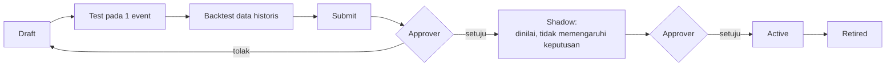

# Tata Kelola & Kepatuhan

Untuk compliance, audit internal, risk, dan manajemen. Dokumen ini menjelaskan **kontrol apa yang sudah ada di
platform**, **apa yang belum**, dan bagaimana kaitannya dengan regulasi. Bukan opini hukum: kesesuaian akhir tetap
dinilai oleh tim compliance dan auditor Anda.

Status per 13 Oktober 2026. Kontrol yang masih direncanakan diambil dari [backlog](../backlog.md).

## 1. Ringkasan kontrol

| Kontrol | Status | Inti |
|---|---|---|
| Empat mata (maker–checker) | ✅ ada | Rule, ruleset, model ML, dan usulan AI harus disetujui orang lain |
| Mode bayangan (shadow) & backtest | ✅ ada | Rule baru diuji di data historis dan lalu lintas nyata tanpa memengaruhi keputusan |
| Versi yang tidak bisa diubah | ✅ ada | Setiap perubahan rule membuat versi baru; keputusan mencatat versi yang dipakai |
| Jejak audit append-only | ✅ ada | Database menolak setiap upaya mengubah atau menghapus catatan audit |
| Hak akses berbasis peran (RBAC) | ✅ ada | 6 peran; hak dicek di setiap service |
| Isolasi tenant | ✅ ada | Data antar perusahaan dipisahkan di level database (*row-level security*) |
| Hash & masking data sensitif | ✅ ada | Nomor kartu/rekening tidak disimpan mentah; email, HP, IP ditampilkan tersamar |
| Alasan keputusan (explainability) | ✅ ada | Reason code, skor per mesin, jejak rule, fitur model yang paling berpengaruh |
| AI hanya mengusulkan | ✅ ada | Asisten AI tidak bisa mengaktifkan, mengubah, atau menghapus apa pun |
| LLM lokal (data tidak keluar) | ✅ default | Ollama di server sendiri; Gemini hanya jika diaktifkan secara sadar |
| Retensi & hak hapus data (UU PDP) | ⏳ rencana (P1) | Belum ada penghapusan otomatis atau alur permintaan subjek data |
| SSO (OIDC/SAML) | ⏳ rencana (P1) | Saat ini login email + password |
| mTLS antar service, secrets manager | ⏳ rencana (P1) | Saat ini rahasia lewat variabel environment |
| Rate limit login, pembatasan akun demo | ⏳ rencana (P1) | Penting untuk instalasi publik |
| Backup/restore produksi | ⏳ rencana (P1) | Demo memakai snapshot harian, bukan backup produksi |
| Penetration test & threat model formal | ⏳ rencana (P2) | Belum dilakukan |
| Evaluasi kualitas jawaban AI | ⏳ rencana (P1) | Belum ada *golden set* pertanyaan regulasi |

## 2. Empat mata (maker–checker)

Setiap perubahan yang bisa memengaruhi keputusan terhadap pelanggan dibuat oleh satu orang (*maker*) dan disetujui
oleh orang **lain** (*checker*). Sistem menolak persetujuan oleh pembuatnya sendiri, apa pun perannya.

| Objek | Maker | Checker | Setelah disetujui |
|---|---|---|---|
| Rule | analyst | approver lain | shadow atau active (pilihan checker) |
| Ruleset | analyst | approver lain | shadow atau active |
| Model ML | analyst (melatih + mengajukan) | approver lain | active; model lama diarsipkan |
| Usulan rule (dari AI atau analyst) | AI / analyst | approver | rule masuk **shadow**; aktivasi penuh butuh persetujuan kedua |

Mengedit rule yang sedang aktif membuat **versi baru**. Versi lama tetap berjalan sampai versi baru disetujui, jadi
tidak ada celah tanpa perlindungan.

Perubahan yang **tidak** lewat maker–checker, tetapi tetap tercatat di jejak audit: pengaturan project (ambang, bobot
mesin), aktivasi mapping sumber data, isi reference list, anggota project, dan penyelesaian case.

## 3. Uji sebelum berlaku: backtest dan shadow

* **Backtest** menunjukkan berapa event yang akan kena, berapa yang benar fraud (precision), dan berapa fraud yang
  tertangkap (recall) pada data berlabel.
* **Shadow** menjalankan rule pada lalu lintas nyata. Hasilnya dicatat dan bisa dibandingkan dengan versi live
  (*champion vs challenger*), tetapi tidak mengubah keputusan untuk pelanggan.

## 4. Jejak audit

* Dicatat: siapa, kapan, aksi apa, objek apa, nilai **sebelum** dan **sesudah**, serta komentar. Contoh aksi: membuat,
  mengubah, mengajukan, menyetujui, dan menolak rule; menyetujui/menolak usulan AI; mengubah pengaturan project;
  mengaktifkan mapping; mengubah anggota; menyelesaikan case; menambah label.
* **Append-only**: database punya pemicu (*trigger*) yang menolak setiap `UPDATE` atau `DELETE` pada tabel audit.
  Tidak ada menu atau API untuk mengubah catatan audit.
* Setiap keputusan menyimpan skor tiap mesin, reason code, serta versi rule dan model yang dipakai, sehingga keputusan
  lama bisa dijelaskan ulang.
* Akses: audit log project bisa dibaca peran **approver** ke atas (menu **Audit log**). Audit log tingkat perusahaan
  hanya untuk tenant admin (saat ini lewat API).

## 5. Hak akses (RBAC)

| Peran | Lingkup | Hak utama |
|---|---|---|
| Platform admin | seluruh instalasi | mengelola tenant |
| Tenant admin | satu perusahaan | pengguna, project, daftar tingkat tenant, pustaka regulasi |
| Project admin | satu project | anggota, pengaturan, sumber data |
| Approver | satu project | menyetujui/menolak; membaca audit log |
| Analyst | satu project | membuat draft, melatih model, menangani case, memakai asisten AI |
| Viewer | satu project | hanya melihat |

* Seseorang bisa punya peran berbeda di project yang berbeda.
* Hak dicek di sisi server pada setiap permintaan, bukan hanya disembunyikan di tampilan.
* Sesi login: token akses berumur pendek (default 60 menit) yang diperbarui otomatis; token disimpan di cookie
  *httpOnly* sehingga tidak bisa dibaca skrip di browser. Password disimpan sebagai hash Argon2.

## 6. Perlindungan data pribadi

| Data | Perlakuan |
|---|---|
| Nomor kartu & rekening | Diubah menjadi sidik jari (HMAC-SHA256) dengan kunci rahasia **per tenant**. Nilai mentah tidak disimpan. Yang disimpan untuk tampilan hanya 6 digit awal (BIN) + 4 digit akhir. Sidik jari yang sama di tenant lain tidak cocok, dan tidak bisa dibalik tanpa kunci. |
| Email, nomor HP, IP | Dinormalisasi agar penulisan berbeda dari data yang sama tetap terhubung di graph; ditampilkan tersamar (mis. `a***@domain`, IP dipotong). |
| Kolom sumber yang tidak dibutuhkan | Bisa dibuang saat pemetaan (*mapping*), sehingga tidak tersimpan (minimisasi data). |
| Kredensial database sumber | Disimpan sebagai **nama** variabel environment, bukan nilainya. API key webhook ditampilkan sekali saja. |
| Data ke model bahasa | Default diproses oleh LLM **lokal**. Jika Gemini diaktifkan, pertanyaan dan potongan regulasi dikirim ke Google. |

## 7. Isolasi tenant

* Setiap baris data membawa identitas tenant. Database menegakkan aturan *row-level security*: setiap transaksi
  database hanya bisa melihat baris milik tenant yang sedang aktif, termasuk jika ada bug di kode aplikasi.
* Setiap service memakai akun database sendiri dengan hak minimum (*least privilege*).
* Kunci hash kartu/rekening berbeda per tenant (lihat §6).
* Model ML, graph, rule, dan regulasi yang ditempel ke project terpisah per project.

## 8. Tata kelola AI

### 8.1 Prinsip: AI mengusulkan, manusia memutuskan

* Asisten AI memakai **20 alat**. Sembilan belas hanya membaca (mencari pasal, membaca rule dan performanya, statistik,
  drift, anomali, komunitas graph, konteks project, validasi dan backtest draft, serta mencari dan membuka pelanggan,
  transaksi, dan kasus). Email dan nomor telepon disamarkan (`b***@gmail.com`, `+62812****890`) dan payload mentah
  dibuang sebelum data sampai ke model. Satu-satunya alat yang menulis adalah
  **membuat usulan berstatus pending**.
* Usulan otomatis divalidasi (definisi rule harus sah; jika tidak, AI diminta memperbaiki maksimal 2 kali) dan
  di-backtest 30 hari sebelum muncul di menu **Usulan rule**.
* Persetujuan usulan hanya membuat rule berjalan di **shadow**. Mengaktifkan penuh butuh persetujuan berikutnya.
  Usulan "pensiunkan rule" langsung berlaku setelah disetujui approver.
* Model ML (bukan LLM) memang memberi skor pada transaksi, tetapi model hanya bisa aktif setelah disetujui orang lain,
  dan keputusan akhir tetap mengikuti ambang yang ditetapkan project admin.

### 8.2 Keterlacakan

* Jawaban chat menampilkan **sitasi pasal** dan **alat yang dipakai**. Percakapan disimpan per project.
* Laporan analisis menyimpan jenis analisis dan versi prompt yang dipakai.
* Usulan menyimpan alasan, bukti data, sitasi, hasil validasi, dan backtest, serta tercatat sebagai buatan AI.

### 8.3 Batasan yang perlu diketahui

* Model bahasa kecil (`qwen3:8b` di demo) bisa **mengarang nomor pasal** atau salah menafsirkan. Kutipan harus selalu
  diperiksa ke teks aslinya.
* Belum ada evaluasi kualitas jawaban yang terukur (rencana P1).
* Verifikasi sitasi otomatis dan pemeriksaan usulan oleh agen kedua (*Critic*) direncanakan di arsitektur
  [multi-agent](../technical/multi-agent.md).

## 9. Kaitan dengan regulasi dan standar

Tabel ini menunjukkan fitur platform yang **mendukung** pemenuhan kewajiban. Platform sendiri tidak membuat organisasi
patuh; kebijakan, prosedur, dan pelaporan tetap tanggung jawab organisasi.

### 9.1 POJK 12/2024 — Penerapan Strategi Anti Fraud bagi LJK

POJK ini mewajibkan strategi anti fraud dengan empat pilar. POJK ini tidak secara eksplisit mewajibkan sistem deteksi
otomatis; kewajiban deteksi di level akun dan transaksi lebih tegas ada di PBI 23/6/PBI/2021 (penyelenggara jasa
pembayaran) dan POJK 8/2023 (APU-PPT).

| Pilar | Dukungan platform | Belum ada |
|---|---|---|
| Pencegahan | Rule pre-payment & account security, daftar hitam, keputusan decline real-time | — |
| Deteksi | Lima mesin deteksi, tipologi fraud, reason code | — |
| Investigasi, pelaporan, sanksi | Antrean case, catatan investigasi, label dengan tipologi, jejak audit | Pembuatan laporan ke OJK dan pengingat tenggat pelaporan fraud signifikan |
| Pemantauan, evaluasi, tindak lanjut | Dashboard, drift data, backtest, shadow, versi, analisis relevansi rule oleh AI | Statistik rule harian dan alert rule "mati" (P1) |

Teks POJK 12/2024 sudah dimuat di pustaka regulasi demo, sehingga asisten AI bisa menjawab pertanyaan tentangnya
dengan sitasi pasal.

### 9.2 UU 27/2022 tentang Pelindungan Data Pribadi (UU PDP)

| Prinsip / kewajiban | Dukungan platform | Belum ada |
|---|---|---|
| Keamanan & kerahasiaan data | Hash kartu/rekening per tenant, masking, isolasi tenant, RBAC | mTLS antar service, secrets manager (P1) |
| Minimisasi & pembatasan tujuan | Kolom sumber bisa dibuang saat mapping; LLM lokal (tidak ada transfer ke luar) | — |
| Rekam pemrosesan | Jejak audit append-only | Ekspor catatan pemrosesan |
| Keputusan otomatis (hak keberatan) | Alasan setiap keputusan; status review membawa event ke manusia | Alur keberatan subjek data |
| Retensi, penghapusan, akses subjek data | — | Retensi, hak hapus, laporan akses data (P1) |
| Penilaian dampak (DPIA), notifikasi kebocoran | — | Belum didukung oleh fitur khusus |

### 9.3 ISO/IEC 27001:2022

Platform tidak bersertifikat ISO 27001; sertifikasi berlaku untuk organisasi, bukan perangkat lunak. Fitur yang
membantu kontrol Annex A:

| Area kontrol | Dukungan platform | Belum ada |
|---|---|---|
| Kontrol akses | RBAC per project, maker–checker, sesi berumur pendek | SSO (P1) |
| Logging & monitoring | Jejak audit append-only, log JSON dengan request-id, metrik Prometheus | Stack observability terpadu (P1) |
| Kriptografi | HMAC per tenant untuk PAN/rekening, hash password Argon2 | Rotasi kunci terdokumentasi, TLS OpenSearch (P1) |
| Manajemen perubahan | Versi, backtest, shadow, persetujuan dua orang | — |
| Pemisahan lingkungan & data | Isolasi tenant di database, akun database least-privilege | — |
| Kelangsungan | Degraded mode saat satu mesin gagal | Backup/restore produksi (P1) |
| Uji keamanan | Unit dan integration test di CI (termasuk uji isolasi tenant dan maker–checker) | Penetration test, threat model formal (P2) |

## 10. Catatan khusus demo publik

Demo di <https://fds.hendrikarisma.my.id> memakai data sintetis dan dataset publik. Akun demo dibagikan di halaman
login, dan semua data dikembalikan ke kondisi awal setiap hari pukul 00.00 WIB. Rate limit login dan pembatasan aksi
akun demo belum ada. **Jangan memasukkan data pribadi atau data sungguhan ke demo.**
