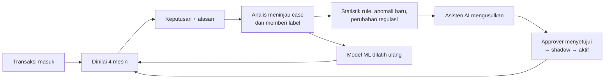

# Fraud Detection Platform — Ringkasan Non-Teknis

Dokumen ini untuk manajemen, tim risk/fraud, compliance, dan bisnis. Tidak perlu latar belakang teknis.

Dokumen terkait: [kasus penggunaan](use-cases.md) · [tata kelola & kepatuhan](governance-compliance.md) ·
[glosarium](glossary.md) · [skenario demo](demo-script.md) · [panduan pengguna](../guides/user-guide.md).

## 0. Ringkasan eksekutif

| | |
|---|---|
| **Masalah** | Fraud online datang dalam banyak bentuk (carding, pembobolan akun, rekening penampung, abuse promo dan retur). Satu metode deteksi saja selalu punya titik buta. |
| **Solusi** | Satu platform yang menilai setiap transaksi atau aktivitas dengan **lima mesin deteksi** sekaligus (rule, ML terawasi, ML tak terawasi, graph jaringan, asisten AI), lalu memberi satu keputusan: approve, review, atau decline, **beserta alasannya**. |
| **Nilai** | Fraud tertangkap lebih awal; keputusan bisa dijelaskan ke pelanggan, auditor, dan regulator; aturan baru diuji dulu (backtest, mode bayangan) sebelum memengaruhi pelanggan; semua perubahan lewat persetujuan dua orang dan tercatat di jejak audit. |
| **Status (21 Oktober 2026)** | Versi 2 berjalan sebagai **demo publik** di <https://fds.hendrikarisma.my.id>. Kelima mesin aktif. Asisten AI memakai model bahasa **lokal** (Ollama, `qwen3:8b`) di **GPU**, sehingga jawaban muncul dalam hitungan detik dan ditampilkan langsung saat ditulis. Asisten bisa mencari dan menganalisis pelanggan, transaksi, dan kasus (email/telepon disamarkan). Asisten saat ini berupa **satu agen** dengan 20 alat; versi **multi-agent** dan halaman pengaturan AI (AI Console) masih tahap desain, lihat [PRD](prd-agent-ai-console.md). |

### Angka kunci (uji 7 Oktober 2026, data yang tidak dipakai untuk melatih model)

| Ukuran | Hasil | Artinya |
|---|---|---|
| Kualitas ranking gabungan (AUC) di demo marketplace | **0,957–1,000** per project | Skor gabungan hampir selalu menaruh fraud di atas transaksi sah. |
| AUC gabungan di dataset publik | 0,86–0,98 (Sparkov 0,976; SAML-D 0,942; PaySim 0,860); uji terpisah TabFormer 0,92, AMLworld 0,96, RBA login 0,88, ULB 0,96 | Metode tetap bekerja di data yang tidak dibuat untuk platform ini. |
| Transaksi sah ikut ditandai (FPR) pada **ambang default 50** | Checkout **23%**, promo **36%** | Ambang default terlalu rendah untuk sebagian project. |
| FPR setelah ambang **dikalibrasi** per project (target ≤ 5%) | Checkout (ambang 75) dan promo (ambang 78) tetap menangkap **~100%** fraud | Ambang harus disetel per project. Rekomendasi ambang otomatis ada di backlog (P1). |
| Kelemahan utama: **money mule** (rekening penampung) | Tertangkap 85% pada ambang 50, tetapi hanya **35%** pada ambang decline 80 | Pola transfer bertingkat butuh rule dan fitur jaringan tambahan (backlog P1). |

Semua angka berasal dari **data sintetis atau dataset publik**, bukan data produksi. Detail di §9 dan
[evaluation.md](../technical/evaluation.md).

### Yang dilakukan AI, dan yang tidak

| AI **melakukan** | AI **tidak** melakukan |
|---|---|
| Model ML memberi skor risiko untuk setiap transaksi dan menjelaskan fitur yang paling berpengaruh. | Tidak memutuskan sendiri tanpa jejak: setiap keputusan mencatat skor tiap mesin, alasan, dan versi rule/model yang dipakai. |
| Asisten AI menjawab pertanyaan tentang regulasi **dengan menyebut pasal sumbernya**. | Tidak memberi nasihat hukum. Interpretasi regulasi tetap tanggung jawab compliance. |
| Asisten AI membaca statistik platform (performa rule, anomali, jaringan) dan menulis laporan analisis. | Tidak mengubah data, rule, atau model. Alat yang dipakai asisten hanya-baca, kecuali satu: membuat **usulan**. |
| Asisten AI **mengusulkan** rule baru, perubahan, atau pensiun rule; usulan otomatis divalidasi dan di-backtest 30 hari. | **Tidak pernah mengaktifkan** apa pun. Usulan harus disetujui orang lain, lalu berjalan di mode bayangan dulu. |

## 1. Masalah yang diselesaikan

Fraud pada transaksi online datang dalam banyak bentuk:

| Jenis | Contoh kejadian |
|---|---|
| **Carding / kartu curian** | Penipu menguji puluhan kartu curian dengan transaksi kecil, lalu belanja besar dengan kartu yang lolos. |
| **Account takeover (ATO)** | Akun pelanggan e-commerce dibobol: login dari perangkat baru, password diganti, alamat pengiriman diubah, lalu belanja barang mahal. |
| **Pengambilalihan rekening / e-wallet** | Rekening korban dikuras ke rekening tujuan baru, sering tengah malam. |
| **Sistem dibobol** | Celah di sistem/API dipakai untuk membuat transaksi massal dari banyak akun sekaligus. |
| **Abuse kebijakan (promo, voucher, cashback)** | Semua transaksinya *sah secara teknis*, tetapi satu orang membuat puluhan akun (perangkat, alamat, atau nomor HP yang mirip) untuk memanen voucher atau cashback. |
| **Abuse retur/refund** | Pelanggan yang berulang kali mengklaim "barang tidak sampai" atau meretur barang segera setelah diterima. |
| **Rekening penampung (money mule)** | Akun yang dipakai untuk menampung dan meneruskan dana hasil kejahatan. |

Tidak ada satu metode yang bisa menangkap semua jenis ini. Karena itu platform ini menggabungkan **lima "mesin"
deteksi** yang saling melengkapi.

## 2. Lima mesin deteksi

| Mesin | Analogi | Kekuatan |
|---|---|---|
| **Rule engine** | Checklist dari analis berpengalaman | Cepat, transparan, dan mudah diaudit. Cocok untuk pola yang sudah diketahui dan untuk kewajiban regulasi. |
| **Machine learning terawasi** (*supervised*) | Analis yang belajar dari ribuan kasus fraud masa lalu | Menangkap kombinasi sinyal halus yang sulit ditulis sebagai aturan. |
| **Machine learning tak terawasi** (*unsupervised*) | Detektor "ada yang aneh" | Menemukan pola **baru** yang belum pernah diberi label, dan mengelompokkan perilaku serupa. |
| **Graph (jaringan)** | Peta hubungan antar pelanggan | Mengungkap jaringan: akun yang berbagi kartu, perangkat, alamat, atau nomor HP (termasuk yang *mirip*). Misalnya, pelanggan yang hanya berjarak 2 langkah dari penipu yang sudah terbukti dianggap berisiko tinggi. |
| **Asisten AI (LLM)** | Konsultan kepatuhan dan analis data | Membaca regulasi (OJK, BI, SOP internal), menilai apakah aturan yang ada masih relevan, menjelaskan kondisi fraud terkini, dan **mengusulkan** aturan baru. Asisten ini tidak pernah mengaktifkan apa pun sendiri. |

Empat mesin pertama menilai setiap transaksi atau aktivitas dalam hitungan milidetik. Asisten AI tidak ikut menilai
transaksi; ia bekerja di belakang untuk analisis dan usulan. Hasil akhirnya satu keputusan:

* ✅ **Approve**: lanjutkan.
* 🔎 **Review**: tahan dan periksa manual (otomatis masuk antrean *case*). Default: skor ≥ 50.
* ⛔ **Decline**: tolak. Default: skor ≥ 80.

Setiap keputusan disertai **alasan yang bisa dibaca manusia**, misalnya: "perangkat baru + password diganti dalam 24 jam",
"kartu dipakai 3 pelanggan berbeda dalam 30 hari", atau "berjarak 2 langkah dari akun fraud". Karena itu keputusan bisa
dipertanggungjawabkan ke pelanggan, auditor, maupun regulator.

Jika salah satu mesin lambat atau gagal, keputusan tetap keluar dari mesin yang lain (*degraded mode*), dan event bisa
dinilai ulang (*rescore*) nanti.

## 3. Tenant dan project: satu perusahaan, banyak titik perlindungan

Platform ini **multi-tenant**: satu instalasi bisa melayani banyak perusahaan (tenant), dan data antar perusahaan
terisolasi langsung di level database.

Di dalam satu perusahaan ada banyak **project**, masing-masing untuk satu titik perlindungan dengan perilaku dan aturan
yang berbeda. Saat project dibuat, platform memasang **template** rule dan reference list sesuai tahapnya:

| Project (tahap) | Kapan dinilai | Contoh fokus |
|---|---|---|
| Checkout (`pre_payment`) | sebelum pembayaran diproses | carding, ATO saat checkout |
| Pasca pembayaran (`post_payment`) | setelah bayar, sebelum barang dikirim atau dana dicairkan | alamat mencurigakan, nominal tidak wajar, rekening penampung |
| Retur (`returns`) | saat permintaan retur/refund | pelaku retur berulang, akun-akun yang saling terkait |
| Promo (`promo`) | saat klaim voucher/cashback | "peternakan" akun promo |
| Keamanan akun (`account_security`) | saat login atau ganti data akun | percobaan login gagal, perangkat baru, credential stuffing |
| Pencairan dana (`payout`) | saat penarikan saldo seller/e-wallet | rekening penampung, pengurasan saldo |
| Kustom (`custom`) | bebas | tanpa template; rule dibuat sendiri |

Setiap project punya **aturan, model AI, data jaringan (graph), sumber data, dan daftar regulasi** sendiri. Daftar hitam
perusahaan (misalnya kartu yang pernah chargeback) bisa dibagikan ke semua project. Rincian per tahap ada di
[use-cases.md](use-cases.md).

## 4. Pakai data Anda apa adanya

Perusahaan tidak perlu mengubah format datanya. Unggah contoh file (CSV, Excel, JSON, Parquet), sambungkan tabel
database (Postgres/MySQL), atau kirim data lewat webhook. Sistem lalu:

1. membaca struktur data secara otomatis, termasuk nama kolom berbahasa Indonesia seperti `tgl_transaksi`, `nominal`,
   atau `no_hp`;
2. menyarankan pemetaan ke kolom standar, yang cukup dikonfirmasi oleh pengguna;
3. mengamankan data sensitif secara otomatis: nomor kartu dan rekening diubah menjadi sidik jari (*hash*) dan tidak
   disimpan mentah;
4. membuat **semua kolom** langsung bisa dipakai di aturan dan model, tanpa perlu mengubah kode.

Dataset historis yang sudah berlabel (misalnya kolom `is_fraud`) bisa langsung dipakai untuk melatih model AI.

## 5. Tata kelola dan kepatuhan

* **Empat mata (*maker–checker*)**: aturan, ruleset, model AI, dan usulan dari asisten AI harus disetujui orang
  **lain** sebelum aktif.
* **Mode bayangan (*shadow*)**: aturan baru bisa diuji pada lalu lintas nyata tanpa memengaruhi keputusan, sampai
  terbukti efektif.
* **Backtest**: sebelum disetujui, efek sebuah aturan pada data historis terlihat dulu (berapa yang tertangkap, berapa
  yang salah tangkap).
* **Jejak audit** yang tidak bisa diubah: siapa mengubah apa, kapan, dan nilai sebelum/sesudahnya.
* **Versi**: setiap perubahan aturan membuat versi baru, dan setiap keputusan mencatat versi aturan dan model yang
  dipakai.
* **Regulasi berubah?** Unggah versi baru regulasinya. Sistem membandingkan pasal demi pasal, dan asisten AI bisa
  diminta menilai dampaknya terhadap aturan yang ada serta menyiapkan usulan perubahan untuk ditinjau.

Penjelasan lengkap, termasuk kaitan dengan POJK 12/2024, UU PDP, dan ISO 27001, ada di
[governance-compliance.md](governance-compliance.md).

## 6. Peran pengguna

| Peran | Bisa apa |
|---|---|
| Platform admin | Mengelola tenant (penyedia layanan) |
| Tenant admin | Mengelola user, project, daftar tingkat tenant, dan pustaka regulasi perusahaan |
| Project admin | Mengatur project: anggota, threshold, bobot mesin, sumber data |
| Approver | Menyetujui atau menolak aturan, model, dan usulan AI; melihat audit log project |
| Analyst | Membuat aturan, melatih model, menangani case, memberi label, menjalankan analisis AI |
| Viewer | Hanya melihat |

Peran project bertingkat: approver juga bisa semua yang bisa dilakukan analyst, dan seterusnya. Apa yang dilakukan
setiap peran di layar dijelaskan di [use-cases.md](use-cases.md#3-per-persona).

## 7. Siklus perbaikan berkelanjutan

Semakin banyak case yang ditinjau dan diberi label, semakin pintar model AI-nya, dan semakin tepat usulan aturan dari
asisten AI.

## 8. Yang perlu diketahui (batasan)

* Kualitas machine learning terawasi bergantung pada **label**. Di awal, andalkan rule engine dan deteksi anomali.
* **Ambang keputusan harus disetel per project.** Ambang default 50 memberi terlalu banyak salah tangkap di sebagian
  project (lihat §0). Fitur rekomendasi ambang otomatis belum ada.
* **Money mule** adalah tipologi terlemah. Rule khusus pola fan-in/fan-out masih di backlog.
* Mesin **graph** baru berguna setelah ada pelanggan yang **terkonfirmasi fraud** dan ada entitas bersama (perangkat,
  rekening, alamat). Pada data tanpa entitas bersama, kontribusinya nol.
* Asisten AI memberi **usulan**, bukan keputusan hukum. Interpretasi regulasi tetap menjadi tanggung jawab tim
  compliance.
* Secara default model bahasa berjalan **lokal** (Ollama), sehingga data tidak dikirim ke layanan AI pihak ketiga.
  Konsekuensinya, server membutuhkan CPU/RAM (idealnya GPU) yang memadai. Di demo publik saat ini model berjalan di
  CPU, sehingga satu jawaban bisa memakan beberapa menit.
* Sebagai opsi, percakapan asisten AI bisa memakai **Gemini (Google)** agar lebih cepat. Dengan opsi ini, pertanyaan
  dan potongan regulasi dikirim ke Google, jadi perlu persetujuan kebijakan data. Index regulasi tetap dibuat di
  server sendiri.
* Model AI kecil kadang **mengarang nomor pasal** atau menjawab kurang tepat. Selalu periksa kutipan pasal yang
  diberikan asisten. Evaluasi kualitas jawaban AI secara formal belum dilakukan.

## 9. Hasil uji

### 9.1 Demo marketplace (data sintetis, 7 Oktober 2026)

Simulator membuat 60 hari aktivitas marketplace dengan pola fraud nyata. 70% pertama dipakai sebagai histori dan
untuk melatih model; 30% terakhir dinilai dengan semua mesin aktif, lalu dibandingkan dengan kebenaran (*ground truth*)
yang tidak pernah dikirim ke platform.

| Project | AUC gabungan | Ambang 50: recall / FPR | Ambang terkalibrasi (FPR ≤ 5%): ambang → recall |
|---|---|---|---|
| Checkout | 0,999 | 100% / **23%** | 75 → 100% |
| Pasca pembayaran | 0,957 | 86% / 6% | 52 → 84% |
| Promo | 1,000 | 100% / **36%** | 78 → 100% |
| Retur (hanya 7 fraud) | 0,992 | 100% / 16% | 68,5 → 100% |

Fraud tertangkap per tipologi pada ambang 50 / 80: carding, system breach, promo abuse 100% / 100%; account takeover
100% / 98%; refund abuse 100% / 86%; **money mule 85% / 35%**.

### 9.2 Dataset publik

| Dataset | Jenis | AUC gabungan |
|---|---|---|
| Sparkov | kartu kredit | 0,976 |
| SAML-D | pencucian uang (AML) | 0,942 |
| PaySim | mobile money | 0,860 |
| IBM TabFormer | kartu kredit | 0,91–0,92 |
| IBM AMLworld | pencucian uang | 0,96 |
| RBA login | pembobolan akun | 0,88 |
| ULB | kartu kredit (data nyata, hanya ML) | 0,96 |

Pelajarannya sama di semua dataset: **ranking baik, tetapi ambang harus dikalibrasi per project.** Template rule bawaan
dibuat untuk marketplace Indonesia, jadi di dataset dengan skema lain kontribusi rule kecil dan model ML yang dominan.

## 10. Teknologi di balik layar (versi sederhana)

| Bagian | Teknologi | Kenapa dipilih |
|---|---|---|
| Inti penilaian transaksi | **Rust** | Sangat cepat dan stabil; keputusan keluar dalam hitungan milidetik |
| Kecerdasan buatan (ML) | **Python** + PyTorch & scikit-learn | Standar industri untuk machine learning |
| Penyimpanan data | **PostgreSQL** | Database andal; data tiap perusahaan dipisahkan langsung di level database |
| Pencarian regulasi | **OpenSearch** | Mencari pasal berdasarkan makna maupun kata kunci |
| Asisten AI | **Ollama** (lokal, demo: `qwen3:8b`) atau **Gemini** (opsional) | Pilihan antara privasi penuh dan kecepatan |
| Tampilan | **Nuxt (Vue)**, Bahasa Indonesia & English | Satu halaman untuk setiap mesin deteksi |
| Instalasi | **Docker Compose** | Satu perintah untuk menjalankan semuanya |

Cara kerja asisten AI dalam satu kalimat: dokumen regulasi dipecah per **pasal**, lalu setiap pertanyaan dijawab
dengan terlebih dahulu **mencari pasal yang relevan** dan **menyebutkan sumbernya**. Asisten juga bisa membaca
statistik platform (performa rule, anomali, jaringan) sebelum mengusulkan aturan baru. Detail teknis ada di
[technical-overview.md](../technical/technical-overview.md).

## 11. Demo

Demo publik: <https://fds.hendrikarisma.my.id>. Isinya:

* satu perusahaan contoh **"Demo Marketplace"** dengan 4 project: *Checkout Protection*, *Post-payment & Payout*,
  *Returns & Refunds*, dan *Promo & Cashback*;
* tiga tenant eksperimen dari dataset publik (Sparkov, PaySim, SAML-D), masing-masing dengan 1 project.

Akun demo (tenant admin, analyst, approver per tenant) tercantum di halaman login. Setiap hari pukul **00.00 WIB**
seluruh data dikembalikan ke kondisi awal: data 60 hari yang berakhir "hari ini", regulasi POJK 12/2024, model ML yang
aktif, serta contoh case, laporan, dan usulan AI. Proses ini memakan beberapa menit, dan selama itu demo tidak bisa
diakses. Jangan memasukkan data sungguhan ke instalasi demo. Skenario presentasi ada di [demo-script.md](demo-script.md).

## 12. Istilah

Daftar istilah lengkap ada di [glossary.md](glossary.md).
