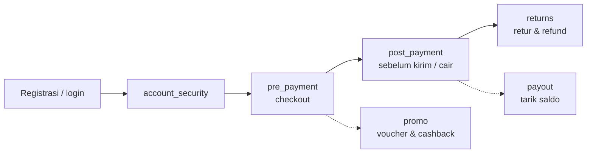
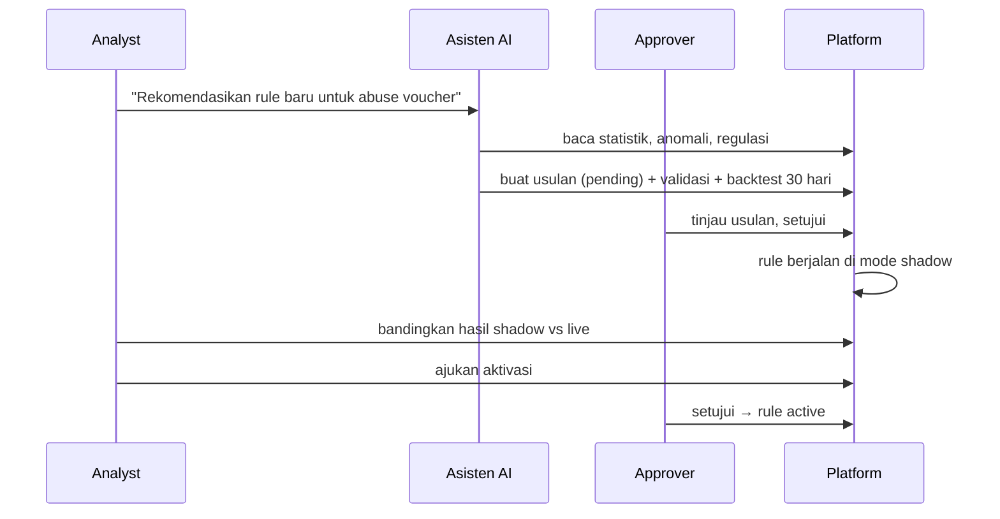

# Kasus Penggunaan — per Tahap dan per Persona

Untuk manajemen, tim risk/fraud, compliance, dan bisnis. Dokumen ini menjawab dua pertanyaan: **titik mana yang bisa
dilindungi** dan **siapa melakukan apa** di platform. Ringkasan umum ada di [overview.md](overview.md); cara memakai
setiap menu ada di [panduan pengguna](../guides/user-guide.md).

## 1. Cara berpikir: satu project = satu titik perlindungan

Setiap project punya **tahap** (*stage*). Saat project dibuat, platform langsung memasang **template** untuk tahap itu:
rule, ruleset, dan reference list yang umum dipakai. Template hanya titik awal. Semua rule bisa diubah, dimatikan, atau
ditambah, tetap lewat maker–checker.

Event yang bisa dinilai: `transaction`, `login`, `account_change`, `promo_redemption`, `payout`, `registration`,
`refund`, atau jenis kustom sesuai data Anda.

## 2. Per tahap

### 2.1 `pre_payment` — Checkout, sebelum pembayaran diotorisasi

**Tipologi umum:** carding (uji kartu curian), account takeover saat checkout, sistem/API partner dibobol, kartu
yang sudah masuk daftar hitam.

| Rule template | Apa yang dicek |
|---|---|
| Kartu / perangkat di daftar hitam | Sidik jari kartu ada di `card_blacklist`, perangkat ada di `device_blacklist` |
| Pelanggan VIP | Pelanggan terverifikasi di `vip_whitelist` disetujui, kecuali ada rule tolak yang kena |
| Di atas limit merchant | Nominal melebihi `max_amount` merchant di daftar `merchant_limits` |
| Kartu dipakai banyak pelanggan | Kartu yang sama dipakai ≥ 3 pelanggan berbeda dalam 30 hari |
| Card testing | ≥ 4 kartu berbeda dari satu perangkat dalam 1 jam |
| Negara BIN tidak cocok | Negara penerbit kartu ≠ negara klien dan nominal > Rp2 jt |
| Nominal tidak wajar | z-score nominal terhadap histori 30 hari pelanggan > 3 |
| Sinyal ATO saat checkout | Minimal 2 dari: perangkat baru, ganti kredensial 24 jam, alamat kirim ≠ tagih, negara tidak biasa |
| Lonjakan belanja 24 jam | Formula: belanja 24 jam dibanding rata-rata transaksi 30 hari > 10× |
| Dekat dengan penipu | Berjarak ≤ 2 langkah dari pelanggan fraud terkonfirmasi |
| Skor model sangat tinggi | Probabilitas model ML ≥ 0,9 → review manual |
| Malam hari, nominal besar | Pukul 00.00–05.59 dan nominal > Rp10 jt |

Ruleset: *Blocklists & whitelists*, *Carding*, *Account takeover at checkout*, *Network & model*.

### 2.2 `post_payment` — Setelah bayar, sebelum barang dikirim atau dana dicairkan

**Tipologi umum:** pengambilalihan rekening bank/e-wallet, **money mule** (rekening penampung), alamat kirim
mencurigakan, nominal di luar kebiasaan.

| Rule template | Apa yang dicek |
|---|---|
| Alamat kirim ≠ tagih pada pesanan besar | Beda alamat dan nominal > Rp5 jt |
| Nominal di ekor distribusi | Peluang nominal setinggi ini < 1% menurut histori 60 hari pelanggan |
| Lonjakan volume merchant | Volume harian merchant menyimpang jauh dari tren 14 hari |
| Pencairan ke rekening mule | Rekening tujuan ada di daftar `mule_accounts` |
| Pengurasan ke penerima baru | Penerima baru + ganti kredensial 24 jam + nominal > Rp5 jt |
| Fan-in penerima | ≥ 5 pelanggan berbeda mengirim ke penerima yang sama dalam 7 hari |
| Lingkungan fraud | ≥ 2 pelanggan fraud dalam jarak 2 langkah |

Catatan: money mule adalah tipologi terlemah di hasil uji (lihat [overview.md](overview.md#0-ringkasan-eksekutif)).

### 2.3 `returns` — Permintaan retur dan refund

**Tipologi umum:** pelaku retur berulang, klaim ganda untuk pesanan yang sama, akun baru dengan refund besar, jaringan
akun yang saling terkait.

| Rule template | Apa yang dicek |
|---|---|
| Retur berulang | ≥ 5 refund oleh pelanggan dalam 90 hari |
| Klaim berulang | ≥ 2 permintaan refund untuk transaksi asal yang sama dalam 30 hari |
| Akun baru, refund besar | Akun < 30 hari dan refund > Rp3 jt |
| Di daftar pantau | Pelanggan ada di watchlist `serial_returners` |
| Jaringan akun | Komponen graph ≥ 5 pelanggan yang terhubung lewat alamat/HP/perangkat/rekening |
| Lonjakan refund | Jumlah refund hari ini sangat tidak wajar dibanding rata-rata harian pelanggan |

### 2.4 `promo` — Voucher, diskon, dan cashback

**Tipologi umum:** "peternakan" akun promo (satu orang, banyak akun), akun baru yang langsung memakai diskon besar,
satu perangkat memanen banyak promo. Semua transaksinya sah secara teknis, sehingga **graph dan rule composite**
paling berperan.

| Rule template | Apa yang dicek |
|---|---|
| Promo farm di satu perangkat | ≥ 3 pelanggan berbeda memakai kode promo yang sama dari perangkat yang sama dalam 7 hari |
| Akun baru, diskon besar | Akun < 3 hari dan rasio diskon > 30% |
| Perangkat memakai banyak promo | > 5 penukaran promo dari satu perangkat dalam 30 hari |
| Multi-akun terhubung | Pelanggan berbagi ≥ 3 entitas (perangkat/alamat/HP/rekening) dengan pelanggan lain |
| Konsentrasi cashback | Cashback di satu perangkat > Rp1 jt dalam 30 hari |
| Perangkat diblokir dari promo | Perangkat ada di `promo_device_blacklist` |

### 2.5 `account_security` — Login dan perubahan data akun

**Tipologi umum:** credential stuffing, brute force, account takeover, API client yang disalahgunakan.

| Rule template | Apa yang dicek |
|---|---|
| Login gagal berulang | ≥ 5 login gagal dalam 1 jam |
| Ganti kredensial dari perangkat baru | Ganti password/email/HP/2FA dari perangkat yang belum pernah dipakai |
| Credential stuffing dari satu IP | ≥ 10 pelanggan berbeda login dari satu IP dalam 1 jam |
| Lonjakan API client | Volume 5 menit API client sangat tidak wajar |
| API client menyentuh banyak akun | > 50 pelanggan berbeda lewat satu API client dalam 5 menit |
| Ganti rekening tujuan tengah malam | Perubahan penerima pukul 00.00–05.59 |
| Perangkat di daftar hitam | Perangkat ada di `device_blacklist` |

### 2.6 `payout` — Penarikan saldo seller atau e-wallet

**Tipologi umum:** pencairan ke rekening mule, pengurasan saldo ke penerima baru, pencairan tepat setelah akun diubah.

| Rule template | Apa yang dicek |
|---|---|
| Pencairan ke rekening mule | Penerima ada di daftar `mule_accounts` |
| Pengurasan ke penerima baru | Formula: nominal / saldo rata-rata > 5 dengan penerima baru |
| Fan-in penerima | ≥ 5 pelanggan berbeda membayar penerima yang sama dalam 7 hari |
| Pencairan setelah perubahan akun | Pencairan dalam 1 jam setelah data akun diubah |
| Terhubung langsung ke fraud | Berbagi entitas dengan pelanggan fraud terkonfirmasi |

### 2.7 `custom` — Kebutuhan khusus

Tanpa template. Cocok untuk titik perlindungan yang tidak termasuk enam tahap di atas, atau untuk tim yang ingin
menyusun rule dari nol (misalnya dari katalog rule berbasis literatur). Semua mesin lain (ML, graph, asisten AI)
tetap tersedia.

### 2.8 Peran tiap mesin per tahap

| Tahap | Rule | ML supervised | ML unsupervised | Graph | Asisten AI |
|---|---|---|---|---|---|
| pre_payment | ●●● pola carding jelas | ●●● | ●● | ●● | usulan rule, kondisi fraud |
| post_payment | ●● | ●●● | ●● | ●●● untuk mule (butuh label) | dampak regulasi |
| returns | ●● | ●● (label sedikit) | ●● | ●●● jaringan retur | relevansi rule |
| promo | ●● composite | ●●● | ●● | ●●● peternakan akun | usulan rule |
| account_security | ●●● velocity login | ●● | ●● | ●● IP/perangkat bersama | — |
| payout | ●●● daftar mule | ●● | ●● | ●●● | dampak regulasi |

●●● = kontributor utama, ●● = pendukung. Ini panduan umum; angka nyata per project terlihat di menu evaluasi dan
backtest.

## 3. Per persona

Peran di platform: platform admin, tenant admin, project admin, approver, analyst, viewer. Peran project bertingkat
(viewer < analyst < approver < project admin): peran yang lebih tinggi bisa semua yang bisa dilakukan peran di bawahnya.
Satu aturan berlaku untuk semua: **tidak ada yang bisa menyetujui perubahannya sendiri.**

### 3.1 Analyst (analis fraud)

Pekerjaan harian: menangani antrean, menyelidiki, dan memperbaiki deteksi.

| Tugas | Menu |
|---|---|
| Melihat tren keputusan, distribusi skor, dan drift data | **Dashboard** |
| Membuka transaksi, membaca skor tiap mesin, alasan, dan jejak rule | **Event & transaksi** → detail |
| Mengambil case, menulis catatan investigasi, menyelesaikan sebagai fraud (dengan tipologi) atau legit | **Kasus** |
| Menandai pelanggan sebagai fraud agar mesin graph ikut belajar | Detail event/case → *Terapkan ke pelanggan* |
| Menelusuri jaringan pelanggan dan jalur ke fraud terdekat | **Graph explorer** |
| Membuat atau mengubah rule, menguji di satu event, backtest, lalu mengajukan | **Rule**, **Ruleset**, **Formula playground** |
| Mengisi daftar hitam/putih/pantau | **Reference list** |
| Melatih model ML dan mengajukannya untuk disetujui | **ML supervised**, **ML unsupervised** |
| Bertanya ke asisten AI, menjalankan analisis, membuat usulan rule | **Chat LLM**, **Analisis & laporan**, **Usulan rule** |

### 3.2 Approver (risk manager, kepala tim fraud)

Pekerjaan harian: menjadi "mata kedua" untuk setiap perubahan.

| Tugas | Menu |
|---|---|
| Meninjau rule/ruleset yang diajukan: definisi, hasil backtest, versi sebelumnya | **Rule**, **Ruleset** |
| Menyetujui ke mode **shadow** dulu, lalu ke **active** setelah terbukti | Detail rule |
| Meninjau dan menyetujui model ML (kurva ROC/PR, confusion matrix, kalibrasi) | **ML** → detail model |
| Meninjau usulan AI: alasan, sitasi pasal, validasi, backtest 30 hari | **Usulan rule** |
| Melihat siapa mengubah apa dan kapan | **Audit log** |

### 3.3 Project admin (pemilik titik perlindungan)

| Tugas | Menu |
|---|---|
| Mengatur ambang review/decline, bobot mesin, metode kombinasi, timeout | **Pengaturan** |
| Menambah anggota dan memberi peran | **Anggota** |
| Menyambungkan dan memetakan sumber data, mengimpor data historis | **Sumber data**, **Katalog field** |
| Memilih regulasi yang berlaku untuk project | **Regulasi proyek** |

### 3.4 Tenant admin (admin perusahaan)

| Tugas | Menu |
|---|---|
| Membuat project baru dan memilih tahap/template | **Proyek** |
| Mengelola pengguna perusahaan | **Pengguna tenant** |
| Mengelola daftar yang berlaku untuk semua project (mis. kartu chargeback) | **Daftar tingkat tenant** |
| Mengunggah regulasi OJK/BI/SOP internal dan versi barunya (analyst juga bisa mengunggah) | **Pustaka regulasi** |
| Melihat audit log tingkat perusahaan | Lewat API; halaman khusus belum ada |

### 3.5 Compliance / auditor

Platform tidak punya peran khusus "compliance". Praktiknya:

* untuk **membaca** keputusan, rule, dan case cukup peran **viewer**;
* untuk membaca **audit log project** dibutuhkan peran **approver** (audit log tingkat perusahaan hanya untuk tenant
  admin, saat ini lewat API);
* untuk mengunggah regulasi ke **pustaka regulasi** dibutuhkan tenant admin atau analyst.

| Tugas | Di mana |
|---|---|
| Memeriksa alasan sebuah keputusan dan versi rule/model yang dipakai | Detail event → tab *Keputusan* dan *Trace rule* |
| Memastikan setiap perubahan disetujui orang yang berbeda | **Audit log** |
| Bertanya "pasal mana yang mewajibkan X?" dan memeriksa kutipannya | **Chat LLM** |
| Melihat dampak regulasi baru terhadap rule yang ada | **Analisis & laporan** → *Dampak regulasi* |

### 3.6 Viewer

Hanya melihat: dashboard, event, case, rule, model, graph, dan laporan. Cocok untuk manajemen, auditor internal,
atau tim lain yang perlu visibilitas tanpa hak mengubah.

### 3.7 Platform admin

Hanya untuk penyedia layanan: membuat dan mengelola tenant. Tidak dipakai oleh pengguna perusahaan sehari-hari.

## 4. Contoh alur kerja lintas persona

