# Panduan Pengguna — Fraud Platform

Panduan ini untuk analis fraud, approver, admin proyek, admin tenant, tim compliance/auditor, dan manajemen. Semua
fitur dipakai lewat Web UI. Label menu dan tombol ditulis persis seperti di UI bahasa Indonesia. Istilah teknis
seperti *rule*, *ruleset*, *dashboard*, *shadow* tetap dalam bahasa Inggris, sama seperti di UI.

## Cara membaca panduan ini

Setiap fitur dijelaskan dengan pola yang sama:

1. **Story**: siapa yang memakai fitur ini dan untuk apa ("Sebagai …, saya ingin …, agar …").
2. **Langkah**: urutan klik dengan label UI yang sebenarnya.
3. **Screenshot**: tampilan layar dari demo (tema terang, UI bahasa Indonesia).
4. **Tips / batasan**: peran yang dibutuhkan dan hal yang perlu diperhatikan.

Bagian terakhir, [Alur cerita lengkap](#alur-cerita-lengkap-end-to-end), merangkai banyak fitur menjadi satu skenario
investigasi dari awal sampai rule baru aktif.

### Peran dan hak akses

Peran proyek berjenjang: **viewer < analyst < approver < project admin**. Peran yang lebih tinggi punya semua hak
peran di bawahnya. **Tenant admin** adalah peran tingkat perusahaan.

| Peran | Hak |
|---|---|
| Viewer | melihat data, dashboard, rule, model, graph |
| Analyst (Analis) | + membuat/mengubah draf rule dan ruleset, melatih model, menangani kasus, memberi label, menjalankan analisis LLM |
| Approver | + menyetujui/menolak/memensiunkan rule, ruleset, model, dan usulan; melihat Audit log |
| Project admin (Admin proyek) | + anggota proyek, pengaturan proyek, sumber data |
| Tenant admin (Admin tenant) | + pengguna tenant, membuat proyek, daftar tingkat tenant, pustaka regulasi |

### Konsep dasar

* **Tenant** = perusahaan Anda. **Proyek** = satu titik proteksi, misalnya *Checkout (pre-payment)*,
  *Post-payment*, *Promo & cashback*, *Returns & refunds*. Setiap proyek punya rule, model, graph, dan regulasinya
  sendiri.
* Setiap **event** (transaksi, login, registrasi, perubahan akun, klaim promo, refund, …) dinilai oleh beberapa engine: rule,
  ML supervised, anomali (ML unsupervised), dan graph. Hasilnya keputusan
  **Setujui / Review / Tolak** beserta **alasan**. Keputusan review/tolak bisa otomatis membuka **kasus**.
* **Maker–checker:** perubahan penting (rule, ruleset, model, usulan AI) dibuat oleh satu orang dan harus disetujui
  orang lain. Anda tidak bisa menyetujui perubahan yang Anda ajukan sendiri.
* **Shadow:** rule atau ruleset berjalan pada lalu lintas nyata dan dicatat, tetapi tidak memengaruhi keputusan.
  Dipakai untuk uji aman sebelum aktif penuh.

---

## 0. Masuk dan navigasi

### 0.1 Masuk (login)

**Story**
* Sebagai analis fraud, saya ingin masuk dengan akun saya, agar saya bisa melihat proyek tempat saya bertugas.
* Sebagai calon pengguna yang mencoba demo, saya ingin memakai akun demo dengan satu klik, agar saya bisa mencoba
  setiap peran tanpa membuat akun.

**Langkah**
1. Buka halaman login. Isi **Email** dan **Kata sandi**, lalu klik **Masuk**.
2. Di demo publik, panel **Akun demo & eksperimen** menampilkan akun per tenant (*Demo Marketplace*,
   *Experiment — Sparkov (card fraud)*, *Experiment — PaySim (mobile money)*, *Experiment — SAML-D (money
   laundering)*, *Platform*). Buka tenant, lalu klik **Pakai** pada akun yang diinginkan (mis. `tenant admin`,
   `analyst`, `approver`). Form login terisi otomatis. Ikon salin menyalin email.
3. Pilih bahasa dengan tombol **ID / EN** dan tema dengan tombol matahari/bulan di bawah form.

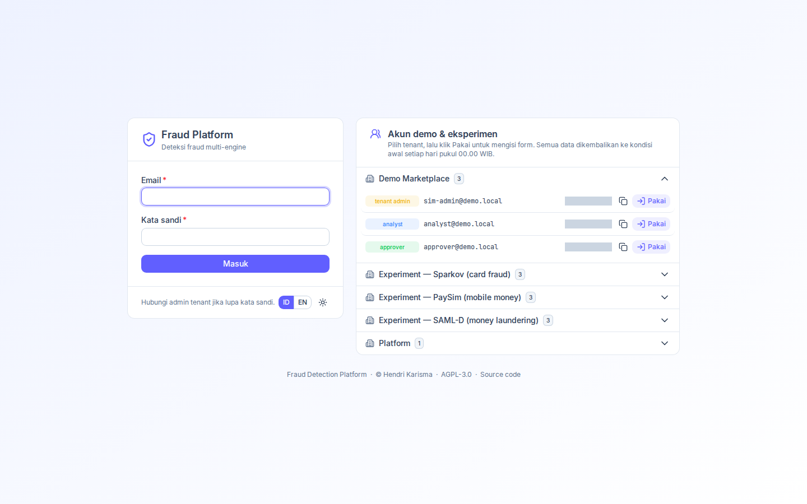

**Tips / batasan**
* Lupa kata sandi? Hubungi admin tenant (teks bantuan di bawah form).
* Demo publik: semua data dikembalikan ke kondisi awal **setiap hari pukul 00.00 WIB**. Perubahan Anda hilang dan ID
  proyek bisa berubah (bookmark lama diarahkan ke daftar proyek).

### 0.2 Memilih proyek

**Story**
* Sebagai analis fraud, saya ingin melihat semua proyek yang bisa saya akses, agar saya bisa membuka titik proteksi
  yang sedang saya tangani.
* Sebagai admin tenant, saya ingin membuat proyek baru, agar titik proteksi baru (mis. retur) punya rule dan model
  sendiri.

**Langkah**
1. Setelah login, halaman **Proyek** menampilkan kartu proyek: nama, slug, tahap (mis. *Sebelum pembayaran*,
   *Setelah pembayaran*, *Promo & cashback*, *Retur & refund*), deskripsi, dan peran Anda (mis. *Admin proyek*).
2. Klik kartu untuk membuka proyek. Cara lain: gunakan **pemilih proyek** (*Pilih proyek*) di atas sidebar. Pemilih
   ini juga dipakai untuk pindah proyek kapan saja.
3. Aktifkan **Tampilkan arsip** untuk melihat proyek yang diarsipkan.
4. Admin tenant: klik **Proyek baru**. Wizard berisi langkah *Dasar* (nama, slug, tahap proteksi, template rule,
   zona waktu, mata uang, konteks bisnis), *Algoritma ML*, *LLM & graph*, dan *Tinjau*.

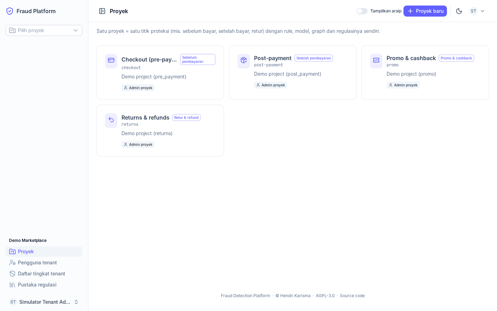

### 0.3 Sidebar dan header

Sidebar kiri berisi pemilih proyek, menu proyek, menu tenant, dan menu akun di bagian bawah. Tombol di kiri judul
halaman menyembunyikan/menampilkan sidebar.

| Bagian | Menu |
|---|---|
| Ringkasan | **Dashboard**, **Event & transaksi**, **Kasus** |
| Rule engine | **Rule**, **Ruleset**, **Reference list**, **Formula playground**, **Usulan rule** |
| Machine learning | **ML supervised**, **ML unsupervised**, **Algoritma (plugin)** |
| Graph | **Graph explorer** |
| Asisten LLM | **Chat LLM**, **Analisis & laporan**, **Regulasi proyek** |
| Data | **Sumber data**, **Katalog field** |
| Proyek | **Pengaturan**, **Anggota** (admin proyek), **Audit log** (approver ke atas) |
| Menu tenant (di bawah nama tenant) | **Proyek**, **Pengguna tenant** dan **Daftar tingkat tenant** (admin tenant), **Pustaka regulasi**, **Tenant** (khusus admin platform) |

Menu yang tampil tergantung peran Anda.

### 0.4 Menu akun, tema, dan bahasa

**Story**
* Sebagai analis fraud, saya ingin mengganti tema terang/gelap dengan cepat, agar layar nyaman dipakai saat shift
  malam.
* Sebagai pengguna mana pun, saya ingin melihat akun dan peran saya serta keluar dengan aman, agar sesi saya tidak
  dipakai orang lain.

**Langkah**
1. Klik **avatar (inisial) dan panah** di kanan atas halaman mana pun. Menu yang sama ada di **footer sidebar** (nama
   Anda dengan ikon panah atas-bawah).
2. Bagian atas menu menampilkan **nama**, **email**, dan **peran** (mis. *Admin tenant*).
3. Pilih salah satu:
   * **Profil saya**: membuka halaman profil (lihat 0.5);
   * **Tema** → *Sistem* / *Terang* / *Gelap*;
   * **Bahasa** → *ID* / *EN*;
   * **Tentang & lisensi**: versi, lisensi AGPL-3.0, dan tautan kode sumber;
   * **Keluar**: mengakhiri sesi di browser ini.
4. Untuk ganti tema cepat, klik **tombol matahari/bulan** di sebelah avatar.

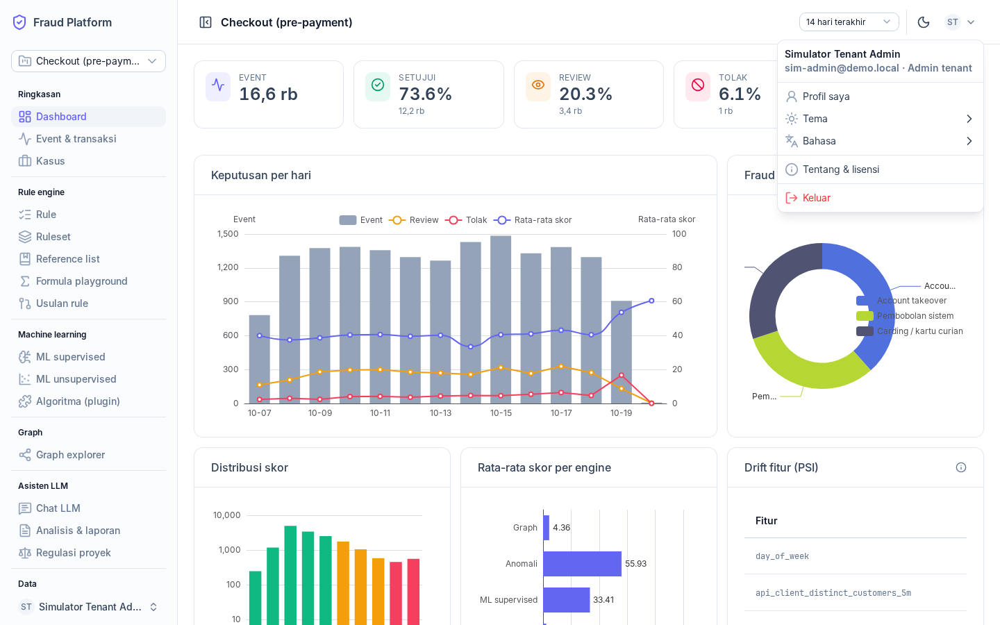

**Tips / batasan**
* Tema bawaan adalah **Terang**. *Sistem* mengikuti pengaturan perangkat.

### 0.5 Profil saya

**Story**
* Sebagai approver, saya ingin melihat peran saya di setiap proyek, agar saya tahu di proyek mana saya boleh
  menyetujui perubahan.
* Sebagai compliance/auditor, saya ingin memastikan akun saya terdaftar di tenant yang benar, agar akses saya sesuai
  penugasan.

**Langkah**
1. Buka menu akun → **Profil saya** (alamat `/profile`).
2. Kartu akun menampilkan **Nama**, **Email**, **Tenant**, **Peran tenant**, dan **Login terakhir**.
3. Kartu **Tampilan**: pilih **Tema** (*Sistem*, *Terang*, *Gelap*) dan **Bahasa** (*ID*, *EN*).
4. Tabel **Proyek dan peran** menampilkan setiap proyek (**Nama**, **Tahap**, **Peran**). Klik nama proyek untuk
   membukanya.
5. Bagian **Keamanan dan keluar** berisi tombol keluar.

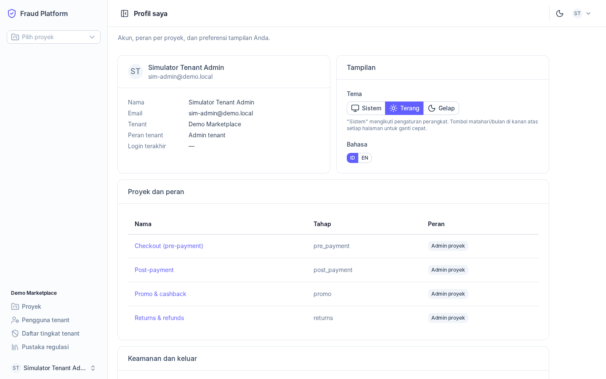

**Tips / batasan**
* Kata sandi tidak diganti sendiri di halaman ini. Hubungi admin tenant (halaman **Pengguna tenant**).

---

## 1. Dashboard

**Story**
* Sebagai manajemen, saya ingin melihat volume event, tingkat penolakan, dan kasus terbuka sekilas, agar saya tahu
  apakah ada lonjakan fraud.
* Sebagai analis fraud, saya ingin melihat tren keputusan per hari dan drift fitur, agar saya bisa mendeteksi pola
  baru lebih awal.

**Langkah**
1. Pilih proyek, lalu klik **Dashboard**.
2. Pilih periode di kanan atas: **7 / 14 / 30 hari terakhir**.
3. Baca kartu ringkasan: **Event**, **Setujui**, **Review**, **Tolak** (persentase dan jumlah), serta **Kasus
   terbuka** (dengan persentase *degraded*, yaitu event yang dinilai saat ada engine tidak tersedia).
4. Grafik **Keputusan per hari**: batang = jumlah event; garis = review, tolak, dan rata-rata skor.
5. **Fraud terlabel per tipologi**: komposisi fraud yang sudah dilabel (mis. *Account takeover*, *Pembobolan sistem*,
   *Carding / kartu curian*).
6. **Distribusi skor** dan **Rata-rata skor per engine** (Graph, Anomali, ML supervised, Rule).
7. **Drift fitur (PSI)**: membandingkan 7 hari terakhir dengan 30 hari sebelumnya. Nilai di atas 0,25 = signifikan,
   artinya pola data berubah.
8. Di bawah dashboard ada tombol pintas **Lihat transaksi ditolak**, **Lihat kasus terbuka**, dan **Minta analisis
   LLM**.

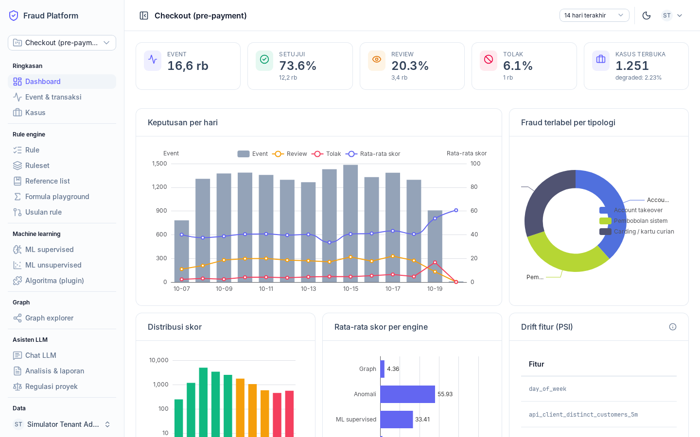

**Tips / batasan**
* Semua peran proyek (viewer ke atas) bisa melihat dashboard.
* Lonjakan garis *Tolak* atau fitur dengan drift *Signifikan* adalah titik awal investigasi yang baik.

---

## 2. Event & transaksi

### 2.1 Daftar event

**Story**
* Sebagai analis fraud, saya ingin memfilter event berdasarkan keputusan dan skor, agar saya bisa fokus pada
  transaksi berisiko tinggi.
* Sebagai tim customer service, saya ingin mencari transaksi berdasarkan ID, agar saya bisa menjelaskan kenapa
  transaksi pelanggan ditolak.

**Langkah**
1. Klik **Event & transaksi**.
2. Cari dengan kotak **ID transaksi / pelanggan**.
3. Filter **Semua tipe** (transaction, login, registration, …), **Semua keputusan** (Setujui/Review/Tolak), dan
   **Skor min.**
4. Tabel menampilkan **Waktu**, **ID eksternal**, **Tipe**, **Pelanggan**, **Nominal**, **Kanal**, **Keputusan**, dan
   **Skor**. Gunakan paginasi di bawah tabel; tombol muat ulang ada di kanan atas.
5. Klik baris untuk membuka detail event.

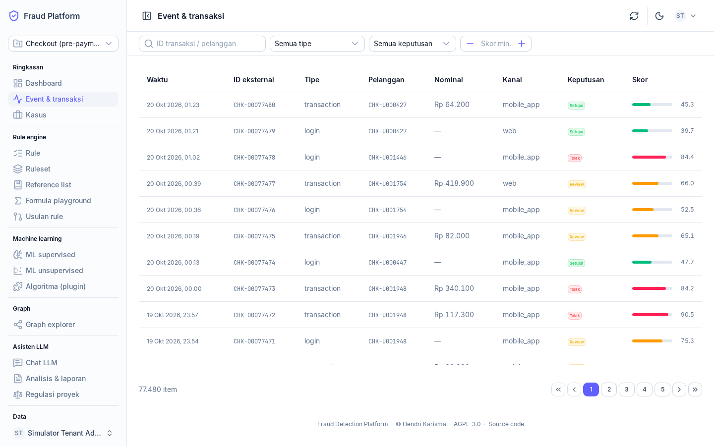

### 2.2 Detail event

**Story**
* Sebagai analis fraud, saya ingin melihat skor per engine dan alasan utama sebuah keputusan, agar saya bisa menilai
  apakah keputusan itu tepat.
* Sebagai compliance/auditor, saya ingin melihat jejak rule lengkap per event, agar setiap keputusan bisa
  dipertanggungjawabkan.

**Langkah**
1. Dari daftar event, klik satu baris. Kartu atas menampilkan **Tipe**, **Waktu**, **Pelanggan** (tautan ke halaman
   pelanggan), **Nominal**, **Kanal**, dan **ID**.
2. Tab **Keputusan**: keputusan akhir (mis. *Tolak*), **Skor akhir**, latensi, dan kartu skor per engine (**Rule**,
   **ML supervised**, **Anomali**, **Graph**). Kartu engine memberi konteks, mis. *P(fraud)* dan versi model, cluster
   dan fraud rate, *Jarak ke fraud* dan *Ukuran komponen*.
3. **Alasan utama**: kode alasan (mis. `ML_SUPERVISED_HIGH`, `GRAPH_FRAUD_DISTANCE_1`, `GRAPH_SHARED_ADDRESS`) dengan
   kontribusinya. Total kontribusi sama dengan skor akhir.
4. Tab lain:
   * **Trace rule**: setiap rule dengan hasil *Kena* / *Tidak kena* / *Trapped* dan alasan trapped;
   * **Event kanonik**: field standar setelah mapping;
   * **Data sumber**: record asli dari sumber data (field PII yang dibuang tidak ada). Bisa dipakai di rule sebagai
     `source.*`;
   * **Fitur**: fitur yang dihitung untuk event ini;
   * **Label**: label fraud/legit. Klik **Tambah label**; centang **Terapkan ke pelanggan** untuk menandai
     pelanggannya juga.
5. Tombol header: **Buka di graph**, **Buka kasus**, dan **Skor ulang** (menilai ulang event dengan konfigurasi saat
   ini).

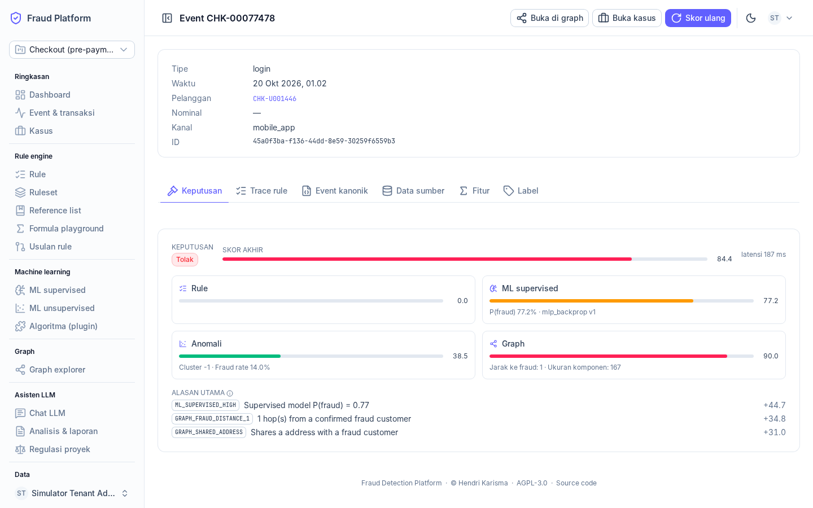

**Tips / batasan**
* Memberi label dan *Skor ulang* butuh peran analyst ke atas.
* Event yang dimuat dengan mode `load_only` tidak punya keputusan ("Belum ada keputusan").

---

## 3. Kasus

### 3.1 Antrean kasus

**Story**
* Sebagai analis fraud, saya ingin melihat antrean kasus terbuka beserta prioritas dan skornya, agar saya menangani
  kasus paling berisiko lebih dulu.
* Sebagai manajemen, saya ingin melihat berapa kasus yang sudah selesai sebagai fraud atau legit, agar saya bisa
  mengukur beban kerja tim.

**Langkah**
1. Klik **Kasus**.
2. Pilih tab status: **Semua**, **Terbuka**, **Sedang direview**, **Selesai · fraud**, **Selesai · legit**.
3. Filter **Semua prioritas** di kanan.
4. Tabel menampilkan **P** (prioritas), **Status**, **Pelanggan**, **Tipologi**, **Skor**, **Jumlah event**,
   **Penanggung jawab**, dan **Dibuat**. Klik baris untuk membuka kasus.

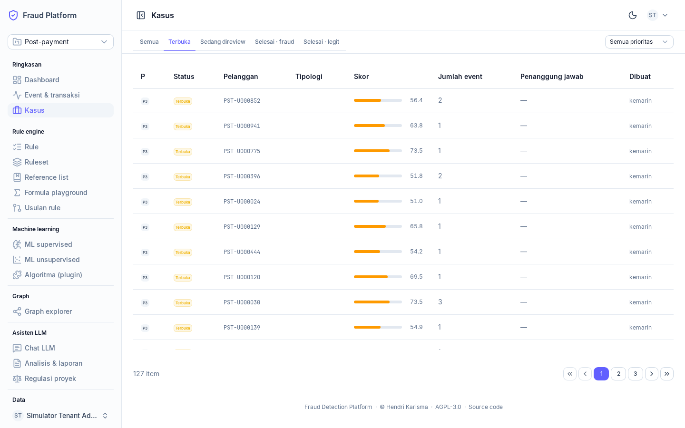

### 3.2 Menangani kasus

**Story**
* Sebagai analis fraud, saya ingin mengambil kasus, mencatat temuan, dan menyelesaikannya sebagai fraud atau legit,
  agar keputusan tercatat dan menjadi bahan belajar model.

**Langkah**
1. Buka kasus. Klik **Ambil kasus** untuk menugaskan ke diri sendiri (atau pilih **Penanggung jawab**), lalu
   **Mulai review**.
2. Periksa **Event pemicu**, jejak rule (**Trace rule**), dan ringkasan kasus (status, prioritas, pelanggan, jumlah
   event).
3. Panel **Graph** menunjukkan **Jarak ke fraud**, **Fraud ≤ 2 hop**, **Ukuran komponen**, dan **Entitas bersama**.
   Klik **Buka di graph** untuk menyelidiki jaringan.
4. Tulis temuan di **Catatan** (*Tambah catatan investigasi…*).
5. Klik **Selesaikan**. Pilih **Fraud** (lalu pilih **Tipologi**) atau **Legit**, isi catatan, dan centang
   **Terapkan ke pelanggan** bila pelanggannya perlu ditandai.

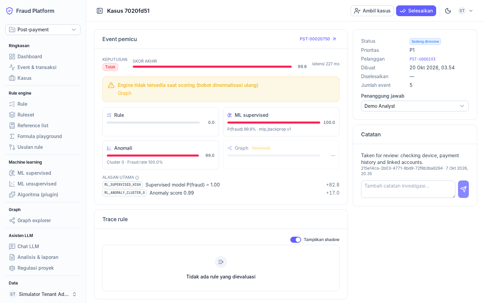

**Tips / batasan**
* Butuh peran analyst ke atas.
* Bila sebuah engine tidak ikut menilai (misalnya **Graph** *tidak tersedia*), kotak kuning di atas skor menyebutkan
  engine mana yang dilewati; keputusan tetap dihitung dari engine lain (bobotnya dinormalisasi ulang). Panel **Graph**
  hanya muncul bila ada metrik graph untuk kasus itu.
* Selalu ada **satu kasus terbuka per pelanggan**. Event berikutnya dari pelanggan yang sama masuk ke kasus itu.
* *Terapkan ke pelanggan* sebagai fraud langsung memengaruhi engine graph (jarak ke fraud pelanggan lain).
* Label dari kasus adalah bahan latih model ML supervised.

---

## 4. Pelanggan

**Story**
* Sebagai analis fraud, saya ingin melihat profil dan riwayat event seorang pelanggan, agar saya bisa menilai apakah
  perilakunya wajar.

**Langkah**
1. Buka halaman pelanggan dari tautan **Pelanggan** di detail event, dari kasus, atau dari graph.
2. Kartu profil menampilkan **Nama**, **Email**, **Telepon**, **Label risiko** (mis. *Fraud*), **Status**, dan
   **Terdaftar**.
3. Kartu ringkasan: **Event 30 hari**, **Ditolak 30 hari**, **Rata-rata skor 30 hari**.
4. Tabel **Event terbaru**: klik **ID eksternal** untuk membuka event.
5. Tombol header: **Buka di graph** dan **Event & transaksi** (daftar event pelanggan ini).

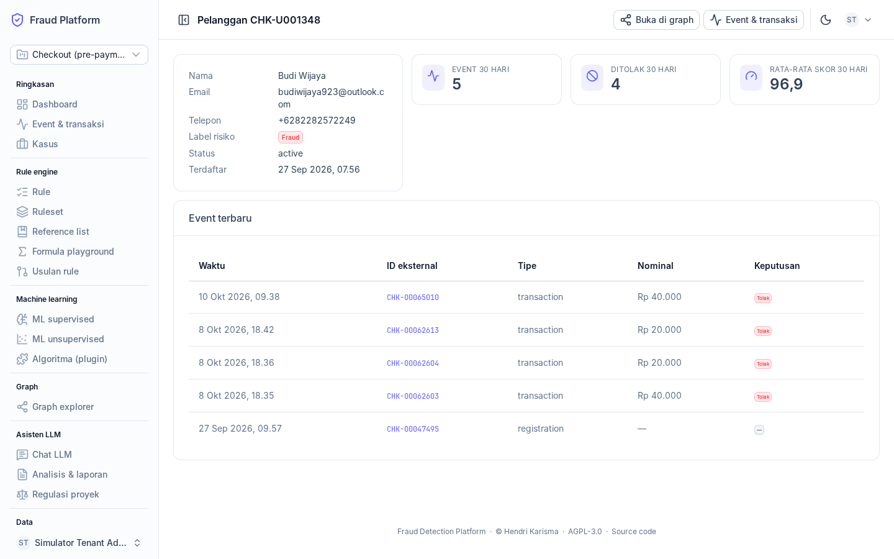

---

## 5. Rule engine

### 5.1 Daftar rule

**Story**
* Sebagai analis fraud, saya ingin melihat semua rule beserta status dan jumlah hit, agar saya tahu rule mana yang
  bekerja.
* Sebagai compliance/auditor, saya ingin memfilter rule per tipologi, agar saya bisa memeriksa cakupan kontrol untuk
  risiko tertentu.

**Langkah**
1. Klik **Rule**.
2. Cari dengan **Cari…**, filter **Semua jenis**, **Semua status** (Draf, Menunggu persetujuan, Aktif, Shadow,
   Pensiun), dan **Semua tipologi**.
3. Tabel menampilkan **Kode** (dengan versi), **Nama** dan ringkasan kondisi, **Jenis**, **Status**, **Risk score**
   (dengan penanda aksi seperti *Paksa tolak*), **Hit 7 hari**, dan **Diperbarui**.
4. Klik **Rule baru** untuk rule kosong, atau buka panah di tombol itu → **Mulai dari contoh** untuk menyalin contoh
   rule.

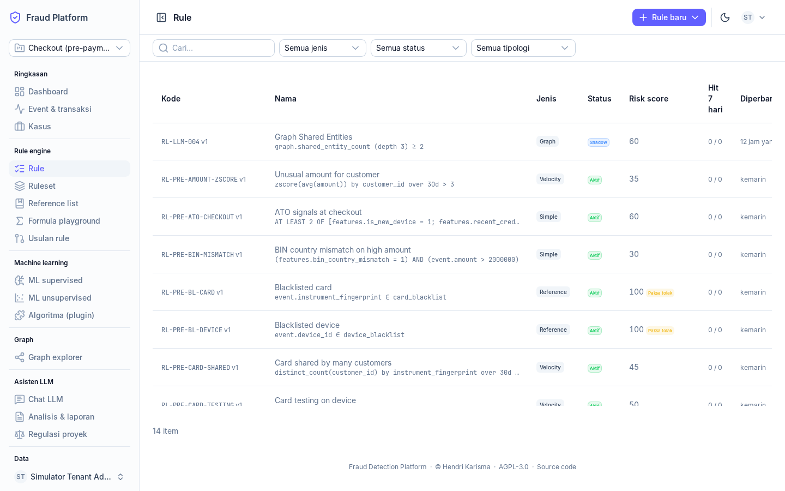

#### Jenis rule

| Jenis | Kapan dipakai | Contoh |
|---|---|---|
| **Simple** | membandingkan field/formula dengan nilai **atau dengan field lain**, bisa beberapa kondisi (SEMUA/SALAH SATU/NOT/MINIMAL n) | `amount > 5.000.000` DAN `issuer_country ≠ geo_country` |
| **Velocity** | agregasi histori per kelompok dalam jendela waktu, dibandingkan dengan nilai, field, atau formula | kartu yang sama dipakai ≥ 3 pelanggan berbeda dalam 30 hari |
| **Velocity statistik** | velocity dengan fungsi statistik: membandingkan nilai sekarang dengan distribusi historisnya | z-score nominal > 3; ekor Gaussian < 1%; peringkat persentil; tren regresi linear; ekor Poisson (lonjakan jumlah) |
| **Composite** | velocity, tetapi histori **difilter** dulu dengan kondisi simple | ≥ 3 pelanggan berbeda di device yang sama memakai **kode promo yang sama** dalam 7 hari |
| **Reference** | cek ke daftar (blacklist/whitelist/watchlist/lookup) | kartu ada di `card_blacklist`, atau nominal > `max_amount` merchant di daftar lookup |
| **Graph** | kondisi pada metrik graph pelanggan | jarak ke pelanggan fraud ≤ 2 langkah; entitas dipakai bersama ≥ 2 |

#### Aksi rule

| Aksi | Arti |
|---|---|
| **Skor** | menambah skor sesuai bobot |
| **Paksa review** | jika kena, keputusan minimal review |
| **Paksa tolak** | jika kena, transaksi ditolak (prioritas tertinggi) |
| **Paksa setujui (whitelist)** | jika kena, disetujui kecuali ada paksa tolak |

### 5.2 Detail rule: definisi, uji, backtest, versi

**Story**
* Sebagai analis fraud, saya ingin menguji dan mem-backtest rule sebelum mengajukannya, agar rule tidak menolak
  terlalu banyak pelanggan sah.
* Sebagai approver, saya ingin melihat definisi, hasil backtest, dan riwayat versi rule, agar saya bisa menyetujui
  dengan yakin.

**Langkah**
1. Klik rule di daftar. Header menampilkan kode, nama, status (mis. **Shadow**), serta tombol **Ajukan persetujuan**
   dan **Pensiunkan** (sesuai peran dan status).
2. Tab **Definisi**: kolom kiri berisi **Kode** (tidak bisa diubah setelah dibuat), **Nama**, **Deskripsi**,
   **Jenis**, **Tipologi**, **Tipe event**, **Risk score**, **Skor trapped**, **Aksi**. Panel kanan berisi editor
   sesuai jenis rule. Untuk rule graph: **Metrik graph** (mis. *Entitas dipakai bersama*), **Jenis tautan**,
   **Termasuk entitas mirip**, **Kedalaman maks.**, dan **Bandingkan**. Tombol **Form / JSON** mengganti tampilan
   editor.
3. Kotak **Ringkasan** menampilkan kondisi dalam satu baris. Klik **Validasi** untuk memeriksa rule.
4. Tab **Uji**: jalankan rule terhadap satu event (**Dari event tersimpan**, isi **ID event**) atau **Dari konteks
   JSON**.
5. Tab **Backtest**: lihat **Dievaluasi**, **Kena**, **Hit rate**, **Presisi**, **Recall**, distribusi keputusan, dan
   contoh event pada data historis.
6. Tab **Versi (n)**: riwayat versi dan perbedaannya.
7. Setelah yakin, klik **Ajukan persetujuan**. Approver lain membuka rule yang sama dan klik **Setujui** (pilih target
   **Aktif** atau **Shadow**) atau **Tolak** (dengan komentar).

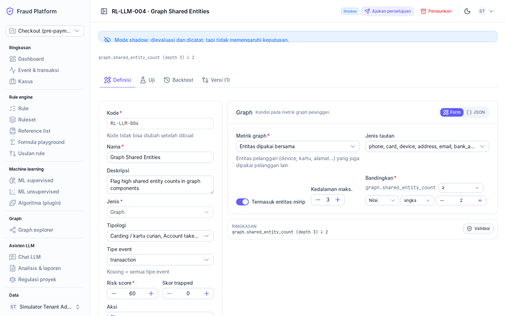

**Siklus hidup rule**

```
Draf → (Ajukan persetujuan) → Menunggu persetujuan → (Setujui oleh orang lain) → Aktif atau Shadow → Pensiun
```

* Banner **Mode shadow** berarti rule dievaluasi dan dicatat, tetapi tidak memengaruhi keputusan. Dari shadow, rule
  bisa diajukan lagi untuk **Aktif**.
* Mengedit rule aktif membuat **versi baru** (status kembali ke draf, perlu disetujui lagi). Versi lama tetap
  berjalan sampai versi baru disetujui. Isi **Catatan perubahan** agar riwayat jelas.
* Saat **Menunggu persetujuan**, rule tidak bisa diubah.

**Hasil "trapped"**

Rule menjadi **trapped** jika tidak bisa dievaluasi, misalnya field kosong, pembagian dengan nol, histori terlalu
sedikit untuk statistik, atau reference list tidak ada. Pengaturan **Jika trapped** per rule:
* **Abaikan (dicatat)**: hanya dicatat;
* **Tambah skor trapped**: tambahkan *Skor trapped*;
* **Paksa review**: paksa event masuk review.

Centang **Field kosong = tidak kena** jika field kosong seharusnya dianggap "tidak kena", bukan trapped.

**Tips / batasan**
* Membuat/mengubah: analyst ke atas. Menyetujui, menolak, memensiunkan: approver ke atas.
* Maker–checker: jika Anda yang mengajukan, approver harus orang lain.

### 5.3 Membuat rule baru

**Story**
* Sebagai analis fraud, saya ingin membuat rule dengan form tanpa menulis kode, agar saya bisa cepat merespons pola
  fraud baru.

**Langkah**
1. Di **Rule**, klik **Rule baru** (atau **Mulai dari contoh**).
2. Isi **Kode** (HURUF BESAR, angka, dan tanda hubung, 3–40 karakter, mis. `RL-CARD-010`), **Nama**, **Deskripsi**,
   **Jenis**, **Tipologi**, dan **Tipe event** (kosong = semua tipe event).
3. Atur **Risk score**, **Skor trapped**, **Aksi**, dan **Jika trapped**.
4. Di panel kanan, pilih **Mode skor**: **Biner** (kena → risk score penuh) atau **Berbobot per kondisi** (skor =
   risk score × bobot kondisi yang kena / total bobot).
5. Susun kondisi. Pilih grup **SEMUA (AND)**, **SALAH SATU (OR)**, **MINIMAL n**, atau **NOT**. Klik **+ Kondisi**
   atau **Grup**. Setiap kondisi: operand kiri (mis. *Field* `event.amount`), operator (mis. *lebih dari (>)*), dan
   operand kanan (*Nilai*, *Field*, *Formula*, *Kolom ref*, atau *Field histori*).
6. Lihat **Ringkasan** dan klik **Validasi**. Error ditampilkan di bawah ringkasan (mis. kode tidak sesuai format,
   nama wajib diisi).
7. Coba di tab **Uji** dan **Backtest**, lalu klik **Simpan draf**. **Batal** membuang perubahan.

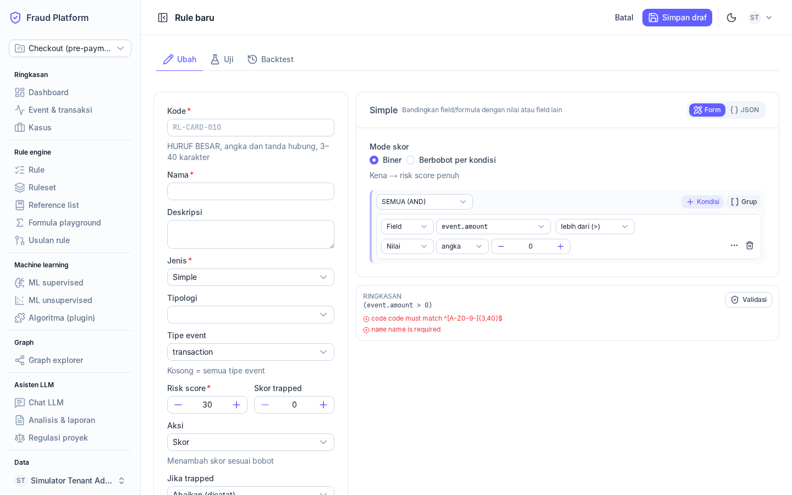

### 5.4 Ruleset

**Story**
* Sebagai analis fraud, saya ingin mengelompokkan beberapa rule untuk satu tujuan dengan bobot dan cara agregasi,
  agar skor rule lebih seimbang.

**Langkah**
1. Klik **Ruleset**. Tabel menampilkan **Kode**, **Nama**, **Agregasi skor**, **Rule** (jumlah anggota), **Tipe
   event**, dan **Status**.
2. Klik **Ruleset baru**, atau klik ruleset untuk mengubahnya.
3. Tambah anggota dengan **Tambah rule…**, pilih **Versi** (mis. *Terbaru*), dan atur bobot.
4. Pilih **Agregasi skor**:

| Agregasi | Cara hitung |
|---|---|
| **Probabilistic OR** | 100 × (1 − Π(1 − c/100)); tidak pernah lewat 100, cocok untuk sinyal independen |
| **Jumlah** | jumlah kontribusi, dibatasi skor maks. |
| **Maksimum** | kontribusi tertinggi |
| **Rata-rata berbobot** | Σ kontribusi / Σ kontribusi maksimum × 100 |

5. Simpan (status kembali ke draf), lalu ajukan persetujuan seperti rule.

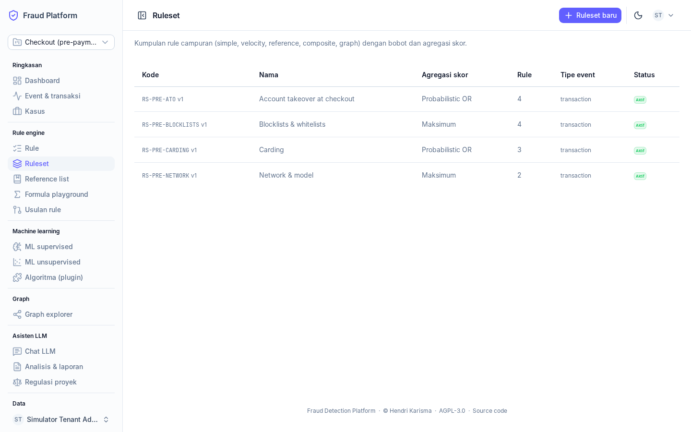

**Tips / batasan**
* Ruleset juga ber-versi dan harus disetujui approver lain.

### 5.5 Reference list

**Story**
* Sebagai analis fraud, saya ingin menambahkan kartu atau device ke blacklist kapan saja, agar fraudster yang sudah
  dikenal langsung ditolak tanpa deploy.
* Sebagai admin tenant, saya ingin membuat daftar yang berlaku untuk semua proyek, agar blacklist perusahaan cukup
  dikelola sekali.

**Langkah**
1. Klik **Reference list**. Tabel menampilkan **Nama**, **Tipe** (*Blacklist*, *Whitelist*, *Watchlist*, *Lookup*),
   **Jenis key** (mis. `card_fingerprint`, `device_id`, `merchant_id`, `customer_external_id`), **Cakupan**
   (*Proyek*), dan **Entri**.
2. Klik **List baru**. Isi nama (huruf kecil, angka, garis bawah), tipe, jenis key, dan **Kolom atribut** (opsional,
   mis. `max_amount` untuk lookup).
3. Buka list untuk **Tambah entri** (key, atribut, **Berlaku sampai**) atau impor **CSV** (kolom pertama = key,
   kolom lain = atribut).
4. Rujuk list dari rule jenis **Reference** dengan mode **Ada di list**, **Tidak ada di list**, atau **Ada & atribut
   memenuhi kondisi**.

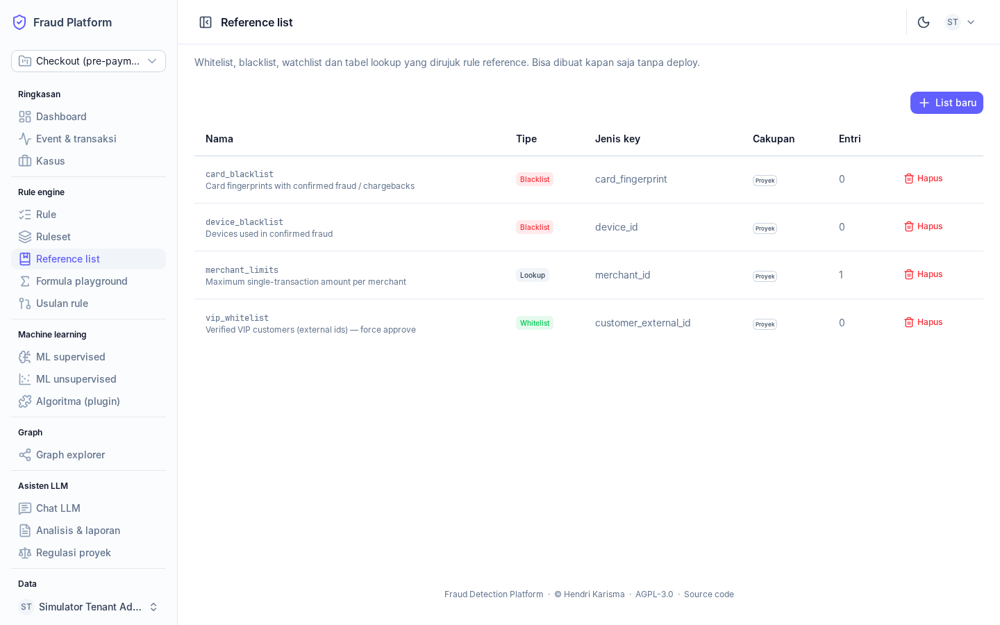

**Tips / batasan**
* List tingkat tenant dikelola admin tenant di menu **Daftar tingkat tenant** dan berlaku untuk semua proyek.
* **Hapus** tidak bisa dilakukan jika list dipakai rule aktif.

### 5.6 Formula playground

**Story**
* Sebagai analis fraud, saya ingin mencoba formula dengan angka contoh, agar saya yakin formulanya benar sebelum
  dipakai di rule.

**Langkah**
1. Klik **Formula playground**.
2. Tulis formula di kolom **Formula**, mis. `F(x,y,z) = 2x + 2^y / z^2`. Header `F(a,b)` opsional; perkalian implisit
   `2x`; pangkat `^`.
3. Isi **Variabel** (mis. `x = 10`, `y = 3`, `z = 2`). Klik **Tambah variabel** bila perlu.
4. Klik **Hitung**. Posisi kesalahan penulisan akan ditunjukkan.
5. Panel **Contoh** berisi contoh formula dan daftar fungsi: abs, sqrt, ln, log10, log(x,b), exp, pow, min, max,
   floor, ceil, round, clamp, sigmoid, gauss, normcdf, if, serta konstanta pi dan e.

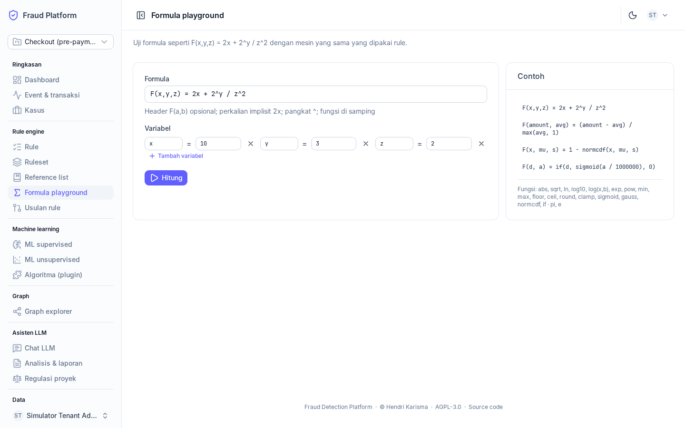

**Tips / batasan**
* Di mana pun rule meminta nilai, Anda bisa memakai operand **Formula** dan mengikat variabelnya ke field atau
  konstanta. Mesinnya sama dengan playground.

### 5.7 Usulan rule

**Story**
* Sebagai approver, saya ingin meninjau usulan rule dari LLM atau analis lengkap dengan bukti backtest dan rujukan
  regulasi, agar hanya rule yang terbukti yang masuk produksi.
* Sebagai compliance/auditor, saya ingin melihat usulan yang diterapkan dan ditolak, agar saya bisa menelusuri alasan
  setiap perubahan kontrol.

**Langkah**
1. Klik **Usulan rule**. Pilih tab **Menunggu**, **Diterapkan**, **Ditolak**, atau **Semua**; filter **Semua
   sumber** (LLM atau Analis).
2. Setiap kartu menampilkan sumber (mis. **LLM**), jenis usulan (**Rule baru**, **Ubah rule**, **Pensiunkan rule**,
   **Atur threshold**), kode dan nama rule, alasan dengan rujukan pasal (mis. `[POJKATIFRAUD §Lampiran III > IV.302]`),
   ringkasan kondisi, **Presisi** dan **Recall**, serta status (mis. *Menunggu*).
3. Klik kartu untuk detail: **Alasan**, **Rule yang diusulkan** (dibandingkan dengan rule saat ini bila mengubah),
   **Bukti backtest (30 hari)** (Kena, Hit rate, Presisi, Recall), **Validasi**, **Rujukan regulasi**, **Bukti
   data**, serta tautan **Buka laporan** dan **Buka rule**.
4. Approver klik **Setujui** atau **Tolak** (dengan komentar).
5. Usulan yang disetujui membuat/memperbarui rule dalam **mode shadow**. Aktivasi penuh butuh persetujuan kedua di
   halaman rule (**Ajukan persetujuan** → **Setujui** dengan target **Aktif**).

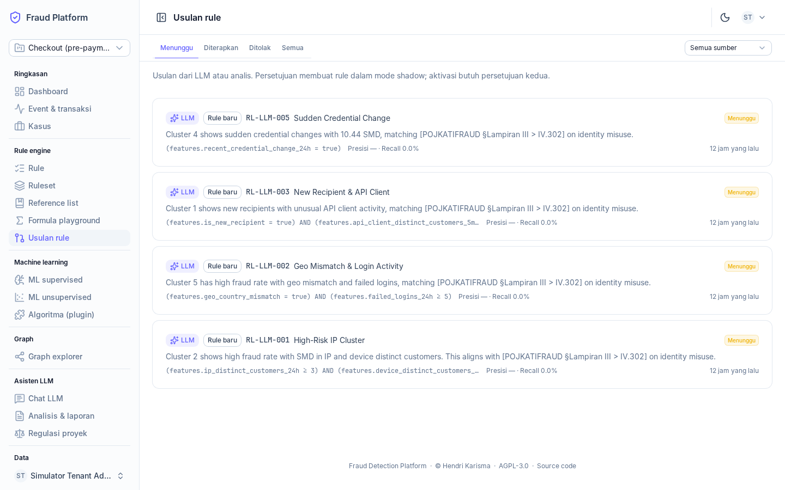

**Tips / batasan**
* AI tidak pernah mengaktifkan rule sendiri. Semua usulan lewat persetujuan manusia (maker–checker) dan shadow dulu.
* Presisi "—" berarti backtest belum menemukan event yang kena; perhatikan ini sebelum menyetujui.

---

## 6. ML supervised

**Story**
* Sebagai analis fraud, saya ingin melatih model dari event berlabel, agar sistem bisa memprediksi probabilitas fraud
  untuk pola yang sulit ditangkap rule.
* Sebagai approver, saya ingin membandingkan metrik model baru dengan model aktif sebelum menyetujuinya, agar
  kualitas deteksi tidak turun.

**Langkah**
1. Klik **ML supervised**. Kartu atas menampilkan **Model aktif** (mis. *v1 · mlp_backprop*), **PR-AUC**, dan
   **ROC-AUC**. Klik **Lihat metrik** untuk detail.
2. Tabel model menampilkan **v**, **Algoritma**, **Status**, **PR-AUC**, **ROC-AUC**, **Baris latih**, dan
   **Dilatih**.
3. Klik **Latih model**. Pilih **Algoritma** (form parameter muncul otomatis dari plugin), **Data (hari)**, dan
   **Seleksi fitur** (sertakan/kecualikan, field sumber tambahan).
4. Tunggu status **Siap**. Buka model untuk melihat kurva ROC/PR, **Confusion matrix**, **Kalibrasi**, **Kepentingan
   fitur**, dan **Riwayat training**.
5. Klik **Ajukan persetujuan**. Approver lain klik **Setujui**. Model menjadi **Aktif**; model lama diarsipkan tanpa
   downtime.

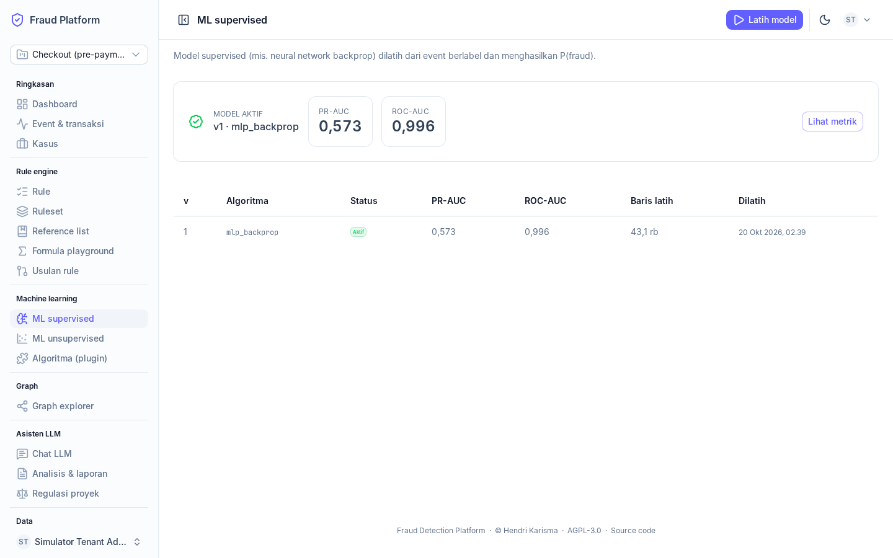

**Tips / batasan**
* Melatih: analyst ke atas. Menyetujui: approver ke atas.
* Event yang lebih tua dari masa matang label (default 14 hari) tanpa laporan fraud dianggap legit saat training.
* Di awal, ketika label masih sedikit, andalkan rule dan unsupervised. Model supervised membaik seiring bertambahnya
  kasus yang diselesaikan.
* PR-AUC lebih jujur daripada ROC-AUC untuk data fraud yang sangat tidak seimbang.

---

## 7. ML unsupervised

**Story**
* Sebagai analis fraud, saya ingin melihat cluster event yang aneh tanpa butuh label, agar saya bisa menemukan pola
  fraud baru.
* Sebagai analis fraud, saya ingin memberi nama cluster (mis. "peternakan promo"), agar tim lain memahami artinya.

**Langkah**
1. Klik **ML unsupervised**. Pilih model di kanan atas (mis. *v1 · isolation_forest + hdbscan*) atau klik **Latih
   model** (pilih **Algoritma anomali**: isolation forest / LOF / autoencoder, dan **Algoritma clustering**: HDBSCAN /
   k-means / DBSCAN / Gaussian mixture).
2. **Proyeksi 2-D (PCA)**: peta event, berwarna **Per cluster** atau **Per skor anomali**. Klik titik untuk membuka
   event.
3. Tab **Cluster**: **#**, **Label**, **Ukuran**, **Fraud rate** (dari label), **Fitur pembeda** (fitur yang naik/turun
   dibanding rata-rata), dan **Profil**. Klik **Beri nama cluster** untuk memberi label.
4. Tab **Anomali teratas**: event paling aneh sebagai kandidat investigasi atau bahan rule baru.
5. Tab **Komunitas graph**: komunitas Louvain dari graph pelanggan–entitas beserta fraud rate-nya (dipakai rule graph
   *Fraud rate komunitas*). Klik **Hitung ulang** untuk memperbarui.

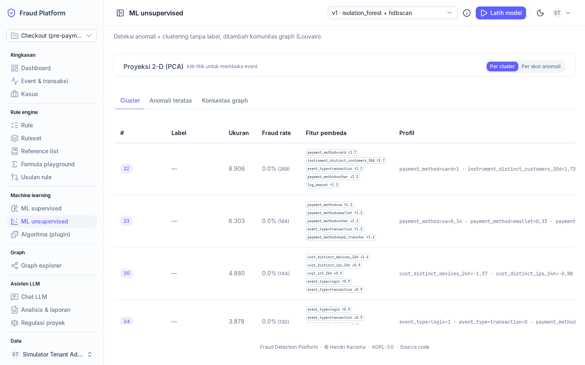

---

## 8. Algoritma (plugin)

**Story**
* Sebagai analis fraud, saya ingin melihat algoritma yang tersedia beserta parameternya, agar saya memilih algoritma
  yang tepat saat melatih model.

**Langkah**
1. Klik **Algoritma (plugin)**. Pilih tab **Semua**, **Supervised**, **Anomali**, atau **Clustering**.
2. Setiap kartu menampilkan nama, penanda **builtin** atau **plugin**, status (*Tersedia*), kode dan versi, jenis, dan
   deskripsi singkat. Klik **Lihat parameter** untuk melihat parameter dan nilai bawaannya.
3. Contoh yang tersedia di demo: Autoencoder, Isolation forest, Local outlier factor, k-NN distance anomaly (contoh
   plugin), DBSCAN, Gaussian mixture, HDBSCAN, K-means, Gradient boosting (histogram), Logistic regression, Neural
   network (MLP, backpropagation), Random forest.

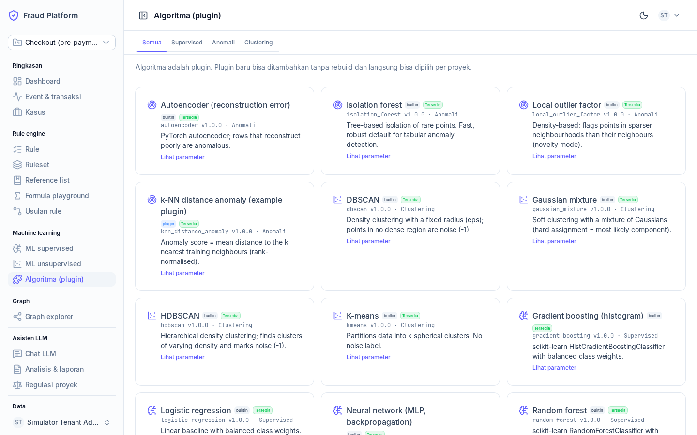

**Tips / batasan**
* Plugin baru ditaruh di folder `plugins/` lalu dimuat dengan tombol **Muat ulang plugin** (khusus admin platform),
  tanpa rebuild. Lihat `docs/technical/ml-plugins.md`.

---

## 9. Graph explorer

**Story**
* Sebagai analis fraud, saya ingin mencari pelanggan dari nama, email, atau nomor HP dan melihat siapa saja yang
  memakai device atau alamat yang sama, agar saya bisa menemukan jaringan fraud.
* Sebagai analis fraud, saya ingin melihat jalur terpendek dari pelanggan ke pelanggan fraud terdekat, agar saya bisa
  menjelaskan kenapa skor graph-nya tinggi.
* Sebagai manajemen, saya ingin mengekspor gambar jaringan, agar temuan bisa dilampirkan di laporan.

**Langkah: memulai**
1. Klik **Graph explorer**. Tanpa pelanggan terpilih, halaman menampilkan **Pilih pelanggan** dan daftar **Mulai dari
   pelanggan yang berlabel fraud**. Klik salah satu untuk langsung mulai.
2. Atau ketik minimal 2 karakter di kotak **Cari nama, email, telepon, IP, device, atau ID pelanggan…**. Pencarian
   menerima:
   * nama (sebagian juga bisa), ID pelanggan, email;
   * nomor telepon (format `08…` atau `+62…`);
   * IP, ID device, dan referensi transaksi.
3. Hasil dikelompokkan menjadi **Pelanggan** dan **Entitas**. Memilih entitas akan memfokuskan graph pada pelanggan
   yang paling baru terhubung dengan entitas itu.
4. Panel **Statistik graph** menampilkan jumlah **Pelanggan**, **Pelanggan fraud**, **Entitas**, **Tautan**,
   **Tautan kemiripan**, dan daftar **Supernode** (entitas terlalu umum, mis. IP publik atau API client partner, yang
   diabaikan saat penelusuran).

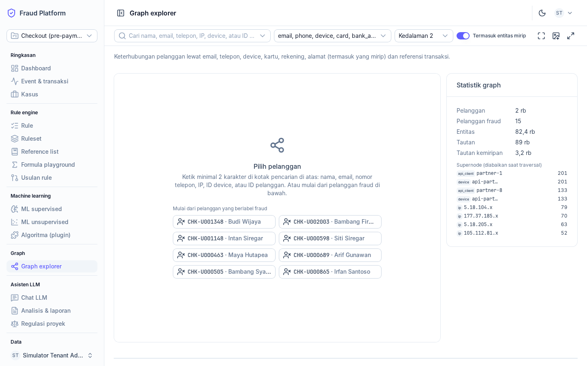

**Langkah: menjelajah**
1. Atur filter di bar atas:
   * **Jenis tautan**: Email, Telepon, Device, IP, Kartu, Rekening, Alamat, Ref. transaksi, API client;
   * **Kedalaman** 1–3;
   * **Termasuk entitas mirip** (mis. alamat yang ejaannya mirip, dengan skor kemiripan).
2. Baca kanvas. Lingkaran = pelanggan, kotak = entitas. Panel **Keterangan** (bisa dilipat) memakai warna yang sama
   dengan node dan menampilkan jumlahnya: *Pelanggan dipilih*, *Pelanggan fraud*, *Pelanggan legit*, *Pelanggan
   (belum berlabel)*, entitas (*Alamat*, *Kartu*, *Email*, *Telepon*, *Device*, …), serta garis *Tautan entitas
   bersama*, *Entitas mirip (skor)*, dan *Jalur ke fraud terdekat*.
3. **Klik ganda** node untuk memperluas. Klik node untuk memilihnya, lalu gunakan **Fokus**, **Perluas**, atau
   **Detail**.
4. Panel **Kedekatan ke fraud** menampilkan jumlah **hop ke pelanggan fraud terdekat**, jumlah fraud per jarak
   (≤1, ≤2, ≤3), dan jalurnya (mis. pelanggan → device → pelanggan fraud). Toggle **Jalur** menyorot jalur di kanvas.
   Klik **Buka fraud terdekat** untuk pindah ke pelanggan fraud itu.
5. Tombol kanan atas: **Paskan tampilan**, **Ekspor PNG**, dan **Layar penuh**.
6. Di bawah kanvas, tabel **Komponen terhubung** menampilkan kelompok pelanggan terhubung dengan fraud rate tertinggi
   (filter **Hanya yang ada fraud**). Kelompok ini sering berupa jaringan promo farm atau mule.

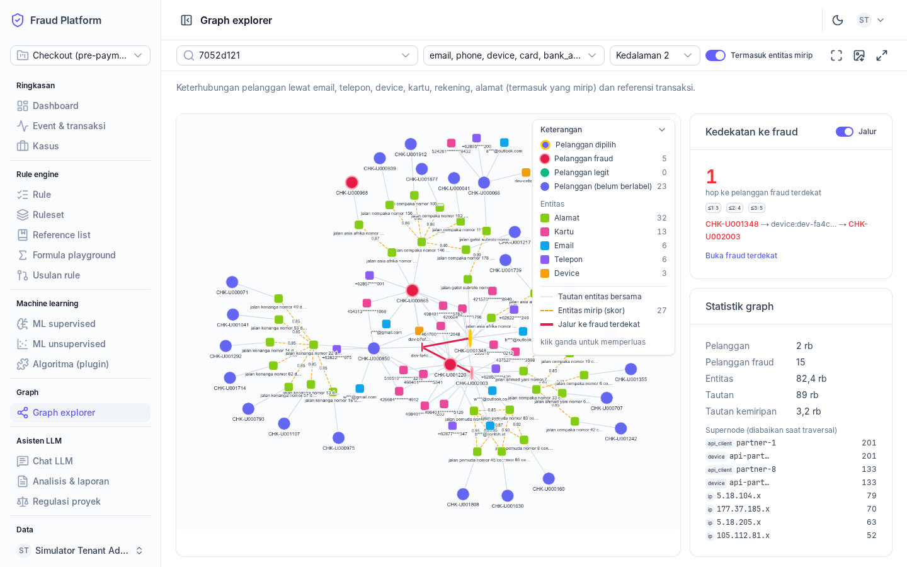

**Tips / batasan**
* Data kontak di label node ditampilkan tersamar (mis. `+62895****200`, `a***@outlook.com`).
* Jika node terlalu banyak, graf dipotong ("Graf dipotong"). Kurangi kedalaman atau jenis tautan.
* Label fraud dari kasus (*Terapkan ke pelanggan*) langsung terlihat di graph.

---

## 10. Asisten LLM

### 10.1 Chat LLM

**Story**
* Sebagai analis fraud, saya ingin bertanya dalam bahasa biasa ("cari pelanggan fraud, analisis transaksinya"), agar
  saya mendapat ringkasan tanpa membuka banyak halaman.
* Sebagai compliance/auditor, saya ingin bertanya tentang isi regulasi dan mendapat rujukan pasal, agar jawaban bisa
  diverifikasi.
* Sebagai manajemen, saya ingin penjelasan kondisi fraud 7 hari terakhir, agar saya bisa mengambil keputusan cepat.

**Langkah**
1. Klik **Chat LLM**. Daftar **Percakapan** ada di kiri. Klik **Chat baru** untuk memulai percakapan baru.
2. Tulis pertanyaan di kotak bawah (Enter untuk kirim, Shift+Enter baris baru), lalu klik **Kirim**. Percakapan baru
   menampilkan contoh pertanyaan yang bisa diklik.
3. Jawaban **mengalir langsung** (streaming). Selama bekerja, asisten menampilkan status dengan detik berjalan,
   mis. **Sedang berpikir… 1 dtk** atau **Menganalisis hasil…**.
4. Setiap langkah alat muncul sebagai chip dengan nama yang mudah dibaca, mis. **Mencari pelanggan**, **Membuka profil
   pelanggan**, **Mencari transaksi**, **Membuka transaksi**, **Mencari kasus**, **Membuka kasus**, **Mencari
   regulasi**, **Mengecek performa rule**, **Membaca komponen graph**, **Backtest rule**.
5. Klik **Hentikan** untuk menghentikan jawaban yang sedang berjalan.

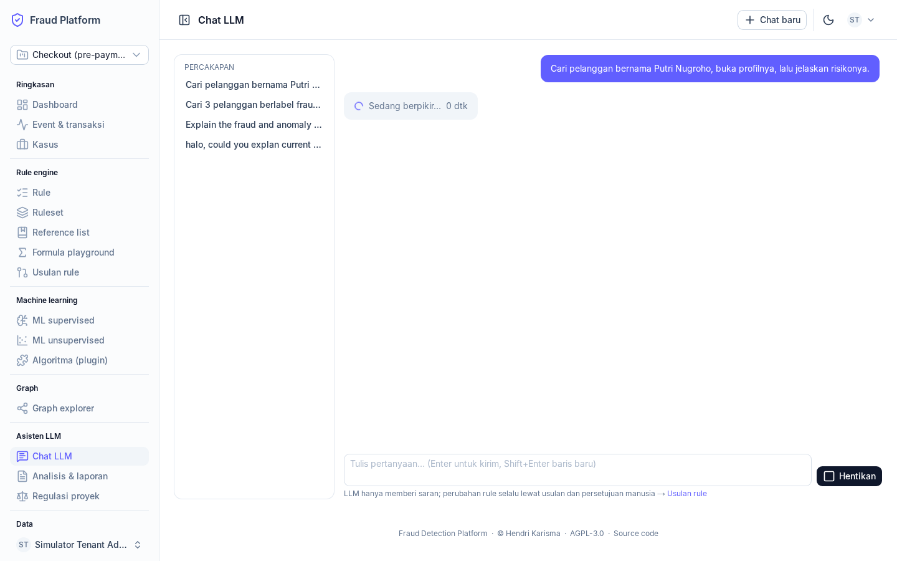

6. Jawaban bisa berisi tabel, daftar, dan rujukan regulasi. Contoh di bawah: asisten mencari pelanggan berlabel fraud,
   membuka salah satunya, merangkum transaksinya, dan menemukan jalur *Budi Wijaya (fraud) → Device (dev-fa4c…) →
   Bambang Firmansyah (fraud)*, lalu memberi rekomendasi.

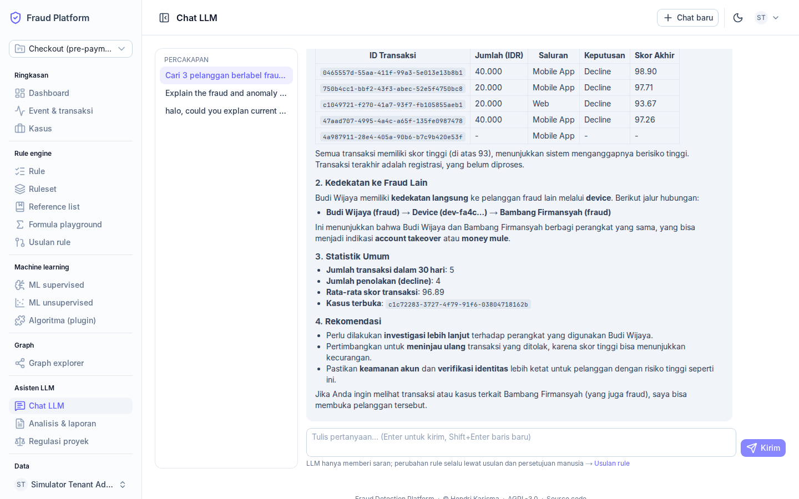

**Yang bisa dilakukan asisten**
* Mencari dan membuka **pelanggan**, **transaksi/event**, dan **kasus** (berdasarkan nama, ID, email, telepon, …)
  lalu menganalisisnya.
* Membaca statistik rule, analitik, drift fitur, tipologi, cluster anomali, komponen dan komunitas graph, serta
  konteks proyek.
* Mencari di regulasi yang dilampirkan ke proyek dan menyertakan rujukan pasal.
* Memvalidasi dan mem-backtest definisi rule, lalu membuat **usulan rule** (status pending).

**Tips / batasan**
* **LLM hanya memberi saran.** Perubahan rule selalu lewat **Usulan rule** dan persetujuan manusia (maker–checker,
  lalu shadow). Tautan *Usulan rule* ada di bawah kotak input.
* Data kontak (email, telepon) dikirim ke model dalam bentuk tersamar.
* Riwayat percakapan tetap tersimpan walaupun Anda pindah percakapan atau menutup tab saat asisten masih menjawab.
* LLM berjalan lokal (demo: `qwen3:8b`). Tanpa GPU, jawaban bisa lambat.

### 10.2 Analisis & laporan

**Story**
* Sebagai analis fraud, saya ingin menjalankan analisis terjadwal atas data, rule, dan regulasi, agar saya mendapat
  laporan tertulis tanpa menyusunnya manual.
* Sebagai manajemen, saya ingin membaca laporan situasi fraud, agar saya punya gambaran tren dan tipologi terbaru.

**Langkah**
1. Klik **Analisis & laporan**.
2. Di kartu **Jalankan analisis**, atur **Data (hari)** (mis. 30), **Regulasi** (*Pilih regulasi*), **Fokus
   tipologi** (mis. *Semua*), dan **Maks. rule** (mis. 5).
3. Klik salah satu jenis analisis:
   * **Situasi fraud & anomali**: tren, tipologi, cluster anomali, komunitas graph;
   * **Relevansi rule**: rule mana yang dipertahankan, diubah, atau dipensiunkan;
   * **Dampak regulasi**: perubahan pasal dan rule yang terdampak;
   * **Rekomendasi rule**: usulan rule baru/ubah yang sudah divalidasi dan dibacktest, menunggu persetujuan.
4. Tabel laporan menampilkan **Judul**, **Tipe**, **Status** (*Selesai*, *Gagal*, …), **Model**, dan **Dibuat**.
   Klik laporan untuk membacanya. Gunakan **Tampilkan data terstruktur** untuk melihat data mentahnya.
5. Usulan dari *Rekomendasi rule* masuk ke **Usulan rule**.

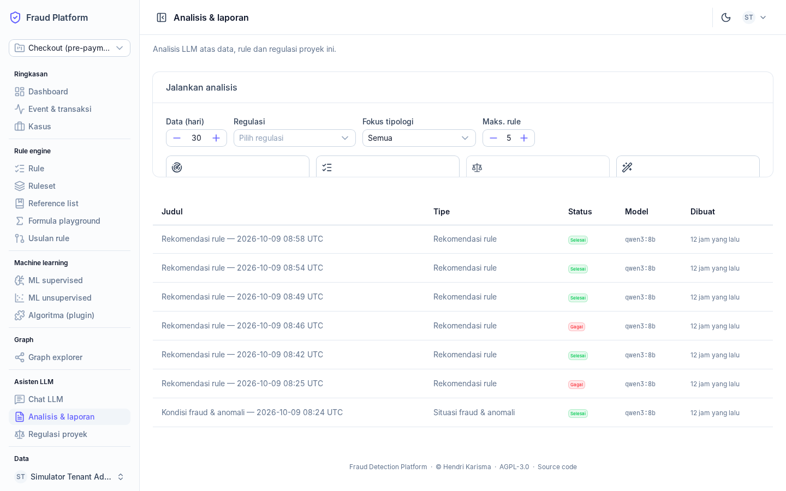

**Tips / batasan**
* Butuh peran analyst ke atas.
* Tanpa GPU, laporan bisa memakan waktu lama (puluhan menit). Status tetap *LLM sedang menyusun laporan…* sampai
  selesai.

### 10.3 Regulasi proyek

**Story**
* Sebagai compliance/auditor, saya ingin memilih regulasi yang berlaku untuk proyek ini, agar asisten LLM dan analisis
  dampak hanya merujuk dokumen yang relevan.

**Langkah**
1. Klik **Regulasi proyek**.
2. Di **Regulasi yang dilampirkan**, centang dokumen dari pustaka tenant (mis. *POJKATIFRAUD v1 · pojkatifraud*, OJK ·
   Regulasi, status *Terindeks*). Klik **Simpan**.
3. Di **Cari di regulasi**, ketik kata kunci (mis. *verifikasi perubahan kredensial*) lalu klik **Cari** untuk
   menemukan pasal terkait.
4. Tombol **Pustaka regulasi** membuka pustaka tingkat tenant.

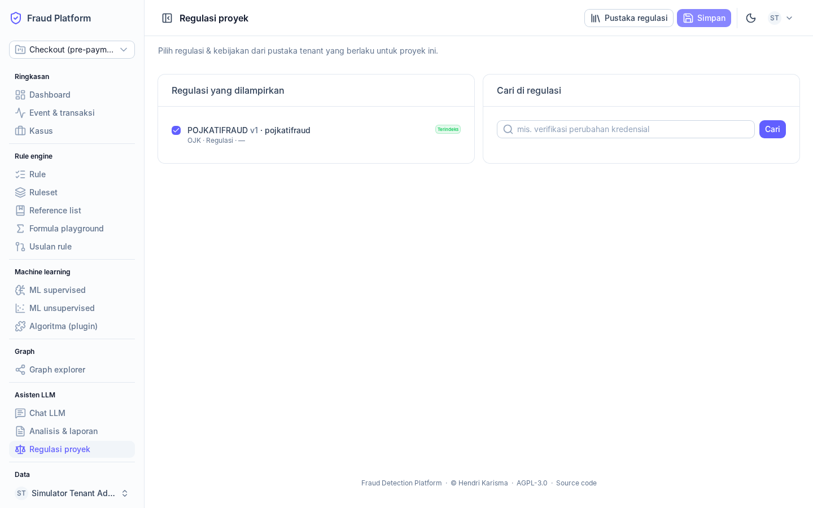

### 10.4 Pustaka regulasi (tingkat tenant)

**Story**
* Sebagai admin tenant, saya ingin mengunggah regulasi OJK/BI dan SOP internal sekali untuk semua proyek, agar setiap
  proyek memakai versi dokumen yang sama.
* Sebagai compliance/auditor, saya ingin melihat perubahan pasal antara versi lama dan baru, agar saya tahu rule mana
  yang perlu ditinjau.

**Langkah**
1. Di menu tenant, klik **Pustaka regulasi**. Tabel menampilkan **Kode**, **Judul**, **Tipe** (mis. *Regulasi · OJK*),
   **Tanggal berlaku**, **Chunk**, dan **Status**.
2. Klik **Unggah dokumen**. Pilih file (PDF, DOCX, TXT, atau Markdown), isi kode, versi, tipe (*Regulasi*, *Kebijakan
   internal*, *SOP*, *Lainnya*), **Penerbit**, dan **Tanggal berlaku**.
3. Untuk versi baru, pilih dokumen lama di **Menggantikan**. Sistem membandingkan **pasal demi pasal** (*Ditambah*,
   *Dihapus*, *Diubah*).
4. Tunggu status berubah dari *Diproses* menjadi **Terindeks**.
5. Jalankan analisis **Dampak regulasi** di tiap proyek untuk melihat rule yang terdampak.

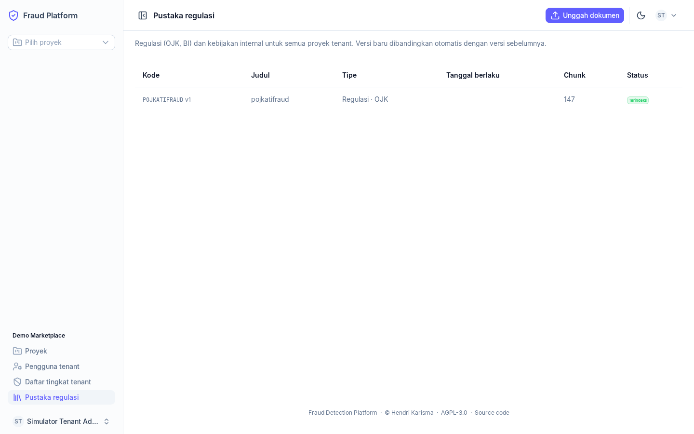

---

## 11. Data

### 11.1 Sumber data

**Story**
* Sebagai admin proyek, saya ingin menghubungkan data transaksi kami apa adanya (webhook, file, atau database), agar
  platform bisa menilai event tanpa mengubah sistem sumber.
* Sebagai analis fraud, saya ingin memuat data historis berlabel, agar model bisa dilatih dan rule bisa dibacktest.

**Langkah**
1. Klik **Sumber data**. Kartu menampilkan setiap sumber, mis. *Canonical API* (*Internal*, *Format kanonik*, *Skor
   (real-time)*) dan *Simulator webhook* (*Webhook (real-time)*, *Mapping v1 aktif*).
2. Klik **Sumber data baru** dan pilih jenis: **Webhook (real-time)**, **File / dataset** (CSV, JSON, JSONL, Parquet,
   Excel), **PostgreSQL**, atau **MySQL**. Pilih **Mode**: **Skor (real-time)** atau **Muat saja (histori)**.
   * Webhook: API key ditampilkan **sekali**. Simpan saat itu juga.
   * Database: password tidak disimpan; isi nama **Env var password**. Opsional **Polling berkala** dengan **Kolom
     kursor**.
3. **Baca struktur data**: unggah contoh file, tempel **Contoh JSON**, atau isi **SQL**. Klik **Baca struktur**.
   Sistem mendeteksi tipe, format tanggal, dan PII, lalu menyarankan mapping.
4. **Mapping ke field kanonik**: cocokkan field sumber ke field standar dan tambah transformasi (format tanggal, angka
   format Indonesia, hash nomor kartu, normalisasi HP, …). Di **Dataset berlabel**, petakan kolom label (mis.
   `is_fraud`; nilai fraud: 1, true, Y). Isi **Field yang dibuang** untuk data sensitif (mis. nomor kartu mentah,
   CVV).
5. **Pratinjau, simpan & aktifkan**: klik **Simpan & aktifkan**. Semua kolom sumber langsung tersedia di rule sebagai
   `source.<kolom>`.
6. Untuk file/tabel, buka tab **Import job** dan klik **Mulai import**. Baris yang gagal masuk ke tab **Error
   ingest**.

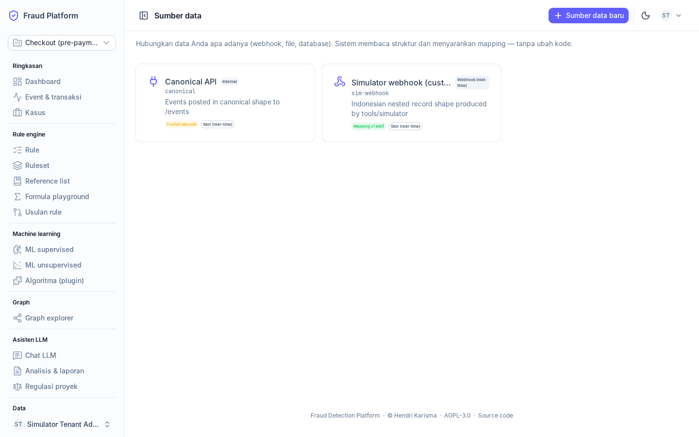

**Tips / batasan**
* Butuh peran project admin.
* **Rotasi API key** membuat key lama langsung tidak berlaku. Perbarui sistem pengirim.
* Mode *Muat saja* membangun fitur dan graph tanpa keputusan, cocok untuk training dan backtest.

### 11.2 Katalog field

**Story**
* Sebagai analis fraud, saya ingin melihat semua field yang bisa dipakai di rule, agar saya tahu nama path yang tepat
  saat menulis kondisi.
* Sebagai compliance/auditor, saya ingin melihat field mana yang berisi PII, agar penggunaan data pribadi terkontrol.

**Langkah**
1. Klik **Katalog field**.
2. Cari dengan **Cari…** atau pilih tab **Semua**, **event**, **source**, **customer**, **features**, **ml**,
   **graph**.
3. Tabel menampilkan **Path**, **Tipe**, **Entitas**, **Velocity**, **PII**, dan **Deskripsi**.
4. Nyalakan toggle **Velocity** untuk field yang ingin dipakai sebagai kunci/agregasi di rule velocity.

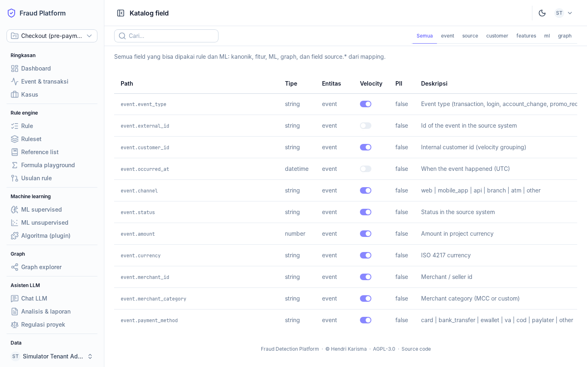

---

## 12. Proyek: pengaturan, anggota, audit log

### 12.1 Pengaturan proyek

**Story**
* Sebagai admin proyek, saya ingin mengatur ambang review dan tolak, agar keputusan sesuai selera risiko bisnis.
* Sebagai admin proyek, saya ingin mengisi konteks bisnis, agar asisten LLM memahami apa yang dilindungi proyek ini.

**Langkah**
1. Klik **Pengaturan**.
2. **Profil proyek**: **Nama**, **Deskripsi**, **Konteks bisnis** (dipakai LLM sebagai konteks). Klik **Simpan**.
   **Arsipkan proyek** menghentikan penerimaan event; data tetap tersimpan.
3. **Ambang keputusan**: skor akhir ≥ **Review** → review; ≥ **Tolak** → tolak (bawaan 50 dan 80). Ambang tolak harus
   lebih besar dari ambang review.
4. **Bobot engine**: pilih **Kombinasi engine** dan atur slider bobot (Rule, ML supervised, Anomali, Graph):
   * **Noisy-OR (default)**: bukti dari tiap engine terakumulasi; engine yang diam tidak pernah melemahkan sinyal
     kuat. Bobot bersifat relatif (eksponen wᵢ/w_max), jadi jumlahnya tidak harus 1;
   * **Rata-rata berbobot**: Σwᵢsᵢ/Σwᵢ.
5. **Skor graph**: skor engine graph per **Jarak 1/2/3** ke pelanggan fraud dan untuk **Entitas fraud bersama**.
6. Di bagian bawah: **Timeout (ms)** per engine (engine yang lewat timeout di-skip/degraded), **Jika rule engine
   mati** (keputusan cadangan), dan **Buat kasus otomatis untuk** keputusan tertentu.

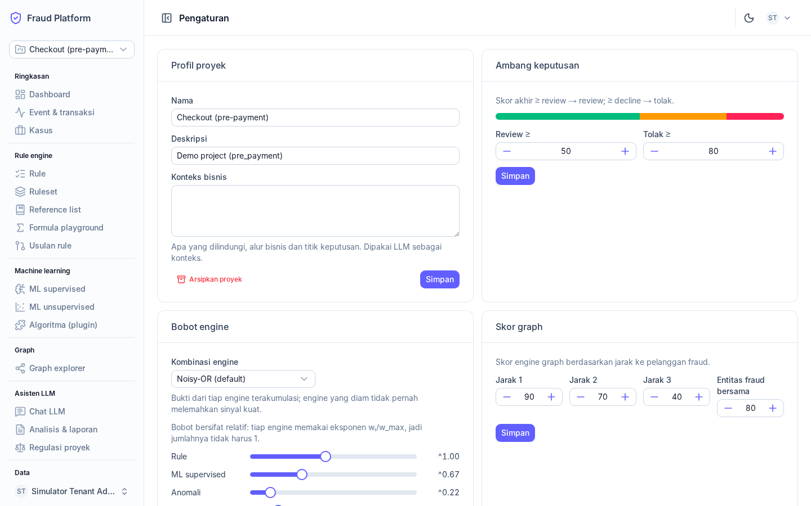

**Tips / batasan**
* Butuh peran project admin.
* Tahap berbeda (pre-payment vs retur) biasanya butuh ambang berbeda. Kalibrasi dengan melihat metrik model dan hasil
  backtest.
* Selalu ada satu kasus terbuka per pelanggan; event berikutnya ditambahkan ke kasus tersebut.

### 12.2 Anggota

**Story**
* Sebagai admin proyek, saya ingin menambahkan analis dan approver ke proyek, agar pembagian tugas maker–checker
  berjalan.

**Langkah**
1. Klik **Anggota**.
2. Pilih **Pengguna** (dari pengguna tenant) dan **Peran** (*Viewer*, *Analis*, *Approver*, *Admin proyek*). Klik
   **Tambah**.
3. Ubah peran langsung dari dropdown di tabel, atau klik **Hapus** untuk mengeluarkan anggota.

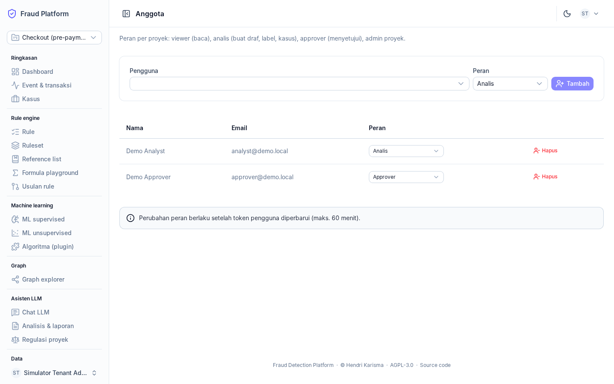

**Tips / batasan**
* Butuh peran project admin.
* Perubahan peran berlaku setelah token pengguna diperbarui (maks. 60 menit).
* Pastikan minimal ada dua orang dengan peran approver/analyst agar maker–checker bisa berjalan.

### 12.3 Audit log

**Story**
* Sebagai compliance/auditor, saya ingin melihat siapa mengubah apa dan kapan, agar setiap perubahan konfigurasi dan
  persetujuan bisa diaudit.

**Langkah**
1. Klik **Audit log**.
2. Filter dengan **Aksi** (mis. `proposal.approve`, `case.update`) dan **Pelaku**.
3. Tabel menampilkan **Waktu**, **Pelaku**, **Aksi**, **Objek**, dan **Request ID**.

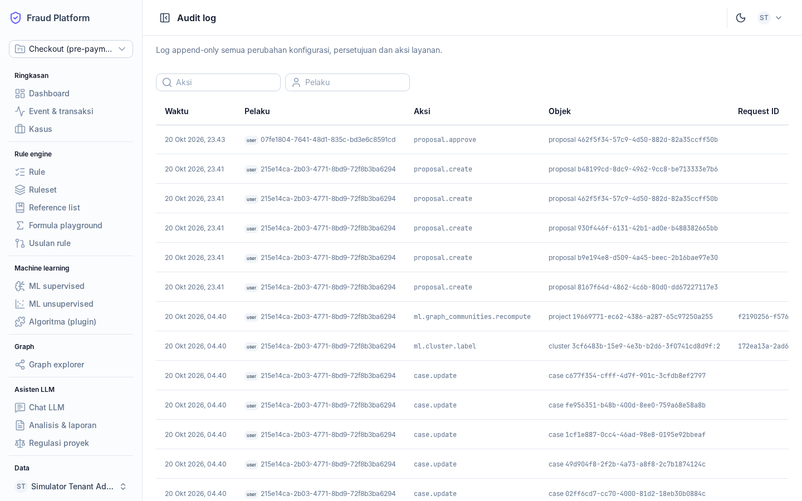

**Tips / batasan**
* Butuh peran approver ke atas.
* Log bersifat append-only: tidak bisa diubah atau dihapus.

---

## 13. Admin tenant

### 13.1 Pengguna tenant

**Story**
* Sebagai admin tenant, saya ingin membuat akun untuk karyawan baru dan menonaktifkan akun yang keluar, agar hanya
  orang yang berwenang yang bisa masuk.

**Langkah**
1. Di menu tenant, klik **Pengguna tenant**. Tabel menampilkan **Nama**, **Email**, **Peran** (*Anggota* atau *Admin
   tenant*), dan **Status** (toggle aktif).
2. Klik **Pengguna baru**. Isi **Email**, **Nama**, **Kata sandi** (minimal 12 karakter), dan **Peran**. Klik
   **Buat**.
3. Ubah peran tenant dari dropdown, atau matikan toggle **Status** untuk menonaktifkan akun.
4. Atur peran per proyek di menu **Anggota** tiap proyek.

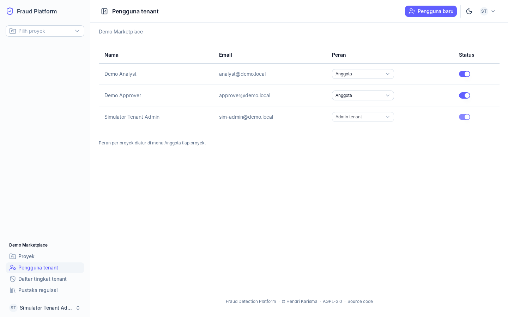

**Tips / batasan**
* Butuh peran tenant admin.
* Pengguna tidak bisa mengganti kata sandinya sendiri dari halaman Profil; mereka menghubungi admin tenant.

### 13.2 Daftar tingkat tenant

**Story**
* Sebagai admin tenant, saya ingin satu blacklist perusahaan yang dipakai semua proyek, agar fraudster yang ditemukan
  di satu proyek langsung diblokir di proyek lain.

**Langkah**
1. Di menu tenant, klik **Daftar tingkat tenant**.
2. Kelola list sama seperti **Reference list** proyek (5.5). Di rule reference, pilih cakupan **Tingkat tenant**.

---

## Alur cerita lengkap (end-to-end)

Skenario: proyek **Checkout (pre-payment)**. Tim melihat lonjakan penolakan, menemukan jaringan fraud yang berbagi
device, dan menambahkan rule baru dengan aman.

| # | Siapa | Apa yang terjadi | Fitur |
|---|---|---|---|
| 1 | Manajemen / analis | Di **Dashboard**, garis *Tolak* di grafik **Keputusan per hari** naik di hari terakhir dan rata-rata skor meningkat. Analis klik **Lihat transaksi ditolak**. | [Dashboard](#1-dashboard) · [gambar: Dashboard](../images/guide/03-dashboard.png) |
| 2 | Analis fraud | Di **Event & transaksi** (filter *Tolak*), analis membuka event `CHK-00077478` dengan skor 84,4. Tab **Keputusan** menunjukkan alasan `GRAPH_FRAUD_DISTANCE_1` dan `GRAPH_SHARED_ADDRESS`: pelanggan ini 1 hop dari pelanggan fraud. | [Event](#2-event--transaksi) · [gambar: Event](../images/guide/05-event-detail.png) |
| 3 | Analis fraud | Analis klik **Buka kasus**, lalu **Ambil kasus** dan **Mulai review**. | [Kasus](#3-kasus) · [gambar: Kasus](../images/guide/06-cases.png) |
| 4 | Analis fraud | Dari kasus, analis membuka halaman pelanggan terkait, mis. *Budi Wijaya* (`CHK-U001348`): 5 event dalam 30 hari, 4 ditolak, rata-rata skor 96,9, label *Fraud*. | [Pelanggan](#4-pelanggan) · [gambar: Pelanggan](../images/guide/08-customer-detail.png) |
| 5 | Analis fraud | Analis klik **Buka di graph**. Panel **Kedekatan ke fraud** menunjukkan jalur `CHK-U001348 → device:dev-fa4c… → CHK-U002003`: dua pelanggan fraud memakai **device yang sama**. Analis mengekspor PNG untuk catatan kasus. | [Graph](#9-graph-explorer) · [gambar: Graph](../images/guide/20-graph-customer.png) |
| 6 | Analis fraud | Di **Chat LLM**, analis meminta: "Cari 3 pelanggan berlabel fraud, buka salah satunya, lalu analisis transaksinya dan kedekatannya ke fraud lain." Asisten mencari pelanggan, membuka profil, dan merangkum transaksi serta jalur device bersama, lalu merekomendasikan investigasi device. | [Chat LLM](#101-chat-llm) · [gambar: Chat](../images/guide/21-llm-chat.png) |
| 7 | Analis fraud | Analis menyelesaikan kasus: **Selesaikan** → *Fraud*, tipologi *Account takeover*, centang **Terapkan ke pelanggan**. | [Kasus](#32-menangani-kasus) |
| 8 | Analis fraud | Analis membuat rule graph baru: **Rule baru** → Jenis *Graph*, Metrik *Entitas dipakai bersama* ≥ 2, Kedalaman maks. 3, **Termasuk entitas mirip**. Klik **Validasi**. (Cara lain: jalankan **Rekomendasi rule** di **Analisis & laporan** agar LLM membuat usulan.) | [Rule baru](#53-membuat-rule-baru) · [gambar: Rule baru](../images/guide/11-rule-new.png) |
| 9 | Analis fraud | Di tab **Uji**, rule dicoba pada event `CHK-00077478`. Di tab **Backtest**, analis memeriksa hit rate, presisi, dan recall. Lalu **Simpan draf** dan **Ajukan persetujuan**. | [Detail rule](#52-detail-rule-definisi-uji-backtest-versi) |
| 10 | Approver | Approver (orang lain) memeriksa definisi dan backtest, lalu **Setujui** dengan target **Shadow**. Rule berjalan pada lalu lintas nyata tanpa memengaruhi keputusan. Jika rule datang dari LLM, approver menyetujuinya dari **Usulan rule** dan rule otomatis masuk shadow. | [Usulan rule](#57-usulan-rule) · [gambar: Rule shadow](../images/guide/10-rule-detail.png) |
| 11 | Analis + approver | Setelah beberapa hari, hit di shadow dibandingkan dengan label kasus. Hasilnya baik, jadi analis **Ajukan persetujuan** lagi dan approver **Setujui** dengan target **Aktif**. | [Siklus hidup](#52-detail-rule-definisi-uji-backtest-versi) |
| 12 | Compliance / auditor | Auditor membuka **Audit log** dan melihat jejak `proposal.create`, `proposal.approve`, dan `case.update` lengkap dengan pelaku dan waktu. | [Audit log](#123-audit-log) · [gambar: Audit](../images/guide/28-audit.png) |

Hasil: jaringan device bersama terdeteksi, label fraud memperkuat engine graph untuk pelanggan lain, dan rule baru
aktif setelah diuji, di-shadow, dan disetujui dua orang.
