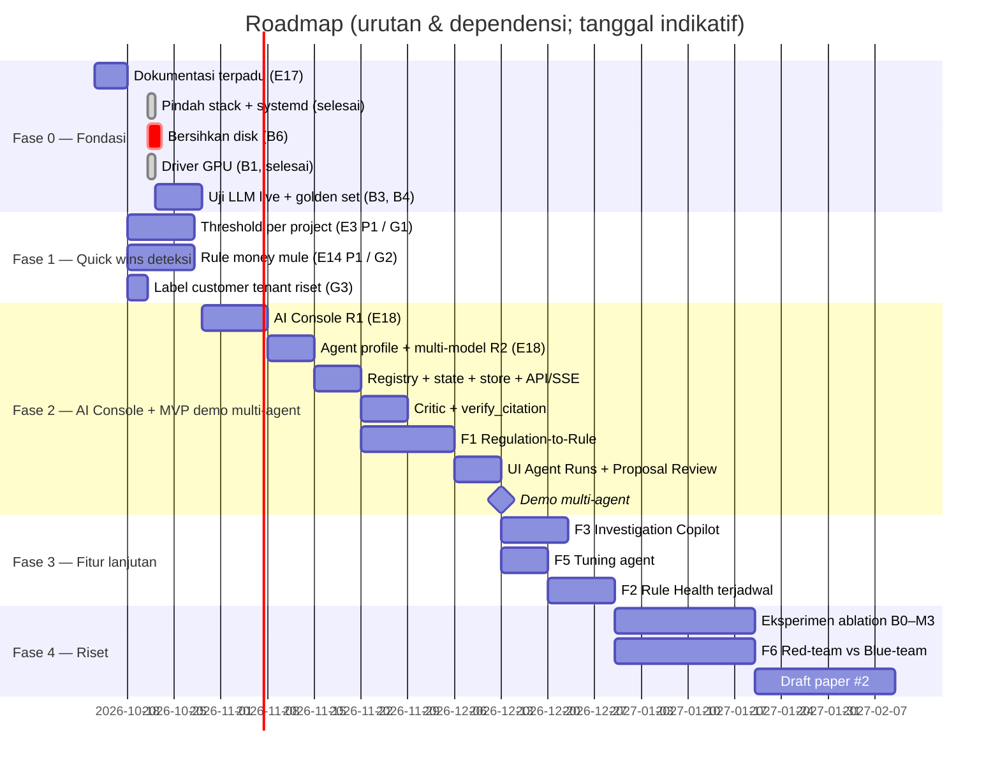

# Roadmap — Fraud Detection Platform v2

Terakhir diperbarui: 2026-10-21. Detail story per epic ada di [`backlog.md`](backlog.md); desain multi-agent di
[`technical/multi-agent.md`](technical/multi-agent.md).

## 1. Posisi sekarang

- **v2 berjalan** sebagai demo publik `fds.hendrikarisma.my.id` di host nvda11-gpu (commit `07ee765`). Epic E0–E14
  selesai kecuali uji live LLM (E7).
- Platform sudah **agentic** (satu tool-calling agent, 20 tools, aksi tulis hanya lewat proposal), tetapi **belum
  multi-agent**.
- Fokus saat ini: **dokumentasi terpadu** dan **desain multi-agent**. Belum ada pengembangan kode baru.

## 2. Blocker

| # | Blocker | Dampak | Status 2026-10-13 |
|---|---|---|---|
| B1 | Driver GPU nvda11-gpu (DKMS nvidia untuk kernel 7.0) | LLM lokal di CPU ~0,5 tok/s; multi-agent tidak layak untuk demo | **selesai 2026-10-21** (100% GPU, ≈ 62 tok/s; Ollama 0.40.7) |
| B2 | Pindah stack ke checkout deploy | dua direktori membingungkan | **selesai 2026-10-21** (`~/own_project/deployment/…`, autostart systemd) |
| B6 | Disk nvda11-gpu 100% | OpenSearch berhenti mengindeks, build gagal | belum |
| B3 | Uji LLM live tuntas | baseline single-agent untuk perbandingan | belum |
| B4 | Golden set regulasi | kemajuan LLM tidak terukur | belum |
| B5 | Merge PR #1 (`revamp/rust-nuxt-stack` → `master`) | pengembangan lanjutan di atas master bersih | menunggu review |

Provider LLM: **Ollama lokal** (qwen3:8b + bge-m3). Gemini opsional bila akun sudah normal.

## 3. Fase

Estimasi untuk satu orang + Claude Code; tanggal hanya menunjukkan urutan.

## 4. Milestone

| Milestone | Isi | Kriteria selesai |
|---|---|---|
| M0 Dokumentasi | docs terpadu di repo + vault | index, bisnis, teknis terverifikasi, backlog, roadmap, runbook |
| M1 LLM siap demo | GPU aktif, uji live, golden set baseline | chat menjawab dengan sitasi < 30 dtk; baseline B1/B2 tercatat |
| M2 Quick wins | threshold per project + rule money mule | FPR ≤ 5% di checkout/promo dengan recall ≥ 0,95; recall@80 money mule ≥ 0,6 |
| M2b AI Console | E18 R1 + R2 | ganti model/provider tanpa restart; model per agent + fallback; API key terenkripsi |
| **M3 Demo multi-agent** | F1 end-to-end di UI | proposal tersitasi (100% lolos `verify_citation`), tervalidasi, ter-backtest; run < 10 menit di GPU 8 GB; timeline live |
| M4 Fitur lanjutan | F3, F5, F2 | acceptance criteria per fitur di `technical/multi-agent.md` |
| M5 Riset | ablation + paper #2 | ≥ 5 seed per kondisi; draft paper |

## 5. Matriks prioritas

| Item | Dampak | Effort | Prioritas |
|---|---|---|---|
| Threshold per project | Tinggi (FPR 23–46% → ≤ 5%) | Rendah | **P1 — pertama** |
| Label customer tenant riset | Tinggi untuk eksperimen graph | Sangat rendah | P1 |
| Rule money mule | Tinggi (recall 0,35) | Rendah–sedang | P1 |
| F1 Regulation-to-Rule | Tinggi (diferensiasi + paper) | Sedang–tinggi | P1 (butuh B1) |
| Critic + `verify_citation` | Tinggi (halusinasi pasal) | Sedang | P1 |
| F3 Investigation Copilot | Sedang–tinggi | Sedang | P1 |
| F5 Tuning agent | Tinggi | Sedang | P1 |
| F2 Rule Health | Sedang | Sedang | P2 |
| F4, F7, F8, F9 | Sedang | Sedang | P2 |
| GNN / sequence model / F6 / federated | Riset | Tinggi | P3 |

## 6. Definition of Done (fitur agentic)

- Unit test (Ollama di-mock) + integration test (Postgres/OpenSearch asli).
- Masuk golden set / harness evaluasi; ada angka sebelum vs sesudah.
- Langkah agent tercatat di `llm.agent_steps`; metrik Prometheus tersedia.
- Tidak ada jalur aktivasi tanpa maker–checker.
- `backlog.md`, `roadmap.md`, dan dokumen teknis terkait diperbarui; atribusi AGPL tetap.
