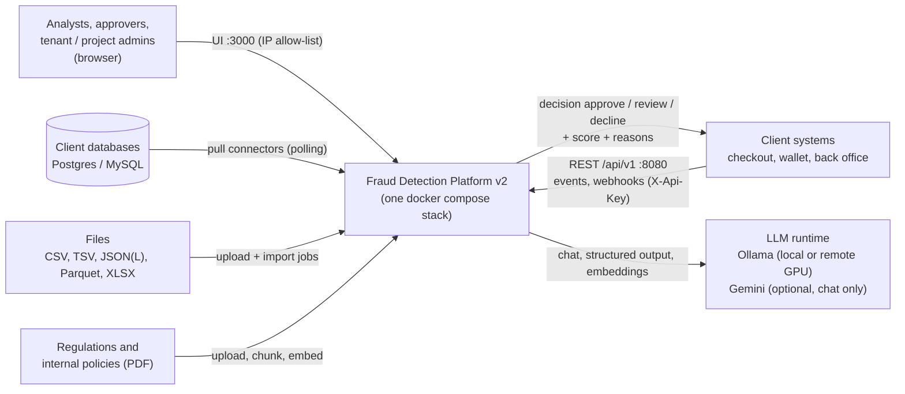
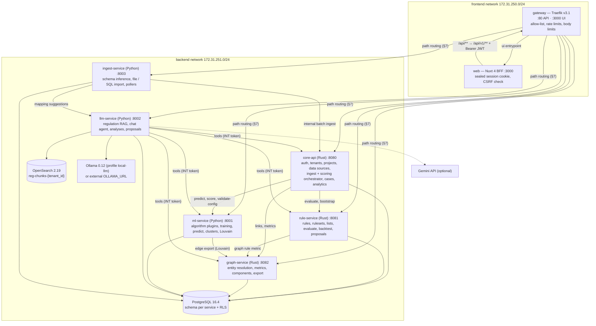
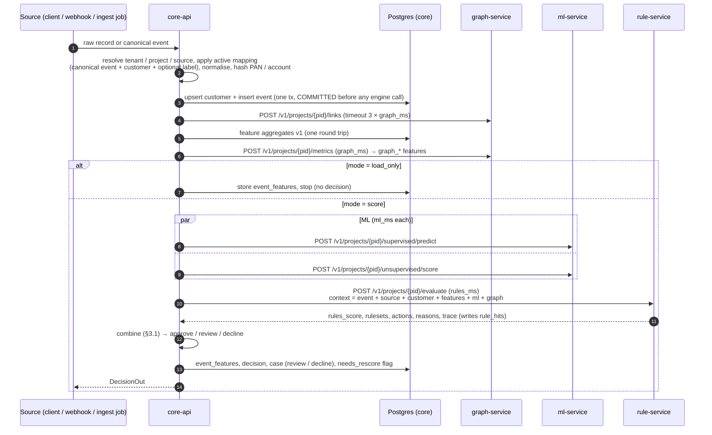

# Architecture — Fraud Detection Platform v2

> Document status: verified against commit `07ee765` on 2026-10-13.

Status: **authoritative design contract**. Services implement against this document and
[`multi-tenancy.md`](multi-tenancy.md), [`rule-dsl.md`](rule-dsl.md), [`api-contract.md`](api-contract.md),
[`feature-catalog.md`](feature-catalog.md), [`data-sources.md`](data-sources.md), [`ml-plugins.md`](ml-plugins.md)
and the SQL in `db/migrations/`. When code and docs disagree, fix one of them in the same change.
A one-page tour with the AI/ML methods is [`technical-overview.md`](technical-overview.md). The future multi-agent
LLM design is in [`multi-agent.md`](multi-agent.md).

## 1. Goals

A **multi-tenant** fraud platform. One tenant (company) owns many **projects**, one per protection point with its own
behaviour. For example, a marketplace might run:

| Project stage | Example | Typical decision point |
|---|---|---|
| `pre_payment` | checkout protection | before payment authorisation (approve / review / decline) |
| `post_payment` | settlement, chargeback prevention | after payment, before fulfilment/shipment |
| `returns` | refund / return abuse | on return or refund request |
| `promo` | voucher / cashback abuse | on promo redemption and cashback payout |
| `account_security` | login / ATO | login, credential change |
| `payout` | seller or wallet withdrawals | before payout |
| `custom` | anything else | |

Each project has its own data sources and schema mapping, customers and events, **graph data set**, rulesets,
reference lists (optionally shared tenant-wide), ML algorithm choice and models, LLM configuration, and the set of
regulations/policies (vector DB) it follows.

Fraud typologies covered (`contracts::Typology`, also the allowed values of a rule's `typologies` and a label's
`fraud_type`):

| Code | Typology | Typical signals |
|---|---|---|
| `carding` | stolen card / card testing | many small auths, many cards per device, BIN country ≠ IP country, card shared across customers |
| `account_takeover` | e-commerce ATO | new device + recent credential change + address change + high value |
| `bank_account_takeover` | stolen bank / e-wallet account | new device, new beneficiary, balance drain, night activity |
| `system_breach` | hacked banking/API system | burst across many accounts from one API client/IP, off-hours, abnormal volume |
| `promo_abuse` | policy abuse (voucher/cashback/discount), with transactions that are technically legit | multi-accounts linked by device/address/phone variants, high discount ratio, new accounts |
| `refund_abuse` | return/refund abuse | serial returns, "item not received" claims, returns shortly after delivery, linked accounts |
| `money_mule` | mule accounts | fan-in/fan-out transfers, graph proximity to fraud |
| `other` | anything not covered above | |

Known event types (`contracts::EventType::KNOWN`): `transaction`, `login`, `account_change`, `promo_redemption`,
`payout`, `registration`, `refund`. Any other `^[a-z][a-z0-9_]{1,39}$` name is accepted as a custom event type.

Five engines produce a decision: **Rules**, **Supervised ML**, **Unsupervised ML** and **Graph** score every event;
the **LLM assistant** only advises humans (it never scores and never activates anything).

Non-functional targets:
* p95 scoring latency < 150 ms (without the LLM).
* Every decision is explainable.
* Every rule, ruleset and model change is versioned, goes through maker–checker approval, and is audited.
* Tenant isolation is enforced in the database (RLS).
* The whole stack runs with `docker compose up`.

## 2. System context and services

### 2.1 System context



### 2.2 Containers

Every engine is its own backend service. Only the **gateway** is published: entrypoint `web` (`:80`, published as
`${GATEWAY_HOST_PORT:-8080}`) serves the API, entrypoint `ui` (`:3000`, published as `${WEB_HOST_PORT:-3000}`)
serves the Nuxt UI. Both are restricted to `ALLOWED_SOURCE_RANGES` (Traefik `ipAllowList`, TCP source IP only).



| Service | Tech | DB schema owned | Responsibilities |
|---|---|---|---|
| `gateway` | Traefik v3.1, file provider only (no docker socket) | — | path routing, IP allow-list, security headers, rate limits on `/api/v1/auth/` and `/api/v1/ingest/`, body limits (5 MB default, 200 MB for uploads), `/api/openapi/<service>.json`, Prometheus metrics. TLS termination is a production concern and is not configured in the compose stack |
| `web` | Nuxt 4, Nuxt UI 4, Pinia, vue-i18n (ID/EN), ECharts, Cytoscape.js, CodeMirror | — | UI with a BFF: tokens live in a sealed `fraud_session` cookie (server-side only), `/api/**` is forwarded to the gateway as `/api/v1/**` with the bearer token, proactive refresh, SSE pass-through. Not published: reachable only through the gateway `ui` entrypoint |
| `core-api` | Rust, axum 0.8, sqlx 0.8 | `core` | auth/JWT, tenants, users, projects, members, settings, data sources + mapping engine, field catalog, **ingest and scoring orchestration**, customers, events, features, decisions, cases, labels, analytics (overview, drift, typologies), audit |
| `rule-service` | Rust, axum, sqlx, `rule-engine` crate | `rules` | rules + versions, rulesets + versions, reference lists (project and tenant-wide), formula eval, validation, **evaluate**, test, backtest, rule performance, LLM proposals + maker–checker, stage templates (bootstrap) |
| `graph-service` | Rust, axum, sqlx | `graph` | entity extraction/normalisation, links, similarity links, supernode handling, graph metrics, neighbourhood, fraud proximity, components, search, edge export |
| `ml-service` | Python 3.12, FastAPI, PyTorch (CPU), scikit-learn, networkx | `ml` | **algorithm plugin registry** (hot-reloadable), training jobs per project, model registry + approval, predict/score (single and batch), clusters, projections, anomalies, graph communities (Louvain) |
| `llm-service` | Python 3.12, FastAPI, httpx, opensearch-py, pypdf | `llm` | regulation/policy library (tenant) + project attachment, chunk/embed/index, change diff, hybrid search, RAG chat agent with tools, analyses, rule recommendations → proposals, mapping suggestions |
| `ingest-service` | Python 3.12, FastAPI, pandas, pyarrow, SQLAlchemy | `ingest` | schema inference, mapping suggestions, file/SQL import jobs, SQL pull connectors (`CONNECTOR_POLL_ENABLED`) |
| `postgres` | PostgreSQL 16.4 | all | one cluster, **one schema and one login role per service**, RLS on tenant data |
| `opensearch` | OpenSearch 2.19.1 (k-NN) | — | `reg-chunks-<tenant_id>` index per tenant; security plugin off in dev (internal network only) |
| `ollama` | Ollama 0.12.3, profile `local-llm` | — | chat model (`OLLAMA_CHAT_MODEL`, default `qwen2.5:7b-instruct`) + embedding model (`OLLAMA_EMBED_MODEL`, default `bge-m3`). Optional: without the profile, `OLLAMA_URL` points at an existing server (e.g. a GPU host). `docker-compose.gpu.yml` reserves an NVIDIA GPU |
| `ollama-pull` | one-shot, profile `local-llm` | — | pulls the chat and embedding models, then exits |
| `migrate` | core-api image, `migrate` subcommand | owner of all schemas (`migrator` role) | runs `db/migrations/*.sql` (`MIGRATIONS_DIR`) once, then exits; every service waits for it |
| `simulator` | Python, profile `seed` | — | synthetic demo data through the gateway (`tools/simulator`) |

Seeding and demo operations (`deploy/seed.sh demo|research|master|restore`, `deploy/demo/*`) run outside the
compose services; see [`../guides/experiments.md`](../guides/experiments.md).

### 2.3 Why separate services

* **Independent scaling.** `rule-service` and `graph-service` are on the hot path and scale horizontally. ML training
  can hog CPU without hurting scoring latency. LLM calls are slow and bursty.
* **Independent release and failure isolation.** The orchestrator degrades gracefully when ML, graph or LLM is down
  (see §3). Rules and core are the minimum viable path.
* **Right language per job.** Rust for the latency-critical, safety-critical engines (rules, graph, orchestration);
  Python for the ML/LLM ecosystem.
* **Ownership boundaries** match the schemas. A service writes **only** its own schema, with three documented
  exceptions: every service may `INSERT` into `core.audit_log`; rule-service and ml-service write their maker–checker
  rows into the shared `core.approvals` ledger; ingest-service may update `core.data_sources.(cursor_state,
  inferred_schema)`. Cross-service **reads** are limited to explicit grants (migrations `0007`, `0010`, `0011`):

  | Reader | Reads | Why |
  |---|---|---|
  | rule-service | `core.events`, `event_features`, `customers`, `labels`, `event_labels` (view), `field_catalog`, `decisions`, `project_settings` | velocity aggregates, rule test/backtest context, validation, ruleset backtest thresholds; a network hop per aggregate would break the latency budget |
  | ml-service | `core.events`, `event_features`, `customers`, `labels`, `event_labels` | training data |
  | graph-service | `ml.graph_communities`, `ml.graph_community_stats` | `community_fraud_rate` metric |
  | core-api | `rules.rules (status)`, `ml.models (kind, status)` | project summary counters |
  | ingest-service | `core.data_sources`, `core.data_source_mappings` | import jobs and pollers |
  | every service | `core.projects` | project config (`ml_config`, `graph_config`, `llm_config`) |

  This is a deliberate trade-off; see [`rust-codebase-guide.md`](rust-codebase-guide.md) §8.

### 2.4 Rust workspace (`services/rust`)

```
services/rust/
  Cargo.toml                  # [workspace] — shared dependency versions, lints, profiles
  Dockerfile                  # one image per service (--build-arg SERVICE=…), cargo-chef, Rust 1.96.1
  crates/
    platform/                 # shared infrastructure: config, telemetry, problem+json errors, JWT/INT auth
                              # extractors, tenant context (RLS), db pool, pagination, http client, audit client,
                              # PII hashing, date-range query parsing, server + health/metrics, CLI subcommands
    contracts/                # DTOs shared between Rust services (EvaluateRequest, GraphMetrics, DecisionOut, …)
    rule-engine/              # PURE domain library: DSL model, formula parser, evaluator, statistics, validation.
                              # No IO: data access goes through traits (ports) implemented by rule-service
    core-api/                 # bin (`serve`, `migrate`, `healthcheck` subcommands)
    rule-service/             # bin (+ templates/<stage>.json)
    graph-service/            # bin
```

## 3. Scoring pipeline (core-api orchestrator)

Entry points: `POST /api/v1/projects/{pid}/events` (canonical event, JWT or INT), `POST /api/v1/ingest/{source_slug}`
(raw record, data-source API key), their batch variants, and the internal batch used by ingest-service jobs
(`POST /v1/internal/projects/{pid}/sources/{source_id}/batch`).



* **Order:** graph metrics run **before** ML (not in parallel with it), so the model sees the same `graph_*`
  features at serving time as the ones stored for training. Supervised and unsupervised calls run in parallel with
  each other.
* **Timeouts:** project setting `timeouts` (defaults graph 100 ms, ML 200 ms, rules 300 ms; each 10–5000 ms). The
  entity-resolution call (`links`) gets 3 × `graph_ms`. DB statements time out after
  `DATABASE_STATEMENT_TIMEOUT_MS` (default 5 s). rule-service additionally enforces a per-rule budget
  (`RULE_TIMEOUT_MS`, default 50 ms; a slow rule is `trapped: timeout`).
* **Degraded mode:** if graph or ML fails, the engine is dropped from the combination and recorded in
  `decision.degraded` (`graph`, `supervised`, `unsupervised`). A project **without an active model** is not degraded:
  the engine is simply absent and its weight is renormalised away. If **rule-service** fails, `degraded` includes
  `rules`, the decision is at least `settings.rules_unavailable_decision` (default `review`; the more severe of the
  fallback and the score-based decision wins), and the event is flagged `needs_rescore`.
  **Ingest never loses an event:** the event is committed before any engine call.
* **Duplicates:** a record whose `external_id` already exists in the project returns the earlier outcome.
* **Dead letters:** mapping/validation errors go to `core.ingest_errors` (PAN-like strings masked) and return 422 for
  single records.
* `load_only` events (historical backfill) stop after features (including graph features) are stored.
* `POST /api/v1/projects/{pid}/score/simulate` runs mapping, features and stages 7–9 without persisting anything
  (rule-service with `dry_run=true`).
* `POST /api/v1/projects/{pid}/events/{id}/rescore` re-runs the scoring stages for a stored event (after an outage
  or rule changes).

### 3.1 Combination

Each engine produces a score in `[0,100]`:

| Engine | Score |
|---|---|
| rules | max over **non-shadow** rulesets of the ruleset aggregate (rule-dsl §7) |
| supervised | `fraud_probability × 100` (active supervised model of the project) |
| unsupervised | `anomaly_score × 100` (active unsupervised model) |
| graph | `graph_scores.fraud_distance_scores[distance_to_fraud]` (default `{1:90,2:70,3:40}`), maxed with `graph_scores.shared_fraud_entity_score` (default 80) when the customer shares an entity directly with a fraud customer |

Only **available** engines take part; failed or model-less engines are dropped. Weights come from project setting
`engine_weights` (default rules 0.45, supervised 0.30, unsupervised 0.10, graph 0.15). The combination method is the
project setting `engine_combination`:

| Method | Formula | Behaviour |
|---|---|---|
| `noisy_or` (default) | `100·(1 − Π(1 − sᵢ/100)^(wᵢ/w_max))` | independent evidence accumulates; an engine with score 0 multiplies by 1, so it never dilutes another engine's strong signal; a single engine at full weight passes through unchanged |
| `weighted_average` | `Σ wᵢ·sᵢ / Σ wᵢ` | calibrated blend; quiet engines pull the score down |

The default was chosen after the end-to-end simulation. With the weighted average, a strong rule hit (e.g. 60) in a
project without an ML model was diluted to 0.75·60 = 45 by a quiet graph engine, and fell below the review threshold.
Reason contributions are an attribution of `final_score`: engine shares sum to the final score (proportional to
`wᵢ·sᵢ` for the average, to `−eᵢ·ln(1 − pᵢ)` for noisy-OR), and a rule's share within the rules engine is
proportional to its rule-level contribution.

Actions override the thresholds with this precedence: `force_decline` > `force_approve` > `force_review` > thresholds
(`decision_thresholds`, default review ≥ 50, decline ≥ 80). A trapped rule with `on_trapped="review"` counts as
`force_review`. Decisions listed in `cases.auto_create_on` (default review and decline) open a case; at most one
open (`open`/`in_review`) case exists per customer (unique index), and later events attach to it.
Shadow rules/rulesets are evaluated and traced but never affect the score.

`decision.reasons`: up to 8 `{code, engine, contribution, message}` sorted by contribution.

## 4. Governance

* **Maker–checker:** rules and rulesets follow `draft → pending_approval → active|shadow → retired`; ML models
  follow `training → ready → pending_approval → active → archived` (or `failed`; approving a model archives the
  previous active one); LLM proposals are `pending → approved|rejected`. The approver must differ from the submitter and hold the approver role in that project (enforced in the
  service and by a DB CHECK on `core.approvals`). Data-source **mapping** versions are activated directly by an
  analyst (audited); `mapping` is a reserved `approvals.subject_type` with no approval flow yet.
* Rules **and rulesets** are **versioned and immutable** (`rules.rule_versions`, `rules.ruleset_versions`; a
  ruleset version snapshots its config and membership, migration `0011`). **The approval ledger (`core.approvals`)
  decides what serves**, not the draft rows. Editing a live rule or ruleset creates a new draft version while the
  last approved version keeps serving. A version approved as `shadow` runs next to the live one (champion/challenger).
  Rule metadata (name, typologies, event_types) is versioned inside `definition._envelope`. Decisions record
  `rule_id@version` and model versions.
* **Audit:** `core.audit_log` is append-only (a trigger blocks UPDATE/DELETE). Every service inserts into it
  (grant in `0007`), Rust services through `platform::audit`. Deleting a user sets "who" references to NULL
  (migration `0009`); the audit row keeps the actor id as text.
* **The LLM never activates anything.** It creates `pending` proposals. A human approval creates a **shadow** rule
  version, and a second approval promotes it to `active`.

## 5. Security

* **Tenant isolation:** see [`multi-tenancy.md`](multi-tenancy.md). RLS is on every tenant table and fails closed
  when no tenant is set.
* **Network:** only the gateway is published; both entrypoints apply the `ALLOWED_SOURCE_RANGES` allow-list
  (`X-Forwarded-For` is not trusted). Postgres and Ollama are published on `127.0.0.1` only, for operators.
* **AuthN:** core-api issues JWT access tokens (HS256, `JWT_TTL_MINUTES`, default 60) plus opaque rotating refresh
  tokens (`REFRESH_TTL_DAYS`, default 14; stored as SHA-256 in `core.refresh_tokens`, reuse of a revoked token
  revokes the whole family). Passwords are Argon2id. All services verify JWTs themselves with the shared
  `JWT_SECRET`. Claims: `sub, tid (tenant, null for platform admins), trole (tenant_admin|member), padmin (bool),
  prj {project_id: role}, exp, iat, jti`.
* **Web BFF:** the browser never sees a token. Login stores the access and refresh token in a sealed, `httpOnly`,
  `SameSite=strict` session cookie (`NUXT_SESSION_SECRET`, `Secure` with `SESSION_COOKIE_SECURE=true`). Mutating
  calls must carry `X-Requested-With: fraud-web` and, when an `Origin` header is present, its host must equal the
  BFF host (the scheme is ignored so TLS-terminating proxies work). Cookies are never forwarded upstream.
* **AuthZ:** project role in the `prj` claim: `project_admin > approver > analyst > viewer`. A tenant admin is
  implicitly `project_admin` on every project of the tenant. Platform admins have no implicit project access.
* **Service-to-service:** `Authorization: Bearer ${INTERNAL_API_TOKEN}` plus `X-Tenant-Id`, `X-Project-Id`, and
  `X-Actor` (user id or label, for audit) headers. Internal routes (`/v1/...`) are never routed by the gateway.
  mTLS is on the production backlog.
* **PII:** card and account numbers are hashed with an HMAC plus a per-tenant pepper derived as
  `HMAC(PII_PEPPER, tenant_id)`, so the same card links within a tenant but never across tenants. Only BIN and last4
  are kept; raw numbers are never stored, and dead-letter rows mask PAN-like strings. Emails and phones are
  normalised for linking and masked for the viewer role.
* **Plugins** run arbitrary Python code. Only the platform admin (or an internal call) can reload them; plugin files
  are mounted read-only from `./plugins` (see [`ml-plugins.md`](ml-plugins.md)).
* **LLM:** regulation text is untrusted data (delimited, never treated as instructions). Tools are allow-listed and
  run with the caller's tenant/project scope. The only write tool creates a pending proposal.

## 6. Cross-cutting conventions

* **API:** JSON, snake_case, UUIDs, RFC 3339 UTC. Date-range query parameters also accept plain `YYYY-MM-DD`
  (`platform::query_time`). Lists return `{items,total,page,page_size}` (page ≥ 1, page_size ≤ 200, default 50).
  Errors use RFC 7807 problem+json `{type,title,status,detail,errors?}`. `x-request-id` is propagated everywhere.
* **OpenAPI** on every service: Rust uses utoipa (`/openapi.json`, Scalar UI at `/docs`), Python uses FastAPI
  defaults. The gateway exposes the documents as `/api/openapi/{core,rule,graph,ml,llm,ingest}.json`.
* **Observability:** JSON logs, Prometheus `/metrics`, `/health/live` and `/health/ready` on every service
  (`/healthz` on web). core-api exports `scoring_stage_seconds{stage}`, `engine_degraded_total{engine}` and `ingest_loaded_total`.
* **Config:** 12-factor env vars only (`.env.example`; optional `.env.sources` for SQL source passwords).
* **Containers:** multi-stage builds, non-root user, pinned images, healthchecks, `no-new-privileges`.
* **Testing:** rule-engine unit + property tests; Rust service integration tests against a real Postgres 16;
  pytest for Python services (Ollama/OpenSearch mocked); vitest for web; migration + RLS smoke tests; CI
  (`.github/workflows/ci.yml`) runs all of them and builds every image.
* **Authorship:** manifests list `Hendri Karisma <situkangsayur@gmail.com>` only.

## 7. Ports and routes

| Service | Internal port | Published (host) |
|---|---|---|
| gateway | 80 (`web` API), 3000 (`ui`) | `${BIND_ADDRESS:-0.0.0.0}:${GATEWAY_HOST_PORT:-8080}` and `:${WEB_HOST_PORT:-3000}` |
| web | 3000 | — (only via gateway `ui`) |
| core-api | 8080 | — |
| rule-service | 8081 | — |
| graph-service | 8082 | — |
| ml-service | 8001 | — |
| llm-service | 8002 | — |
| ingest-service | 8003 | — |
| postgres | 5432 | `127.0.0.1:${POSTGRES_HOST_PORT:-5433}` |
| opensearch | 9200 | — |
| ollama (profile `local-llm`) | 11434 | `127.0.0.1:${OLLAMA_HOST_PORT:-11434}` |

Gateway routes (`deploy/gateway/dynamic.yml`, all under `/api/v1`; higher priority wins):

| Path | Service | Priority | Extra middlewares |
|---|---|---|---|
| `/projects/{pid}/data-sources/{id}/{inspect,jobs}`, `/projects/{pid}/ingest-jobs` | ingest-service | 110 | 200 MB body |
| `/projects/{pid}/{rules,rulesets,reference-lists,formulas,proposals}`, `/tenants/{tid}/reference-lists` | rule-service | 100 | |
| `/projects/{pid}/graph` | graph-service | 100 | |
| `/projects/{pid}/ml`, `/ml/` | ml-service | 100 | |
| `/projects/{pid}/llm`, `/tenants/{tid}/regulations` | llm-service | 100 | 200 MB body |
| `/projects/{pid}/llm/chat/stream` | llm-service | 110 | **no buffering middleware** (it would hold SSE events until the reply ends); message length capped by llm-service (8 000 chars) |
| `/ingest/` | core-api | 90 | rate limit 500/s (burst 1000) |
| `/auth/` | core-api | 90 | rate limit 5/s (burst 20) |
| everything else under `/api/v1/` (`/me`, `/tenants`, `/projects`, members, settings, data sources, events, customers, decisions, cases, labels, analytics, audit, score, field-catalog) | core-api | 10 | |

All API routers apply `lan-only` (allow-list), `secure-headers` and a 5 MB body limit unless noted. Internal-only
paths (`/v1/...`) are not routed.
