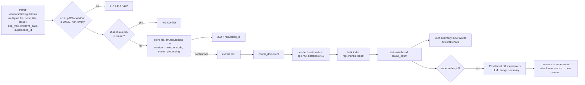
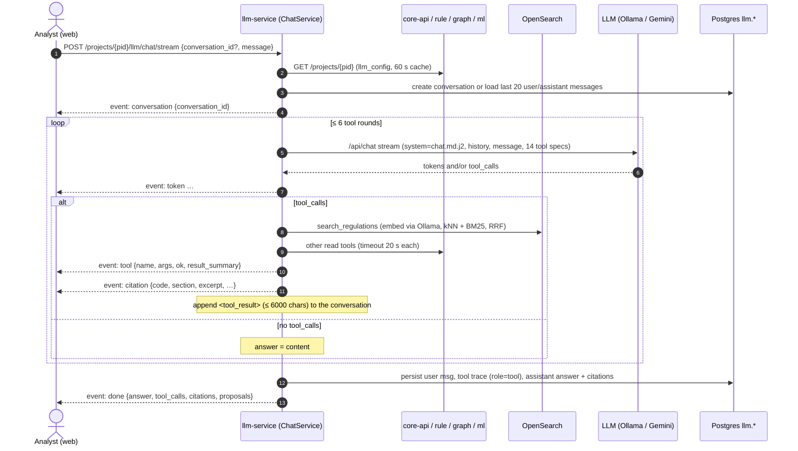
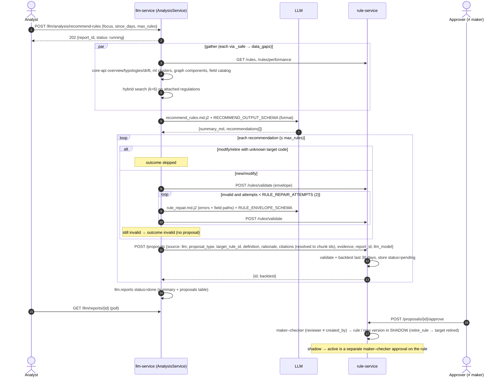

# LLM & Agentic Layer — current implementation (llm-service)

> Document status: verified against commit 07ee765 on 2026-10-13

Scope: what `services/python/llm-service` does **today**. The target multi-agent design is in
[`multi-agent.md`](multi-agent.md); service contracts are in [`api-contract.md`](api-contract.md) §E, tenancy in
[`multi-tenancy.md`](multi-tenancy.md) §4, the rule envelope in [`rule-dsl.md`](rule-dsl.md). Operations
(Ollama host, GPU, Gemini) are in [`../guides/deployment.md`](../guides/deployment.md) §4.

Invariant: **the LLM advises, humans decide.** The only write llm-service performs on another service is
`POST /proposals` on rule-service, which stores a *pending* proposal. Approval is maker–checker in rule-service and
puts the rule into **shadow**; promotion to `active` is a second, separate approval on the rule.

## 1. Components

| Module (`src/llm_service/…`) | Responsibility |
|---|---|
| `clients/ollama.py` | Ollama `/api/chat` (non-stream + NDJSON stream, native tool calling, `format` = JSON schema), `/api/embed` (batched), `/api/tags` ping; strips `<think>` blocks |
| `clients/gemini.py` | `GeminiClient(OllamaClient)`: chat via Gemini's OpenAI-compatible endpoint; converts messages/tool calls Ollama ↔ OpenAI; embeddings stay on Ollama |
| `clients/vector_store.py` | OpenSearch: one index per tenant `reg-chunks-<tenant_id>`, kNN + BM25 queries filtered by `regulation_id` |
| `clients/platform.py` | Calls to core-api, rule-service, graph-service, ml-service (internal token + `X-Tenant-Id`, `X-Project-Id`, `X-Actor`, `X-Request-Id`; timeout = `TOOL_TIMEOUT_S`, connect 3 s) |
| `regulations/` | `extract.py` (PDF/DOCX/TXT/MD), `chunker.py` (BAB › Bagian › Paragraf › Pasal › ayat), `diff.py` (Pasal-level diff), `service.py` (upload → index → summary → diff) |
| `retrieval/` | `search.py` hybrid search, `fusion.py` Reciprocal Rank Fusion |
| `agent/` | `tools.py` (allow-listed tool registry), `loop.py` (bounded tool-calling loop), `chat.py` (conversations + SSE) |
| `analysis/` | `service.py` (4 report pipelines), `schemas.py` (JSON schemas), `structured.py` (schema-constrained call + retry), `proposals.py` (validate → repair → propose) |
| `mapping/suggest.py` | Field-mapping suggestions for ingest-service |
| `project_context.py` | Project + `llm_config` from core-api (60 s TTL cache, degrades to defaults) + attached regulation ids |
| `jobs.py` | In-process background runner (no scheduler, see §9) |
| `prompts/` | Versioned Jinja2 templates (`StrictUndefined`) |
| `repository.py`, `db.py` | Postgres schema `llm.*` via `tenant_session(tenant_id)` → `set_config('app.tenant_id', …)` so RLS applies |

No LangChain or agent framework: the loop, RRF and structured output are ~200 lines of explicit code (README
"Design choices").

## 2. Model providers

| `LLM_PROVIDER` | Chat / tools / structured output | Embeddings | Notes |
|---|---|---|---|
| `ollama` (default) | Ollama `/api/chat`, model `OLLAMA_CHAT_MODEL` or project `llm_config.chat_model` | Ollama `OLLAMA_EMBED_MODEL` (`bge-m3`) | fully local; no data leaves the host |
| `gemini` | `GEMINI_BASE_URL` (OpenAI-compatible) `chat/completions`; `format` → `response_format: json_schema`; tool calls get ids | **still Ollama** (`bge-m3`), so existing indexes stay valid | needs `GEMINI_API_KEY` (startup fails without); a project `chat_model` is honoured only if it starts with `gemini`; prompts, retrieved regulation text and project summaries are sent to Google |

### Configuration (env → `config.py`)

| Env | Code default | Reference deployment (`.env`) | Effect |
|---|---|---|---|
| `OLLAMA_URL` | `http://ollama:11434` | `http://host.docker.internal:11434` (host Ollama, compose profile `local-llm` off) | |
| `OLLAMA_CHAT_MODEL` | `qwen2.5:7b-instruct` | `qwen3:8b` | default chat model |
| `OLLAMA_EMBED_MODEL` | `bge-m3` | `bge-m3` | index dimension is taken from the first embedding |
| `OLLAMA_NUM_CTX` | `8192` | `20480` | `options.num_ctx` on every chat call |
| `OLLAMA_NUM_PREDICT` | `4096` | `4096` | `options.num_predict`; stops runaway (grammar-constrained) generations |
| `OLLAMA_THINK` | unset (`None`) | `false` | `None` → field omitted; `false` → `think:false` **and** `/no_think` appended to the last user turn for `qwen3*` models (older Ollama ignores `think`) |
| `OLLAMA_TIMEOUT_S` | `180` | `900` | HTTP read timeout per LLM call (also used for Gemini); raise on CPU hosts |
| `LLM_PROVIDER`, `GEMINI_API_KEY`, `GEMINI_MODEL`, `GEMINI_BASE_URL` | `ollama`, `""`, `gemini-flash-latest`, Google OpenAI-compat URL | `ollama` | |
| `CHAT_MAX_TOOL_ITERATIONS` | `6` | default | agent loop budget |
| `TOOL_TIMEOUT_S` | `20` | default | per tool call and per platform HTTP call |
| `RULE_REPAIR_ATTEMPTS` | `2` | default | validator-driven repairs per recommended rule |
| `RETRIEVAL_K`, `EMBED_BATCH_SIZE` | `6`, `16` | default | |
| `OPENSEARCH_URL`, `OPENSEARCH_INDEX_PREFIX` | `http://opensearch:9200`, `reg-chunks-` | | |
| `REGULATION_DIR`, `MAX_UPLOAD_MB` | `/regulations`, `50` | | originals stored as `<dir>/<tenant>/<reg_id>/<file>` |

Per project (`core.projects.llm_config`): `chat_model`, `temperature` (default 0.1), `language` (`id` default |
`en`), `system_prompt_extra`.

`<think>…</think>` is always removed from returned content (`strip_thinking`, and `_ThinkFilter` for tags split
across stream chunks).

## 3. Regulation library & RAG

### 3.1 Ingestion



* Uploader: `tenant_admin`, platform admin, internal service, or a user with `analyst`/`approver`/`project_admin` in
  any project of the tenant. `supersedes_id` must point to an `indexed` document (else 409).
* Extraction: `pypdf` (page-number furniture `- 3 -` removed), `python-docx`, UTF-8 text; de-hyphenation and
  whitespace normalisation. Scanned PDFs without text fail (`OCR is on the backlog`).
* Indexing failure → `status=failed` + `error`. Summary and diff are best-effort: failures are logged and never
  un-index the document.
* Statuses: `processing → indexed | failed`, `indexed → superseded`.

### 3.2 Chunking (`regulations/chunker.py`)

Indonesian legal hierarchy is parsed line by line: `BAB <roman>` (+ uppercase title line), `Bagian Ke…`,
`Paragraf n`, `Pasal n[A]`, ayat `(1) …`, `PENJELASAN` (elucidation, keys `Penjelasan Pasal n`), `LAMPIRAN [n]`
with roman subsections; Markdown headings for non-legal documents.

| Parameter | Value |
|---|---|
| Unit | one **Pasal** (article) with section path, e.g. `BAB II PENERAPAN STRATEGI > Pasal 5` |
| `max_chars` | 1800 — longer Pasal are split on ayat boundaries |
| Fallback | word windows of 220 words, 40 overlap (still-too-long pieces, documents without Pasal such as SOPs) |
| Chunk fields | `ordinal`, `section` (display path), `key` (stable diff key: `Pasal 5`, `Penjelasan Pasal 5`, `Pembukaan`, `part-n`), `title`, `text` |
| Chunk id | `<regulation_id>:<ordinal>` |

### 3.3 Index & hybrid search

* Index `reg-chunks-<tenant_id>`: 1 shard, 0 replicas, `knn_vector` (dimension from `bge-m3`, HNSW, `lucene`,
  `cosinesimil` — lucene supports efficient pre-filtering), plus text fields `text`, `section`, `title` and
  metadata (`code`, `version`, `doc_type`, `issuer`, `effective_date`).
* `RegulationSearch.search(tenant, query, regulation_ids, k)`:
  1. returns `[]` if the project has no attached documents or the query is empty;
  2. `candidates = max(3k, 10)`;
  3. kNN on the query embedding **and** BM25 `multi_match` over `text`, `section^2`, `title`, both filtered to the
     project's attached `regulation_id`s;
  4. **Reciprocal Rank Fusion** (`k=60`): `score(d) = Σ 1/(60 + rank_i(d))`, top `k`.
* Citation object: `{regulation_id, chunk_id, code, version, section, excerpt (400 chars), score}`; documents go to
  prompts as `<document code=… section=…>` blocks.
* Project attachment: `PUT /projects/{pid}/llm/regulations` (project_admin). Ids are checked against the tenant
  under RLS (FKs bypass RLS, so foreign ids are rejected explicitly with 422).

### 3.4 Regulation diff (`regulations/diff.py`)

New version uploaded with `supersedes_id` → both texts are re-chunked, `section_texts()` maps `key → text`, and
`diff_sections` emits `added | removed | modified` per Pasal. Whitespace/case-only edits are ignored; `modified` needs
`difflib` ratio < 0.985. Order: Pasal number, elucidation last. Snippets are capped at 2000 chars. Stored in
`llm.regulation_changes(changed_sections, diff_summary)`; the LLM summary (≤300 words, cites `[KODE §Pasal N]`)
gets the first 40 changes. No changes → fixed text "No substantive article-level changes" (ID/EN).

## 4. The agent: single tool-calling loop (`agent/loop.py`)

```
messages ─▶ model ─▶ tool_calls? ─yes─▶ run allow-listed tools (timeout each) ─▶ append <tool_result> ─┐
               ▲                                                                                       │
               └─────────────────────────── until no tool_calls or max iterations ◀────────────────────┘
```

* Up to `CHAT_MAX_TOOL_ITERATIONS` (6) tool rounds. On round 7 the loop appends *"Tool budget exhausted. Answer
  the analyst now…"* and calls the model **without tools**, forcing a final answer.
* Several tool calls in one turn are executed sequentially. Each runs under `asyncio.wait_for(TOOL_TIMEOUT_S)`.
* Errors never raise into the loop; they return to the model as data: unknown tool (with the allow-list), timeout,
  bad arguments (`KeyError/TypeError/ValueError`), other failures (message truncated to 300 chars). Metric
  `llm_tool_calls_total{tool,outcome=ok|unknown|timeout|bad_args|error}`.
* Arguments may arrive as a dict or a JSON string; unparsable → `{}`. Optional integers from small models (0, null,
  strings) fall back to defaults and are clamped (`_int_arg`).
* Events: `token` (stream only), `tool {name, args, ok, result_summary(300 chars)}`, `done {answer, tool_calls,
  citations, proposals}`. The same generator serves the JSON and SSE endpoints.
* Temperature: project `llm_config.temperature` (default 0.1).

### 4.1 Tool allow-list (`agent/tools.py`) — 14 tools, 1 write

| # | Tool | Purpose | Backing call | R/W |
|---|---|---|---|---|
| 1 | `search_regulations` | Hybrid search over the project's attached regulations; adds hits to the citation list. `k` clamped to 4–10 (floor of 4 because small models ask for 1 and fill gaps from memory) | OpenSearch | R |
| 2 | `list_rules` | Rules of the project, filters `status, kind, typology, q` (page_size 200) | rule-service `GET /rules` | R |
| 3 | `get_rule` | One rule with its versions | rule-service `GET /rules/{id}` | R |
| 4 | `get_rules_performance` | Per-rule evaluated/matched/trapped counts, hit rate, precision (`since_days` 1–365, default 30) | rule-service `GET /rules/performance` | R |
| 5 | `validate_rule_definition` | Validate a rule envelope | rule-service `POST /rules/validate` | R (no persistence) |
| 6 | `backtest_rule_definition` | Backtest an unsaved envelope on recent data (`since_days`, default 30) | rule-service `POST /rules/backtest` | R (compute only) |
| 7 | `get_analytics_overview` | Volumes, decision mix, daily trend, score histogram, open cases (default 7 days) | core-api `GET /analytics/overview` | R |
| 8 | `get_feature_drift` | PSI per feature, recent 7 d vs previous 30 d | core-api `GET /analytics/drift` | R |
| 9 | `get_typology_stats` | Labelled fraud counts/amounts per typology and week | core-api `GET /analytics/typologies` | R |
| 10 | `get_anomaly_clusters` | Clusters of the active unsupervised model (size, fraud rate, profile) | ml-service `GET /ml/unsupervised/clusters` (404 tolerated) | R |
| 11 | `get_graph_components` | Connected customer components (shared device/phone/card/address) with fraud counts | graph-service `GET /graph/components` | R |
| 12 | `get_graph_communities` | Louvain communities with fraud rate | ml-service `GET /ml/graph-communities` (404 tolerated) | R |
| 13 | `get_project_context` | Project details, ML/graph config, attached regulation ids, ≤300 field-catalog paths | cached project + core-api field catalog | R |
| 14 | `create_rule_proposal` | Create a **pending** proposal (`new_rule | modify_rule | retire_rule`) through the proposal pipeline (§6). Only when the analyst explicitly asks | rule-service `POST /proposals` | **W** (`writes=True`) |

`test_only_one_write_tool_in_allow_list` guards the single write tool.

### 4.2 Prompt-injection defences

* Instruction hierarchy in `system_base.md.j2`: system > analyst > tool results/documents, which are **data**.
* Every tool result is wrapped as `<tool_result name="…">JSON</tool_result>` and truncated to 6000 chars
  (`… [truncated]`); documents go in `<document>` blocks; mapping sample values are declared as data.
* Allow-list dispatch only (`TOOLS.get(name)`); the model cannot reach arbitrary URLs.
* Hard limits in the system prompt: never claim activation, never invent numbers/articles/rule codes, cite as
  `[KODE §Pasal]`, never reconstruct masked PII.
* Tool calls run with the caller's tenant/project/actor headers, so platform RBAC and RLS still apply.

### 4.3 Chat with tool calls



### 4.4 Conversation persistence

* `llm.conversations(tenant_id, project_id, user_id, title = first 80 chars of the first message)`.
* `llm.messages(role ∈ system|user|assistant|tool, content, tool_calls jsonb, citations jsonb)`. Per turn: the
  user message, one `tool` row with the tool-name list and the full trace (if any tool ran), and the assistant
  answer with citations. Persisted after the loop finishes.
* History replayed to the model: last 20 `user`/`assistant` messages (tool rows are not replayed).
* Conversations are private to their creator: another user's conversation id returns 404. Listing is filtered by
  project and actor.

## 5. Analysis pipelines (`analysis/service.py`)

Analyses are **not** agentic: each is a fixed pipeline — gather data defensively → one schema-constrained LLM call →
optional proposals → `llm.reports`. Endpoints return `202 {report_id, status:"running"}`; the job runs in the
`JobRunner`; status `running → done | failed` (error stored).

| Report (`report_type`) | Body (defaults) | Data gathered | Retrieval query | Output schema (required) | Proposals |
|---|---|---|---|---|---|
| `rule_relevance` | `rule_ids?`, `since_days` 30, `create_proposals` true | rules (slimmed), rules performance, feature drift | "kewajiban pemantauan transaksi deteksi fraud" + names of 15 rules, k=8 | `summary_md`, `verdicts[{rule_code, verdict: keep/tune/retire, rationale, suggested_change?, citations?}]`, `key_risks?[]` | one `retire_rule` per `retire` verdict (≤10) |
| `fraud_situation` | `since_days` 7 | overview, typologies, anomaly clusters (top 12 by fraud rate, top-3 features), graph components (top 15), communities (30), drift | — | `summary_md`, `key_risks[{title, severity: low…critical, evidence, recommended_action?}]`, `typology_trends?[{typology, trend: rising/stable/falling/unknown, note?}]` | none |
| `regulation_impact` | `regulation_id` (required, 404 if unknown), `max_rules` 5 (0–20) | latest `regulation_changes` (≤30 sections), rules, field catalog | text of ≤8 changed sections (or title + "kewajiban fraud"); k=8 in this regulation + k=4 in other attached docs | `summary_md`, `obligations[{article, obligation, coverage: covered/partially_covered/gap/conflict, rule_codes?}]`, `recommendations[]` | ≤ `max_rules` |
| `recommend_rules` | `focus?` (≤60 chars), `since_days` 30, `max_rules` 5 (1–20) | rules, performance, overview, typologies, clusters (slim), drift, components (slim), field catalog | "`<focus or fraud>` kewajiban pencegahan deteksi transaksi mencurigakan", k=6 | `summary_md`, `recommendations[]` | ≤ `max_rules` |

`recommendations[]` item: `{proposal_type: new_rule|modify_rule|retire_rule, target_rule_code?, rationale, evidence
(open object), citations[{code, section, excerpt?}], rule: <envelope>|null}`. The envelope schema requires
`code (^[A-Z0-9-]{3,40}$), name, description, kind, typologies, event_types, risk_score, action, definition`;
`definition` is deliberately shallow (`kind` + `additionalProperties: true`) — the rule-service validator is
authoritative.

**Structured output** (`analysis/structured.py`): the schema goes to Ollama `format` (Gemini: `response_format:
json_schema`), the reply is parsed (code fences tolerated) and re-validated with `jsonschema`; on failure the error
is fed back once (`retries=1`), then `StructuredOutputError` fails the report. Schema hardening (commits
`544c633`, `62ccb8a`): open objects declare `additionalProperties: true` (otherwise the grammar admitted only listed
keys and no rule could pass validation); every free-text string gets `maxLength` (`summary_md` 6000, other fields
1500, array items 300) so grammar-constrained decoding must close strings.

**Prompt budget**: clusters/components are slimmed (`_slim_clusters`, `_slim_components`, `_slim_rule`) — raw
payloads were ~47k tokens. `_llm` logs `analysis_prompt approx_tokens = len(prompt)/3` and warns
`analysis_prompt_exceeds_context` when above `num_ctx − 1024`. Ollama truncates over-long prompts **from the
start** (the instructions), so `num_ctx` must cover ~15–16k tokens for analyses.

**Degraded mode**: every source is fetched through `_safe(name, …)`; a failing service is appended to
`structured.data_gaps` and a default (`[]`/`{}`) is used. Retrieval failures yield no documents. core-api down →
project context falls back to `{id, name=id, stage:"custom"}`. The report still completes
(`test_fraud_situation_report_degrades_when_sources_down`, `test_recommend_rules_degrades_and_creates_proposals`).

`structured` also stores `proposals[]` outcomes, `citations`, `prompt` (`<name>@<version>`), `since_days`/`focus`,
`generated_at`. `content_md` = `summary_md` + a proposals table (ID/EN headings). Report titles are Indonesian
(e.g. "Rekomendasi rule — 2026-10-13 08:00 UTC").

Metrics: `llm_reports_total{report_type,outcome}`, `llm_ollama_calls_total{kind="structured",outcome}`.

## 6. Proposal flow



Outcome statuses (`ProposalOutcome`): `created | invalid | failed | skipped`, with `repair_attempts`, `validation`,
`backtest`. Metric `llm_proposals_total{outcome}`. `resolve_citations` attaches `regulation_id`, `chunk_id`,
`version` when an LLM citation matches a retrieved chunk by `code` and overlapping `section`; unmatched citations are
kept as given. The chat tool `create_rule_proposal` uses the same pipeline with `report_id = null`.
`rules.proposals` also allows `tune_threshold` and `source = analyst`, which llm-service does not emit.
rule-service stores invalid proposals too, but llm-service only posts envelopes that already passed validation.

## 7. Mapping suggestions (internal)

`POST /v1/mapping/suggest` (internal token only), called by ingest-service: `{fields[≤500]: {path, inferred_type,
sample_values}, canonical_fields[≤200]}` → `mapping_suggest.md.j2` (EN/ID field-name hints) + `MAPPING_OUTPUT_SCHEMA`,
temperature 0. `sanitize` drops hallucinated source paths, nulls unknown targets, clamps confidence to 0–1 and keeps
one source per canonical target (highest confidence), except multi-use `instrument_fingerprint`, `card_bin`,
`card_last4`.

## 8. API endpoints

| Method | Path | Role | Notes |
|---|---|---|---|
| GET | `/api/v1/tenants/{tid}/regulations` | tenant member | paged, filters `status`, `q` |
| POST | `/api/v1/tenants/{tid}/regulations` | tenant_admin / analyst+ in any project | multipart; 202 `{regulation_id, status:"processing", version}`; 409 duplicate sha256 |
| GET | `/api/v1/tenants/{tid}/regulations/{id}` | tenant member | |
| DELETE | `/api/v1/tenants/{tid}/regulations/{id}` | tenant_admin | 204; also removes the chunks from OpenSearch |
| GET | `/api/v1/projects/{pid}/llm/regulations` | viewer | attached documents |
| PUT | `/api/v1/projects/{pid}/llm/regulations` | project_admin | `{regulation_ids}` |
| POST | `/api/v1/projects/{pid}/llm/regulations/search` | viewer | `{query (≤2000), k (1–20, default 6)}` → citations with full chunk text |
| POST | `/api/v1/projects/{pid}/llm/chat` | viewer | `{conversation_id?, message (≤8000 chars)}` → `{conversation_id, answer, tool_calls, citations, proposals}` |
| POST | `/api/v1/projects/{pid}/llm/chat/stream` | viewer | SSE events `conversation`, `token`, `tool`, `citation`, `done` |
| GET | `/api/v1/projects/{pid}/llm/conversations[/{id}]` | viewer (own conversations) | |
| POST | `/api/v1/projects/{pid}/llm/analysis/{rule-relevance,fraud-situation,regulation-impact,recommend-rules}` | analyst | 202 `{report_id, status}` |
| GET | `/api/v1/projects/{pid}/llm/reports[?report_type]`, `…/reports/{id}` | viewer | |
| POST | `/v1/mapping/suggest` | internal token | |
| GET | `/health/live`, `/health/ready`, `/metrics`, `/openapi.json`, `/docs` | — | ready = db + Ollama `/api/tags` + OpenSearch; 503 `degraded` otherwise, reports `jobs_running` |

Errors are `application/problem+json` (`errors.py`).

Note: chat only requires `viewer`, and the `create_rule_proposal` tool reaches rule-service with the internal token
and the user as `X-Actor`. A viewer can therefore create a *pending* proposal through chat (approval still needs an
approver ≠ author). Whether chat should require `analyst` is an open question.

## 9. Background jobs (`jobs.py`)

There is **no scheduler** in llm-service: nothing runs periodically. `JobRunner` is an in-process
`asyncio` runner with `Semaphore(2)` used for (a) regulation indexing (`index-regulation-<id>`) and (b) analysis
reports (`report-<id>`). Failures are logged (`job_failed`) and recorded on the row by the job itself. On shutdown
it waits 10 s, then cancels. Not durable: after a restart, rows left in `running`/`processing` stay so until
re-triggered (backlog: durable queue).

Periodic LLM activity in the demo comes from outside: `deploy/demo/activity.py` (`llm_reports`) triggers
`fraud-situation` then `recommend-rules` **sequentially** (two concurrent generations on a CPU host both hit the
timeout), polls every 20 s, then has the approver approve the first valid pending proposal into shadow.

## 10. Prompts & languages

| Template | Version | Used by | Output language |
|---|---|---|---|
| `system_base.md.j2` | 1 | included by chat and the 4 analyses | `llm_config.language` (`id` default → Bahasa Indonesia, else English); technical terms stay English |
| `chat.md.j2` | 1 | chat (+ `rule_dsl_reference.md`) | as above |
| `rule_relevance`, `fraud_situation`, `regulation_impact`, `recommend_rules` `.md.j2` | 1 | analyses | as above; recommended codes prefixed `RL-LLM-` |
| `rule_repair.md.j2` | 1 | proposal pipeline | JSON only |
| `regulation_summary.md.j2`, `regulation_change_summary.md.j2` | 1 | regulation indexing | `language` argument, currently always `id` (job default) |
| `mapping_suggest.md.j2` | 1 | mapping | JSON only |
| `rule_dsl_reference.md` | — | condensed DSL incl. two validator-approved example rules | — |

Templates are written in English; retrieval queries and report titles are Indonesian because the regulation corpus
is (e.g. POJK anti-fraud, `data_regulations/pojkatifraud.pdf`). Reports record `prompt = <name>@<version>`.

## 11. Tests

`uv run pytest` (unit, no infrastructure; `-m integration` excluded by default) — 53 tests:

| File | Covers |
|---|---|
| `test_agent_loop.py` (8) | tool call → answer, unknown tool / bad args returned not raised, iteration budget forces a tool-less final answer, streaming events, string/dict args, int-arg clamping, regulation search floor, **single write tool** |
| `test_proposals.py` (5) | invalid → repaired → proposed; still invalid after repairs → not proposed; retire skips validation; citation resolution; recommend-rules degrades and creates proposals |
| `test_schemas.py` (2), `test_prompt_slimming.py` (2) | `additionalProperties: true` on open objects, bounded strings; cluster/component slimming |
| `test_ollama_client.py` (6), `test_gemini_client.py` (7) | `<think>` stripping (incl. split tags), `think` flag and `/no_think` for qwen3; Gemini message/tool-call conversion, schema → `response_format`, streaming, errors, embeddings stay on Ollama |
| `test_chunker.py` (5), `test_diff_and_fusion.py` (3) | BAB/Pasal units, ayat split, heading fallback, real POJK PDF; diff semantics and ordering; RRF |
| `test_api.py` (7), `test_auth.py` (5) | health/metrics, problem+json, role enforcement, upload validation, internal-only mapping, SSE format; JWT roles, tenant isolation, internal token |
| `test_integration.py` (3, `-m integration`) | real Postgres (migrations + RLS roles) and OpenSearch with a faked model: regulation lifecycle/supersede/isolation, chat persistence with citations, degraded fraud-situation report |

The LLM is never called in tests (scripted fake model in `tests/fakes.py`, `respx` for HTTP). Answer quality is not
covered by automated evaluation.

## 12. Agentic vs multi-agent: current status

| Aspect | Today (07ee765) |
|---|---|
| Agents | **One** agent: the chat loop in `agent/loop.py`, one system prompt, one model, 14 tools |
| Planning | implicit (model decides tool calls turn by turn); no planner, no explicit plan state |
| Analyses | fixed pipelines with a single structured LLM call (+ repair calls), **not** agents |
| Memory | per-conversation history (last 20 messages); no long-term/cross-conversation memory |
| Autonomy | none: no scheduler, no event triggers; every run starts from a user request (or the demo script) |
| Writes | one tool, pending proposals only; activation always human (maker–checker, shadow first) |
| Evaluation | unit/integration tests of mechanics; no answer-quality benchmark |

The multi-agent design (specialised agents, orchestration, triggers, evaluation) is described in
[`multi-agent.md`](multi-agent.md). It builds on the pieces above (tool registry, proposal pipeline, RAG) and keeps
the same invariant: agents propose, humans approve.

## 13. Running with local Ollama on an 8 GB GPU vs CPU

Observed on the reference host (nvda11-gpu, RTX 3060 Ti 8 GB; deployment guide §4, commits `544c633`, `62ccb8a`,
`07ee765`, `366db83`, `9ad7326`):

| | 8 GB GPU | CPU only |
|---|---|---|
| Model | `qwen3:8b` (or `qwen2.5:7b-instruct`) + `bge-m3` | same models work; consider a smaller model or `LLM_PROVIDER=gemini` |
| Ollama server | `OLLAMA_FLASH_ATTENTION=1`, `OLLAMA_KV_CACHE_TYPE=q8_0` (systemd override) | defaults |
| `OLLAMA_NUM_CTX` | **20480**: qwen3:8b + 20k = 8.0 GB, 100 % GPU; 24k already spills layers to CPU | ≥ 16k still needed for analyses (they send ~15k tokens), at the cost of speed |
| `OLLAMA_NUM_PREDICT` | 4096 | 4096 |
| `OLLAMA_THINK` | `false` (qwen3 reasoning is slow and not needed; `/no_think` is added automatically) | `false` — on CPU reasoning tokens alone can exceed the timeout |
| `OLLAMA_TIMEOUT_S` | 180 is usually enough | raise to ~900 |
| Latency | interactive (no benchmark recorded in the repo) | chat 1–3 min per answer (deployment guide); analysis reports take minutes and need the raised timeout |
| Concurrency | `JobRunner` allows 2 parallel jobs | run reports one at a time (the demo script does) |

Checks: `ollama ps` (PROCESSOR should be ≥ 90 % GPU); llm-service log `analysis_prompt approx_tokens` vs `num_ctx`;
Ollama log `truncating input prompt` means the instructions were cut — raise `OLLAMA_NUM_CTX`. If `nvidia-smi` fails
after a kernel upgrade, rebuild the DKMS module and restart Ollama. Known quality limits of 7–8B models: they ignore
instructions, invent article numbers (seen with qwen3:8b), and produce envelopes that need the repair loop; the
validator, the citation resolution and maker–checker are what keep this safe.

The compose stack can run Ollama itself (profile `local-llm`, image `ollama/ollama:0.12.3`, `ollama-pull` pulls the
chat and embed models; GPU via `docker-compose.gpu.yml`), or point `OLLAMA_URL` at an existing server
(`host.docker.internal` requires Ollama listening on `0.0.0.0`). Embeddings always need Ollama with `bge-m3`, even
with Gemini.

## 14. Known limitations

* Non-durable jobs (restart leaves `running` reports / `processing` documents).
* Regulation summaries and change summaries use the provider default model and Indonesian, not the project's
  `llm_config`.
* No OCR for scanned PDFs.
* Context budget is estimated (chars/3), not tokenised; prompts above `num_ctx` are only logged.
* Single agent, no answer-quality evaluation (see §12).
