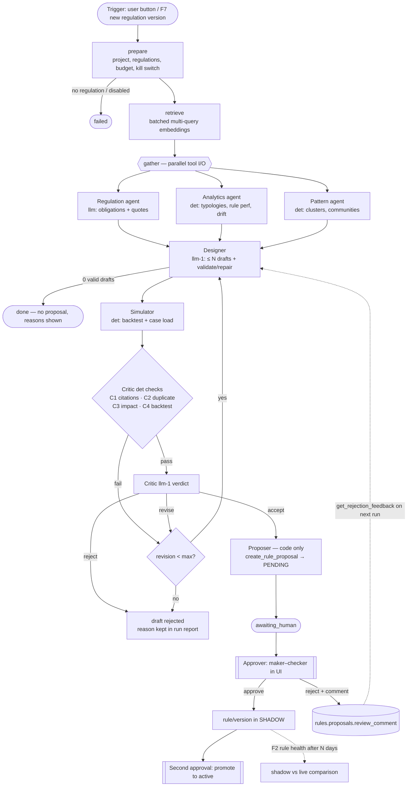
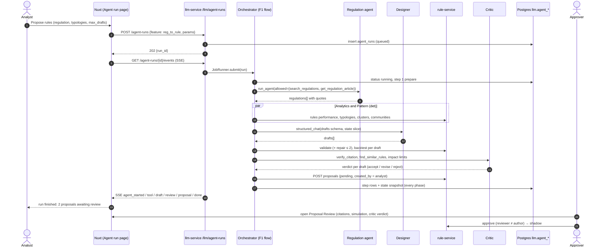

# Multi-agent layer: design

Status: **design only, not implemented**. Last checked against the code on 2026-10-13 (`revamp/rust-nuxt-stack` @ `07ee765`).
Related documents: [`ux-design.md`](ux-design.md) (screens and user flows), [`test-data.md`](test-data.md) (datasets,
golden sets and scenarios), [`architecture.md`](architecture.md), [`rule-dsl.md`](rule-dsl.md),
[`api-contract.md`](api-contract.md), [`evaluation.md`](evaluation.md).

## 0. Summary

Today v2 runs **one tool-calling agent** (`llm_service/agent/loop.py`, 20 tools, `max_iterations` bound) plus
**fixed structured pipelines** (`analysis/service.py`). It is agentic, but it is not a multi-agent system. No agent
has a role of its own, nothing coordinates handoffs, and nothing independently checks the agent's citations or arguments.

This design adds a **multi-agent layer** inside `llm-service`:

* **Role agents.** Each agent has its own prompt, model and least-privilege tool subset. Every agent reuses
  `run_agent`; no new framework is added.
* **An explicit, deterministic orchestrator.** It is a Python state machine with one flow per feature (F1, F2, F3, F5).
* **A shared run state.** It is persisted per step in `llm.agent_runs` / `llm.agent_steps`, so every run can be replayed and audited.
* **A Critic.** It combines deterministic checks (`verify_citation`, duplicate/conflict detection, impact limits) with an
  LLM review.
* **Unchanged governance.** The only write is still a *pending* rule proposal. A human approves it under maker–checker,
  approval puts the rule into shadow, and a second approval promotes it. **No LLM holds the write tool in a flow.** The
  Proposer is plain code.

Demo LLM: **local Ollama `qwen3:8b`, 20k context, 8 GB GPU** (after the driver fix). Gemini is an optional
per-agent override later.

## 1. Goals and non-goals

| Goals | Non-goals |
|---|---|
| G-1 Rule proposals that are cited, valid, backtested and **critiqued** before an approver sees them (F1) | Autonomous activation of rules, thresholds or models: never |
| G-2 Measurably fewer hallucinated regulation articles (`verify_citation`) | Replacing analysts' decisions on cases (F3 drafts a narrative; it never labels a case) |
| G-3 Small contexts per agent so qwen3:8b at 20k tokens stays reliable | A general agent framework (LangChain/LangGraph/CrewAI); see §2 |
| G-4 Every step observable: agent, tool calls, tokens, latency, verdicts | Multi-tenant LLM fine-tuning |
| G-5 An evaluation harness for the ablation B0–M3 (paper #2) | Real-time (in the scoring path) use of LLMs: agents work offline/asynchronously |
| G-6 Graceful degradation: a failed data source or LLM call ends the run with an explicit status | Durable distributed job queue (stays in-process for the MVP, see §11) |

## 2. Design principles

1. **No framework.** Each flow is an explicit `async` state machine. Each agent is `run_agent(...)` with its own system
   prompt, `allowed_tools` and model. LangGraph would only be considered if complex interrupt/checkpoint semantics
   become necessary. Persisted state already gives replay.
2. **Deterministic first, LLM second.** Validation (rule-service), backtests, threshold sweeps, citation checks,
   duplicate detection and case-load estimates are code. The LLM drafts, explains and critiques.
3. **One agent, one role, minimal tools.** The tool allow-list is enforced in `_execute`, not only in the prompt.
4. **The LLM never activates anything.** The Proposer is not an LLM. It calls the existing `ProposalPipeline.propose`
   (validate → repair ≤ 2 → `POST /proposals`, which backtests) with the run initiator as `created_by`.
   Rule-service rejects self-review (`proposal::review`: "the reviewer must differ from the proposal author").
5. **Data, not instructions.** Tool output and regulation text stay wrapped in `<tool_result>` (`wrap_result`, 6 000
   chars max). Agents receive *slices* of the state, never another agent's transcript.
6. **Explicit budgets.** Every run has limits on steps, LLM calls, tokens, wall-clock time and revisions, and always ends
   in a terminal status.

## 3. Agent roster and tools

### 3.1 Existing tools (verified in `agent/tools.py`)

All 20 tools are read-only except `create_rule_proposal` (`writes=True`).

| Group | Tool | Backend call (`clients/platform.py` / search) |
|---|---|---|
| Regulation | `search_regulations` | `RegulationSearch.search` (BM25 + kNN, RRF; k clamped to 4–10) |
| Rules | `list_rules`, `get_rule`, `get_rules_performance`, `validate_rule_definition`, `backtest_rule_definition` | rule-service |
| Analytics | `get_analytics_overview`, `get_feature_drift`, `get_typology_stats` | core-api / ml-service |
| Unsupervised | `get_anomaly_clusters` | ml-service |
| Graph | `get_graph_components`, `get_graph_communities` | graph-service |
| Context | `get_project_context` | project + field catalogue |
| Write | `create_rule_proposal` | `ProposalPipeline.propose` → rule-service |

### 3.2 New tools

Most new tools are thin wrappers over endpoints that already exist (see `api-contract.md`).

| Tool | Kind | Backend | Exists? |
|---|---|---|---|
| `get_regulation_article` | read | OpenSearch: chunks by `regulation_id` + diff key `Pasal n` (chunker `Chunk.key`) | new query on the existing index |
| `verify_citation` | **deterministic check**, no LLM | `{regulation_id, section/article, quote}` → article exists in the attached regulation version, and the quote matches its chunk text (normalised; token-set ratio ≥ 0.9 or exact substring) | new (`multi_agent/critic.py`) |
| `find_similar_rules` | deterministic | `list_rules` + compare `(event_types, field paths, operator, window, value ± 10 %)` | new (code only) |
| `simulate_ruleset_change` | read | `POST /rulesets/{id}/backtest` (exists; adds score histogram + decision distribution) | wrapper |
| `sweep_thresholds` | deterministic | decisions ⨝ labels → recall/precision/FPR/cases-per-day per threshold, bootstrap CI | **new core-api endpoint** `POST /api/v1/projects/{pid}/analytics/threshold-sweep` (logic exists offline in `tools/research_export` operating points) |
| `estimate_case_load` | deterministic | backtest `matched` / window days × share not already flagged | new (code only) |
| `get_case` | read | `GET /api/v1/projects/{pid}/cases/{id}` | wrapper |
| `get_event_decision` | read | `GET /api/v1/projects/{pid}/decisions/{event_id}` | wrapper |
| `get_customer_history` | read | `GET /api/v1/projects/{pid}/customers/{id}/events` (masked fields only) | wrapper |
| `dry_run_score` | read | `POST /api/v1/projects/{pid}/score/simulate` (`persisted:false`) | wrapper (F6) |
| `generate_synthetic_events` | experiment only | `tools/simulator` scenarios as a library, **only in tenants flagged `experiment`** | new (F6, backlog) |
| `get_rejection_feedback` | read | `GET /proposals?status=rejected` → `review_comment` of the last N proposals | wrapper |

### 3.3 Agents

`mode`: **llm** means a `run_agent` loop with tools. **det** means a fixed tool plan in code with no LLM call. **llm-1**
means a single `structured_chat` call (JSON schema, no tools).

| Agent | Role | Mode (MVP) | Allowed tools | Writes to state |
|---|---|---|---|---|
| **Orchestrator** | Runs the flow and stops it on budget, cancel or failure | det (F1–F5); llm-1 router only in F8 | none | `plan`, `status`, `budget` |
| **Regulation** | Finds obligations (detect, prevent, monitor, report) with exact article references | llm (≤ 4 iterations) | `search_regulations`, `get_regulation_article` | `regulations[]` |
| **Analytics** | Typology mix, rule performance, drift, alert volume | det (slimmed payloads, like `_slim_*` in `analysis/service.py`) | `get_analytics_overview`, `get_typology_stats`, `get_rules_performance`, `get_feature_drift`, `list_rules` | `findings[]` |
| **Pattern** | Clusters/communities with high fraud rate and low rule coverage | det | `get_anomaly_clusters`, `get_graph_components`, `get_graph_communities` | `patterns[]` |
| **Designer** | Drafts ≤ N rule envelopes, each with rationale, citations and typology | llm-1 (+ validate loop) | `get_project_context`, `list_rules`, `validate_rule_definition`, `get_rejection_feedback` | `drafts[]` |
| **Simulator** | Backtest + impact | det | `backtest_rule_definition`, `simulate_ruleset_change`, `estimate_case_load`, `sweep_thresholds` | `simulations{}` |
| **Critic** | Independent review: citations verified, no duplicates or conflicts, impact within limits, rationale consistent with evidence | det checks **then** llm-1 verdict | `verify_citation`, `get_regulation_article`, `find_similar_rules`, `get_rule`, `list_rules` | `reviews{}` |
| **Proposer** | Turns accepted drafts into pending proposals | **det (no LLM)** | `create_rule_proposal` (only agent with a write tool) | `proposals[]` |
| **Investigator** (F3) | Explains one case: signals per engine, related entities, history | llm | `get_case`, `get_event_decision`, `get_customer_history`, `get_graph_components` | `case_facts` |
| **Reporter** (F3, F9) | Narrative and report drafts in id/en | llm-1 | none (reads state only) | `narrative` |
| **Red-team** (F6, research) | Simulator parameters for evasive synthetic events | llm | `generate_synthetic_events`, `dry_run_score` | `attacks[]` |

Rules that keep the roster safe:

* The **Critic** never sees the Designer's prompt or reasoning. It sees only the draft, simulation and citations.
* For the M3-x ablation, the Critic runs on a different model. On one 8 GB GPU that forces a model swap, so the demo
  uses the same model for both (see §8).
* The single chat agent (`/llm/chat`) stays unchanged until F8. It keeps all 20 tools.

## 4. Shared run state

```python
class Citation(TypedDict):          # same keys as RetrievedChunk.citation() + verification
    regulation_id: str; chunk_id: str; code: str; version: int; section: str
    excerpt: str; score: float
    quote: str                      # exact text the agent relies on
    verified: bool | None           # set by verify_citation
    verify_detail: str | None       # "article_not_found" | "quote_mismatch" | "ok"

class RuleDraft(TypedDict):
    draft_id: str; revision: int
    proposal_type: Literal["new_rule", "modify_rule", "retire_rule", "tune_threshold"]
    target_rule_code: str | None
    rule: dict                       # rule envelope (rule-dsl.md §2)
    rationale: str; typology: str
    citations: list[Citation]
    validation: dict | None          # rule-service validator output

class AgentRunState(TypedDict):
    run_id: str; tenant_id: str; project_id: str; created_by: str
    feature: Literal["reg_to_rule", "rule_health", "investigate", "threshold", "pattern_to_rule",
                     "red_team", "reg_change", "chat", "compliance_gap"]
    goal: str; params: dict          # e.g. {regulation_ids, typologies, max_drafts, since_days, case_id}
    plan: list[str]                  # ordered phase names (deterministic per feature)
    phase: str                       # current phase
    regulations: list[Citation]
    findings: list[dict]             # {kind, metric, value, window, evidence_ref}
    patterns: list[dict]             # {source: cluster|community|component, id, size, fraud_rate, rule_coverage}
    drafts: list[RuleDraft]
    simulations: dict[str, dict]     # draft_id → {matched, precision, recall, fpr, hits_per_day, case_load}
    reviews: dict[str, dict]         # draft_id → {verdict: accept|revise|reject, checks[], issues[], llm_notes}
    proposals: list[dict]            # ProposalOutcome.as_dict() (status created|invalid|failed|skipped)
    narrative: dict | None           # F3 output
    budget: dict                     # {limits{}, used{steps, llm_calls, prompt_tokens, completion_tokens, seconds}}
    gaps: list[str]                  # data sources that failed (same idea as structured.data_gaps)
    status: Literal["queued", "running", "awaiting_human", "done", "failed",
                    "budget_exhausted", "cancelled"]
    error: str | None
```

* The state is snapshotted to `llm.agent_runs.state` after every phase. Every LLM call or tool call appends one row to
  `llm.agent_steps`. Replay means re-running agents from the stored inputs of a step. The model digest is
  stored per step so drift in local models is visible.
* **Context slicing.** Each agent gets a rendered view. The Designer gets the top 8 findings, the top 6 patterns, the
  verified-candidate citations (quote ≤ 400 chars each), `field_catalog_paths` (≤ 300) and the last 5 rejection
  comments. The Critic gets one draft, its simulation, its citations and the similar rules found. The target is **≤ 12k
  prompt tokens** per call, which leaves room for the output within 20k.

## 5. Orchestration

### 5.1 F1 Regulation-to-Rule (detailed)

**Trigger.** On *Proposals* or *Agent runs*, the user clicks "Propose rules from regulation" and picks the attached
regulation(s), optional typologies and `max_drafts` (default 3, max 5). Later, F7 triggers it when a new version is uploaded.
**Role.** `analyst` or higher. (The chat endpoint today is `viewer`; agent runs that create proposals require `analyst`.)

Phases:

| # | Phase | Agent | Details | Fails → |
|---|---|---|---|---|
| 0 | `prepare` | Orchestrator | Load project (`ProjectContextLoader`), attached regulations, budget limits, kill switch `agents_enabled` | `failed` if no regulation attached or switch is off |
| 1 | `retrieve` | Regulation (det part) | Fixed multi-query retrieval: one query per obligation family (monitoring, verification, reporting, typology keywords) **embedded in one batch** before any chat call (see §8 model swap) | `gaps += regulations`, continue with an empty list only if typologies were given; otherwise `failed` |
| 2 | `gather` | Regulation (llm) ∥ Analytics (det) ∥ Pattern (det) | Tool I/O in parallel (`asyncio.gather`); LLM calls are serialised by an `asyncio.Semaphore(1)` per Ollama endpoint | each failure → `gaps[]` |
| 3 | `design` | Designer (llm-1) | Produces `drafts[]` (≤ `max_drafts`) under `RULE_ENVELOPE_SCHEMA`, then `validate_and_repair` (≤ 2 repairs, existing) | 0 valid drafts → `done` with `proposals=[]` and the reason |
| 4 | `simulate` | Simulator (det) | `backtest_rule_definition` (since_days 30, configurable 30–60) + `estimate_case_load` per draft | draft marked `simulation_failed`, Critic must `reject` |
| 5 | `critique` | Critic (det → llm-1) | Det checks: C1 every citation passes `verify_citation`; C2 no duplicate of an active rule; C3 `case_load ≤ limit` and `fpr ≤ target`; C4 backtest present. LLM verdict only on drafts that pass C1–C4 | `revise` → phase 3 for that draft (`revision < max_revisions`) else `reject` |
| 6 | `propose` | Proposer (det) | `ProposalPipeline.propose` with `evidence = {agent_run_id, simulation, review}` and verified citations | outcome per draft recorded (`created/invalid/failed`) |
| 7 | `finish` | Orchestrator | `awaiting_human` if ≥ 1 proposal created, else `done`; emits summary | — |





F1 acceptance criteria (from spec F1, made testable):

| # | Criterion | How measured |
|---|---|---|
| A1 | 100 % of created proposals carry ≥ 1 citation with `verified=true` | SQL over `rules.proposals.citations` for proposals with `evidence.agent_run_id` |
| A2 | 100 % pass `validate_rule_definition` and have a backtest | `validation.valid`, `backtest is not null` |
| A3 | No proposal identical to an active rule (event types + field + operator + value/window) | `find_similar_rules` replayed on the created set = 0 exact matches |
| A4 | Every run fully recorded (`agent_steps` covers all phases) and replayable | replay test with mocked Ollama reproduces the same verdicts |
| A5 | 8 GB GPU, qwen3:8b, 1 regulation, ≤ 5 drafts: wall-clock < 10 min (p50), < 15 min hard timeout | `llm_agent_run_seconds{feature="reg_to_rule"}` |

### 5.2 F2 Rule Health Review (P1)

* **Trigger.** Weekly per project (a new scheduler: an asyncio periodic task in `llm-service`, since `jobs.py` today is
  only a bounded runner), or manual.
* **Classification is deterministic SQL** over `rules.rule_eval_counters` / `rule_hits` / labels. It sorts rules into
  *dead* (matched ≈ 0 for 30 days), *noisy* (hit rate high, precision < project target), *often trapped*, and
  *redundant* (≥ 90 % hit overlap with another rule).
* **Agents.** Analytics (det) → Designer (llm-1: `modify_rule` / `tune_threshold` / `retire_rule`) → Simulator (before
  and after backtest) → Critic (+ **never retire a rule flagged `mandatory`**) → Proposer.
* **Prerequisites.** A new column `rules.rules.mandatory boolean` (backlog). The weekly report is stored as an `llm.reports`
  row (a new `report_type = 'rule_health'`).
* **Acceptance.** Every proposal shows before and after precision, recall, FPR and hits per day. No `mandatory` rule is
  ever proposed for retirement.

### 5.3 F3 Case Investigation Copilot (P1)

* **Trigger.** The "Explain this case" button on `/p/{pid}/cases/{id}`. Role: `analyst`. Synchronous-feeling
  (SSE) and bounded to 3 min.
* **Agents.** Investigator (llm: `get_case`, `get_event_decision`, `get_customer_history`, `get_graph_components`)
  ∥ Regulation (det retrieval keyed by typology) → Reporter (llm-1). Output schema:
  `{summary, signals_per_engine[{engine, score, reason_codes[]}], related_entities[], regulatory_basis[Citation],
  recommendation, confidence, unknowns[]}`.
* **Never labels.** The narrative is saved as a case note marked `AI-generated` only when the analyst clicks *Save
  as note*. This uses the existing `PATCH /cases/{id}` `{note}` with a `[AI-generated · run <id>]` prefix. Resolving the case is still a human action.
* **PII.** Tools return only hashed/masked identifiers (`instrument_fingerprint`, `card_bin` + `card_last4`, masked
  email/phone), as the platform already stores them.
* **Acceptance.** The narrative names every engine that contributed ≥ 10 score points. This is checked against
  `decision.contributions`, and the Critic runs it as a deterministic check. Review time per case is measured before
  and after (product metric).

### 5.4 F5 Threshold & Ruleset Tuning (P1, addresses G1: FPR 23–46 % at threshold 50)

* **Agents.** Analytics (det) → Simulator (det: `sweep_thresholds` for review and decline thresholds, plus fusion
  weights optionally via `simulate_ruleset_change`) → Critic (stability across weekly folds: chosen threshold
  recall/FPR within CI in ≥ 3 of 4 weeks) → Reporter (llm-1: business explanation) → Proposer.
* **Objective** (user-selected): `FPR ≤ x`, `recall ≥ y`, max cases per day, or minimum cost
  `FN × avg_fraud_amount + FP × (review_cost + friction_cost)`.
* **Governance gap found in the code.** Project decision thresholds (`decision_thresholds` in
  `core.project_settings`) are written by `PUT /settings/{key}` with role `project_admin` and **no maker–checker**.
  `proposal_type = 'tune_threshold'` already exists, but it targets a **rule** version (rule-service `workflow.rs`).
  F5 therefore needs a new governed path: proposal type `settings_change` (or a `core.approvals` subject
  `project_setting`), with approval applying the setting. Until that exists, F5 output is a report with a
  recommendation, and an admin applies it manually.
* **Acceptance.** Demo checkout/promo reach FPR ≤ 5 % at recall ≥ 0.95 (baseline in `evaluation.md` / dataset
  results: checkout 75.0 → recall 1.000; promo 78.0 → recall 1.000). Output includes PR and cost curves and a bootstrap CI.

### 5.5 Backlog features (designed, not in MVP)

| ID | Feature | Agents | Prerequisite / note |
|---|---|---|---|
| F4 | Pattern-to-Rule | Pattern → Analytics (distinguishing features) → Designer → Simulator → Critic → Proposer | Money mule first (recall@80 0.35 → target ≥ 0.6 without +2 pt FPR); depends on fan-in/out features (E2) |
| F6 | Red-team vs Blue-team (research) | Red-team (llm) ↔ Designer/Simulator/Critic; Referee = `dry_run_score` (det) | Experiment tenants only (`exp-*`); never production rulesets; metrics: evasion rate per round, rounds to converge, FPR on real data |
| F7 | Regulation Change Watcher | Regulation (`regulations/diff.py` exists) → Analytics (rules citing changed articles) → Designer → Critic → Proposer | Traceability: derived from `rules.proposals` (`citations` + `applied_rule_id`); a dedicated `rules.rule_citations` table later |
| F8 | Multi-agent chat (router) | Orchestrator llm-1 router → specialist agents; heavy asks become F1/F4/F5 runs | Golden chat set: tool-selection accuracy ≥ single agent, fewer hallucinated articles |
| F9 | Compliance Gap Report | Regulation (enumerate obligations) → Analytics (map to rules via citations + semantic match) → Critic → Reporter | Output matrix article × rule; links to `regulation-mapping` of the paper |

## 6. Guardrails and budgets

| Guardrail | Mechanism | Where |
|---|---|---|
| Least privilege | `AgentSpec.tools: frozenset[str]`; `run_agent(..., allowed_tools=...)` filters **both** `tool_specs()` and `_execute` (unknown or disallowed → error result + `llm_agent_tool_calls_total{outcome="denied"}`) | `agent/registry.py`, `agent/loop.py` |
| No LLM write | `create_rule_proposal` is not in any LLM agent's allow-list; only `Proposer` (code) calls `ProposalPipeline.propose` | registry test asserts this |
| Budgets per run | defaults: `max_llm_calls=40`, `max_tool_calls=80`, `max_tokens=250k` (prompt + completion), `timeout_s=900`, `max_revisions=2` per draft (configurable ≤ 3), `max_drafts=5`; per agent `max_iterations` 4 (Regulation), 6 (Investigator) | `multi_agent/budget.py` |
| Budget exhaustion | checked before each LLM call; on breach → finish current phase with what exists, skip to `propose` only for already-accepted drafts, status `budget_exhausted` | orchestrator |
| Citation verification | Critic C1: any citation `verified=false` → `revise` (once), then `reject`; Proposer drops unverified citations and refuses drafts left with 0 verified | `critic.py` |
| Duplicate / conflict | Critic C2: `find_similar_rules` exact match → `reject`; near match → `revise` with the similar rule in context | `critic.py` |
| Impact limit | Critic C3: `case_load_per_day > project.max_new_cases_per_day` (default 50) or `fpr > target_fpr` (default 0.05) → `reject` | settings |
| Prompt injection | Tool results wrapped in `<tool_result>` (existing), system prompt states that tool content is data; regulation chunks containing imperative "ignore previous…" patterns are flagged in `gaps` | prompts |
| Data minimisation (UU PDP) | Tools expose only stored, already-hashed/masked fields; no raw PAN or account numbers exist in the DB | existing mapping (`hash_pan`, `hash_account`) |
| Kill switch | project setting `agents_enabled` (default `true` in demo, `false` elsewhere); `POST /cancel` cancels the asyncio task and in-flight Ollama request | core-api settings + llm-service |
| Tenant isolation | every DB access through `tenant_session` (RLS `app.tenant_id`); platform calls carry the caller's JWT (`CallContext`) | existing |

## 7. API

All paths sit under the existing Traefik route `^/api/v1/projects/[^/]+/llm(/|$)` → `llm-service`, so no gateway
change is needed. Error format: problem+json (`errors.py`).

| Method | Path | Role | Body / query | Response |
|---|---|---|---|---|
| POST | `/api/v1/projects/{pid}/llm/agent-runs` | analyst | `{feature, goal?, params}`; e.g. `{feature:"reg_to_rule", params:{regulation_ids:[…], typologies:["money_mule"], max_drafts:3, since_days:30}}` | `202 {run_id, status:"queued"}`; `409` if a run of the same feature is already running for the project; `422` invalid params |
| GET | `/api/v1/projects/{pid}/llm/agent-runs` | viewer | `?feature=&status=&page=&page_size=` (`PageParams`) | page of `{id, feature, goal, status, created_by, created_at, finished_at, summary{drafts, accepted, proposals}, budget_used}` |
| GET | `/api/v1/projects/{pid}/llm/agent-runs/{rid}` | viewer | — | run row + `state` (the Investigator narrative is visible only to analyst or higher) |
| GET | `/api/v1/projects/{pid}/llm/agent-runs/{rid}/steps` | viewer (`input`/`output` payloads: approver+) | `?after_seq=` | step rows |
| GET | `/api/v1/projects/{pid}/llm/agent-runs/{rid}/events` | viewer | `?after_seq=` (resume) | `text/event-stream` |
| POST | `/api/v1/projects/{pid}/llm/agent-runs/{rid}/cancel` | initiator or approver+ | `{reason?}` | `202`; terminal status `cancelled` |
| POST | `/api/v1/projects/{pid}/llm/agent-runs/{rid}/replay` | approver+ | `{from_seq?, model?}` | `202 {run_id}` (new run, `params.replay_of`) |

SSE frames (`event:` name, `id:` = step `seq`, `data:` JSON). The headers are the same as `/llm/chat/stream`:
`Cache-Control: no-cache`, `X-Accel-Buffering: no`.

| event | data |
|---|---|
| `run_status` | `{status, phase}` |
| `agent_started` / `agent_finished` | `{agent, phase, seq, duration_ms?, tokens?}` |
| `tool` | `{agent, name, ok, result_summary, latency_ms}` (`result_summary` is 300 chars, as in `loop.py`) |
| `draft` | `{draft_id, revision, code, typology, valid}` |
| `simulation` | `{draft_id, precision, recall, fpr, hits_per_day, case_load}` |
| `review` | `{draft_id, verdict, checks[{id, ok, detail}]}` |
| `proposal` | `{draft_id, proposal_id, status}` |
| `budget` | `{used, limits}` (every phase) |
| `error` | `{detail, recoverable}` |
| `done` | `{status, summary}` (stream closes) |

Implementation: the handler **tails `llm.agent_steps`** (poll every 1 s with `seq > after_seq`). It does not use an
in-memory broadcast, so reconnects and a second browser tab work, and a restart loses nothing already written.
Comment heartbeat `: ping` every 15 s. The web client needs a GET variant of `useApi().stream`, which today is POST
only. `EventSource` is not used because the proxy expects the `x-requested-with` header.

## 8. Models per agent

| Agent | Demo (8 GB GPU) | Experiment variants | Notes |
|---|---|---|---|
| Regulation, Investigator | `qwen3:8b`, `think=false`, temp 0.1 | 14B/32B on a bigger GPU; Gemini | tool calling |
| Designer | `qwen3:8b`, JSON schema (`structured_chat`), `think` optional | Gemini / Claude per tenant (backlog E7 P2) | DSL reference `prompts/rule_dsl_reference.md` (~1k tokens) always included |
| Critic (LLM part) | `qwen3:8b`, temp 0 | **M3-x: different model** (e.g. Gemini, or `qwen3:4b` / another family) | different model = uncorrelated errors, but on 8 GB it means a swap (seconds to load) |
| Reporter | `qwen3:8b` | — | id/en per user locale |
| F8 router | `qwen3:4b` or `qwen3:8b` `think=false` | — | classification only |

Configuration: superseded by the AI Console ([`trd-agent-ai-console.md`](trd-agent-ai-console.md)): per-agent model +
fallback chain stored in `llm.agent_profiles`, resolved project → tenant → platform → env. The env form
`AGENT_MODELS='{"*":"ollama:qwen3:8b","critic":"ollama:qwen3:8b"}'` remains only as the bottom (env) layer.
Fallback: `LLM_PROVIDER` / `OLLAMA_CHAT_MODEL`. Today `llm_provider` is **global** (`config.py`), so per-agent providers
need a small `ChatClient` registry (Ollama and Gemini clients both exist).

**Single 8 GB GPU constraints** (from `.env.example`: qwen3:8b at 20k ctx with flash attention and q8_0 KV ≈ 8.0 GB,
100 % GPU):

* `OLLAMA_NUM_PARALLEL=1`. Each extra slot multiplies the KV cache, so all LLM calls are serialised with a semaphore,
  while tool I/O still runs in parallel.
* `bge-m3` embeddings use the same Ollama. Interleaving embeddings with chat would evict qwen3:8b, so each run
  **batches all retrieval embeddings in phase 1** and caches query vectors per run. An alternative is to pin `bge-m3`
  to CPU (`num_gpu=0`); latency for that must be measured.
* `OLLAMA_NUM_CTX` must be 20480 for agents (the code default is 8192). Token usage (`prompt_eval_count`, `eval_count`)
  must be read from Ollama responses. `clients/ollama.py` does not record it yet.

## 9. Database schema

New migration `db/migrations/0013_llm_agent_runs.sql`. It follows the conventions of `0006_llm_ingest.sql` and
`0007_rls_and_grants.sql`: tenant-scoped, a composite FK to `core.projects`, CHECK lists, a `tenant_isolation` RLS
policy and explicit grants.

```sql
-- 0013_llm_agent_runs.sql — multi-agent runs and their steps (owner: llm-service).

CREATE TABLE llm.agent_runs (
    id             uuid PRIMARY KEY DEFAULT gen_random_uuid(),
    tenant_id      uuid NOT NULL,
    project_id     uuid NOT NULL,
    feature        text NOT NULL CHECK (feature IN ('reg_to_rule', 'rule_health', 'investigate', 'threshold',
                                                    'pattern_to_rule', 'red_team', 'reg_change', 'chat',
                                                    'compliance_gap')),
    goal           text,
    params         jsonb NOT NULL DEFAULT '{}',
    status         text NOT NULL DEFAULT 'queued'
                   CHECK (status IN ('queued', 'running', 'awaiting_human', 'done', 'failed',
                                     'budget_exhausted', 'cancelled')),
    phase          text,
    state          jsonb NOT NULL DEFAULT '{}',      -- AgentRunState snapshot (latest)
    budget         jsonb NOT NULL DEFAULT '{}',      -- {limits:{…}, used:{…}}
    summary        jsonb NOT NULL DEFAULT '{}',      -- {drafts, accepted, rejected, proposals:[ids]}
    models         jsonb NOT NULL DEFAULT '{}',      -- agent → {model, digest}
    error          text,
    replay_of      uuid REFERENCES llm.agent_runs(id) ON DELETE SET NULL,
    created_by     uuid,
    cancelled_by   uuid,
    created_at     timestamptz NOT NULL DEFAULT now(),
    started_at     timestamptz,
    heartbeat_at   timestamptz,                      -- stale 'running' rows → failed('interrupted') at startup
    finished_at    timestamptz,
    FOREIGN KEY (tenant_id, project_id) REFERENCES core.projects (tenant_id, id) ON DELETE CASCADE
);
CREATE INDEX ix_llm_agent_runs_project ON llm.agent_runs (project_id, created_at DESC);
CREATE INDEX ix_llm_agent_runs_active  ON llm.agent_runs (project_id, feature) WHERE status IN ('queued', 'running');

CREATE TABLE llm.agent_steps (
    id                 bigserial PRIMARY KEY,
    tenant_id          uuid NOT NULL,
    run_id             uuid NOT NULL REFERENCES llm.agent_runs(id) ON DELETE CASCADE,
    seq                int  NOT NULL,                -- monotonic per run; SSE id
    phase              text NOT NULL,
    agent              text NOT NULL,
    kind               text NOT NULL CHECK (kind IN ('phase', 'llm', 'tool', 'check', 'verdict', 'proposal',
                                                     'status', 'error')),
    name               text,                         -- tool / check name
    input              jsonb,                        -- prompt slice summary or tool args (no secrets)
    output             jsonb,                        -- result summary / structured output
    ok                 boolean,
    model              text,
    model_digest       text,
    prompt_tokens      int,
    completion_tokens  int,
    latency_ms         int,
    created_at         timestamptz NOT NULL DEFAULT now(),
    UNIQUE (run_id, seq)
);
CREATE INDEX ix_llm_agent_steps_run ON llm.agent_steps (run_id, seq);

ALTER TABLE llm.agent_runs  ENABLE ROW LEVEL SECURITY;
ALTER TABLE llm.agent_steps ENABLE ROW LEVEL SECURITY;
CREATE POLICY tenant_isolation ON llm.agent_runs
    USING (tenant_id = core.current_tenant()) WITH CHECK (tenant_id = core.current_tenant());
CREATE POLICY tenant_isolation ON llm.agent_steps
    USING (tenant_id = core.current_tenant()) WITH CHECK (tenant_id = core.current_tenant());

-- 0007 grants llm_service ALL TABLES/SEQUENCES that existed then + default privileges for future TABLES only;
-- the bigserial sequence of agent_steps needs an explicit grant (pg_temp.grant_if_role pattern from 0007).
CREATE OR REPLACE FUNCTION pg_temp.grant_if_role(p_role text, p_sql text) RETURNS void AS $$
BEGIN
    IF EXISTS (SELECT 1 FROM pg_roles WHERE rolname = p_role) THEN
        EXECUTE replace(p_sql, '{role}', quote_ident(p_role));
    END IF;
END;
$$ LANGUAGE plpgsql;
SELECT pg_temp.grant_if_role('llm_service', 'GRANT SELECT, INSERT, UPDATE, DELETE ON llm.agent_runs, llm.agent_steps TO {role}');
SELECT pg_temp.grant_if_role('llm_service', 'GRANT USAGE, SELECT ON SEQUENCE llm.agent_steps_id_seq TO {role}');
```

Links to existing tables (no FK across services, same as `rules.proposals.report_id`):

* `rules.proposals.evidence.agent_run_id`. This is the MVP and needs no rule-service migration. Later, add a nullable
  column `agent_run_id uuid` next to `report_id`.
* Rejection feedback is read from `rules.proposals.review_comment`, so no feedback table is needed.
* Retention: steps are kept 180 days by default (an audit requirement vs UU PDP minimisation; a policy decision, see Open
  questions). Runs are kept as long as their proposals.

## 10. Observability

Metric names follow the `llm_` prefix of `metrics.py`.

| Metric | Type | Labels |
|---|---|---|
| `llm_agent_runs_total` | counter | `feature`, `status` |
| `llm_agent_run_seconds` | histogram | `feature`, `status` |
| `llm_agent_steps_total` | counter | `agent`, `kind`, `outcome` |
| `llm_agent_tool_calls_total` | counter | `agent`, `tool`, `outcome` (`ok/timeout/bad_args/error/denied`) |
| `llm_agent_tokens_total` | counter | `agent`, `model`, `kind` (`prompt/completion`) |
| `llm_agent_llm_seconds` | histogram | `agent`, `model` |
| `llm_critic_verdicts_total` | counter | `verdict` (`accept/revise/reject`), `reason` (`citation/duplicate/impact/llm`) |
| `llm_citation_checks_total` | counter | `result` (`ok/article_not_found/quote_mismatch`) |
| `llm_agent_budget_exhausted_total` | counter | `feature`, `dimension` (`llm_calls/tokens/time/revisions`) |
| `llm_agent_runs_active` | gauge | — |

Logs (structlog) carry `run_id`, `seq`, `agent` and the inbound `x-request-id`. Grafana gets one dashboard row: runs
by status, p50/p95 duration, tokens per agent, critic reject reasons, and citation failure rate.

## 11. Failure modes and degraded behaviour

| Failure | Detection | Behaviour | Final status / UI |
|---|---|---|---|
| Ollama down / timeout (`ollama_timeout_s` 180) | exception in agent call | 1 retry with backoff; then the phase fails | `failed`, reason shown, "Retry" offered |
| LLM very slow (CPU fallback ~0.5 tok/s) | tokens/s from step latency < 2 | SSE `budget` warns; the run continues until `timeout_s` | `budget_exhausted` (time) with partial results |
| Malformed JSON from Designer/Critic | `StructuredOutputError` | repair prompt ≤ 2 (existing pattern); then draft `invalid` | draft listed as invalid |
| Data source unavailable (ml/graph/rule-service) | `PlatformError` | added to `gaps[]`; flow continues if the phase is not essential (Pattern, Analytics) | banner "partial data: graph unavailable" |
| No attached regulation (F1) | `prepare` | stop before any LLM call | `failed: no_regulation`, link to the regulations page |
| All citations unverified | Critic C1 | revise once, then reject; no proposal is created without a verified citation | `done`, 0 proposals, reasons per draft |
| Duplicate of an active rule | Critic C2 | reject, with a link to the existing rule | listed under "rejected drafts" |
| Budget exhausted | budget guard | already-accepted drafts are still proposed | `budget_exhausted` |
| User cancel | `/cancel` | task cancelled; proposals already created stay pending (they are data) | `cancelled` |
| Service restart mid-run | `heartbeat_at` stale > 2 min at startup | marked `failed` (`interrupted`); replay from the last snapshot | `failed`, "Replay" button |
| Concurrent runs on one GPU | run semaphore (1 per deployment, configurable) | later runs wait as `queued` with a queue position | queued badge |
| Prompt injection in regulation text | pattern flag + data wrapping | content still used as data; flagged in `gaps` | warning chip on the citation |

## 12. Evaluation plan

Ablation (from the research notes; ≥ 5 seeds per condition × task × dataset):

| Code | Configuration |
|---|---|
| B0 | No LLM: stage-template rules + manual backtest |
| B1 | Single agent v2 (loop + 20 tools), today's chat |
| B2 | v2 structured pipeline (`recommend_rules` in `analysis/service.py`) |
| M1 | Multi-agent without Critic |
| M2 | Multi-agent + LLM-only Critic |
| M3 | Multi-agent + Critic + `verify_citation` + Simulator (full system) |
| M3-x | M3 with Critic on a different model than Designer |

Tasks: T1 propose a rule for typology X; T2 fix a noisy rule; T3 close the money-mule gap; T4 answer regulation questions.
Tenants: `demo` (4 projects), `exp-sparkov`, `exp-paysim`, `exp-saml-d`, plus `public-eval` datasets. See
[`test-data.md`](test-data.md).

| Group | Metric |
|---|---|
| Validity | % drafts valid at first attempt; repairs per draft; revisions per draft |
| Grounding | citation precision (cited article exists **and** is relevant, golden set); **hallucinated article rate** |
| Effectiveness | Δ recall, Δ precision, Δ FPR on an out-of-sample time split; recall per typology |
| Novelty | % drafts not duplicating an active rule |
| Acceptance | % approved by 2 blind reviewers; Cohen's κ |
| Cost | wall-clock per run, tokens, LLM calls, GPU energy (optional) |
| Safety | % forbidden actions blocked (denied tools, over-limit drafts), 0 activations without approval |

Harness: `services/python/llm-service/eval/` runs in mock mode (recorded Ollama responses) in CI and in live mode on a
schedule on the GPU host. Leakage control: the backtest window used for scoring the result is **after** the window the
Designer saw.

## 13. MVP scope for the demo

| # | Work item | In MVP |
|---|---|---|
| B1 | `agent/registry.py` (`AgentSpec`: prompt, tools, model, budget); `run_agent(..., allowed_tools, agent_name)`; token capture in `clients/ollama.py` | yes |
| B2 | `multi_agent/state.py`, `store.py`, migration `0013_llm_agent_runs.sql` | yes |
| B3 | Orchestrator + **F1** flow (Regulation ∥ Analytics ∥ Pattern → Designer → Simulator → Critic ↺ → Proposer) | yes |
| B4 | Critic deterministic checks: `verify_citation`, `find_similar_rules`, impact limits | yes |
| B5 | API `agent-runs` + SSE + cancel | yes (replay: API only, no UI) |
| B6 | UI: Agent Runs list, run timeline, Proposal Review multi-agent evidence (see `ux-design.md`) | yes |
| B7 | Tests with mocked Ollama; golden set v0 (50 Q&A POJK 12/2024); demo seed | yes |
| B8 | **F3** Case Copilot | stretch |
| — | F2 scheduler, F5 governed settings proposals, F4, F6–F9 | no |

Demo acceptance criteria:

1. On the `demo` tenant, project `post-payment` with POJK 12/2024 attached, an F1 run for `money_mule` finishes in
   < 10 min on the GPU host. It creates ≥ 1 pending proposal with ≥ 1 verified citation and a backtest.
2. The timeline shows each agent live (SSE). Cancelling during `design` ends the run as `cancelled` within 5 s.
3. One draft is deliberately seeded to fail (an unverifiable article) and appears as *rejected by Critic* with the reason.
4. An approver (≠ initiator) approves from Proposal Review → the rule appears in shadow. Self-approval is refused (409).
5. `llm_agent_*` metrics are visible at `/metrics`. `llm.agent_steps` contains every phase.
6. The same run replayed with mocked responses yields identical verdicts (CI).

## 14. Proposed code layout

```
services/python/llm-service/src/llm_service/
├── agent/
│   ├── loop.py              # + allowed_tools, agent_name, usage callback (backwards compatible defaults)
│   ├── tools.py             # + new read tools (§3.2); TOOLS stays the single registry
│   └── registry.py          # NEW AgentSpec{name, prompt, tools, model, mode, max_iterations}
├── multi_agent/             # NEW
│   ├── state.py             # AgentRunState, Citation, RuleDraft (+ JSON (de)serialisation)
│   ├── budget.py            # limits, accounting, BudgetExhausted
│   ├── store.py             # agent_runs / agent_steps (tenant_session), step tailer for SSE
│   ├── runner.py            # submit/cancel via JobRunner, GPU semaphore, heartbeat, startup recovery
│   ├── orchestrator.py      # phase engine shared by flows
│   ├── critic.py            # verify_citation, find_similar_rules, impact checks, verdict merge
│   ├── views.py             # state → per-agent prompt slices (token-bounded)
│   └── flows/
│       ├── reg_to_rule.py   # F1
│       ├── investigate.py   # F3
│       ├── rule_health.py   # F2 (later)
│       └── threshold.py     # F5 (later)
├── prompts/agents/          # NEW regulation.md.j2, designer.md.j2, critic.md.j2, reporter.md.j2, investigator.md.j2
├── api/agent_runs.py        # NEW endpoints + SSE
└── metrics.py               # + llm_agent_* metrics
services/python/llm-service/eval/            # NEW harness + golden/ (see test-data.md)
db/migrations/0013_llm_agent_runs.sql        # NEW
web/app/pages/p/[pid]/llm/agent-runs/index.vue, [id].vue   # NEW (see ux-design.md)
web/app/components/agents/*                  # NEW AgentTimeline, StepRow, CriticVerdict, CitationViewer, CaseCopilot
web/i18n/locales/{id,en}.json                # + agents.* keys
```

## 15. Open questions

1. Retention of `agent_steps` (audit/ISO 27001 vs UU PDP minimisation): 180 days proposed.
2. Default for `agents_enabled` outside the demo tenant, and whether `viewer` may watch runs.
3. Governed path for F5 settings: a new `settings_change` proposal in rule-service, or `core.approvals` in core-api.
4. Should `bge-m3` move to CPU to avoid model swaps on the 8 GB GPU? Benchmark needed.
5. Second model for M3-x: whether Gemini is acceptable for the paper (data leaves the host only in experiment tenants).
