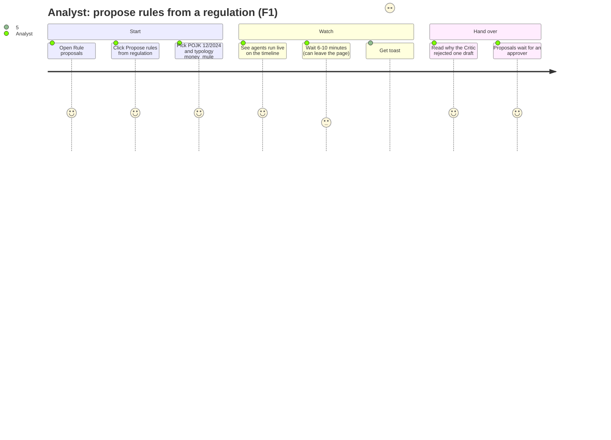
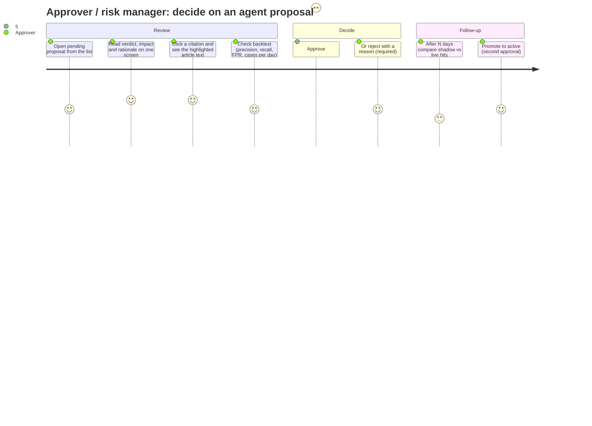
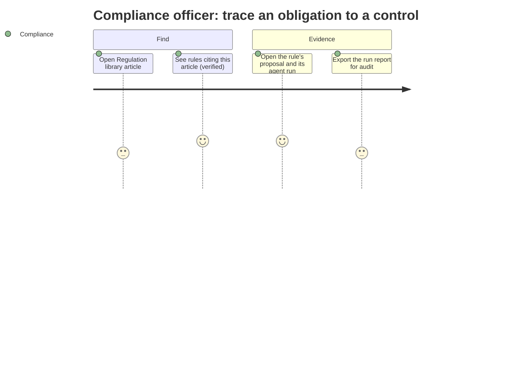
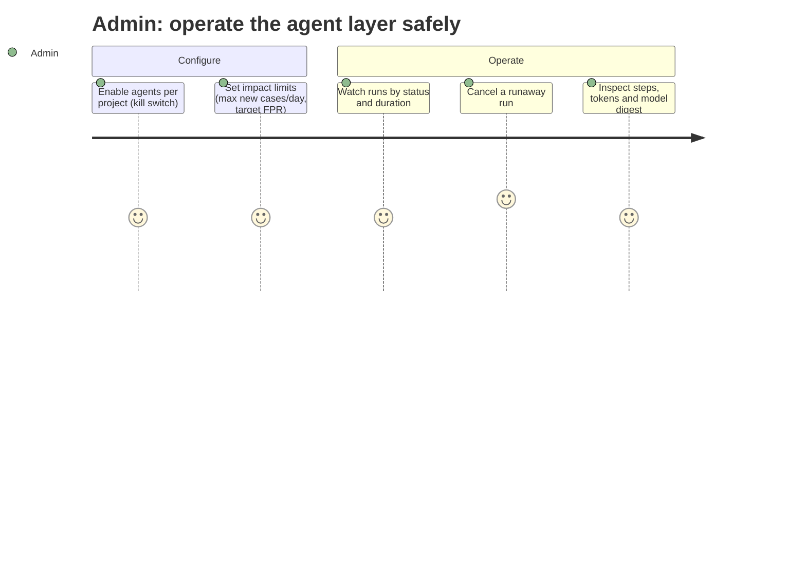
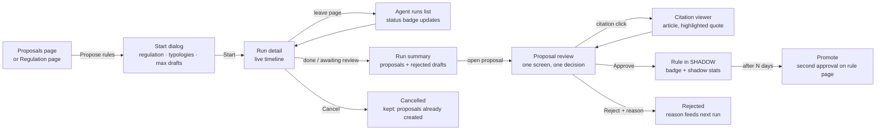

# Multi-agent UX & user flows

Status: **design only**. These are the screens and flows for the multi-agent layer in [`multi-agent.md`](multi-agent.md).
Wireframes are low fidelity. They show content, order and actions, not visual style. The implementation uses the
existing Nuxt 4 + Nuxt UI building blocks (`UDashboardSidebar`, `PagePanel`, `UCard`, `KeyValue`, `StatusBadge`,
`JsonDiff`, `BacktestPanel`, `MarkdownView`, `ConfirmAction`) and the i18n files `web/i18n/locales/{id,en}.json`.
The default locale is `id`.

## 1. Principles

| # | Principle | What it means on screen | Anti-pattern it prevents |
|---|---|---|---|
| P1 | **One screen, one decision** | The approver sees the draft rule, verified citations, simulation and Critic verdict on the Proposal page and decides there (approve/reject with reason) | jumping between report, rule, backtest and regulation tabs before deciding |
| P2 | **Visible progress** | Runs show a live timeline (SSE): which agent is working, which tool it called, elapsed time, budget used | a spinner for 8 minutes |
| P3 | **Every claim has evidence** | Each citation opens the article text with the quoted span highlighted and a *verified / unverified* badge. Each number links to the backtest or query it came from | trusting a fluent paragraph |
| P4 | **Progressive disclosure** | Default view: verdict, impact, top reasons. Expanders hold the per-agent steps, tool I/O, tokens and model digest, for engineers and auditors (approver+) | dumping JSON on business users |
| P5 | **AI never activates** | "AI-generated" chip on every agent output. Proposal status is always visible (Pending → Shadow → Active). The only buttons that change production are human approvals | users believing the agent changed a rule |
| P6 | **Fail loud, fail kind** | Every terminal state (budget exhausted, critic rejected all, cancelled, error) says what happened, what was kept and the next step | silent empty results |
| P7 | **Same words everywhere** | Fixed vocabulary: *run*, *agent*, *draft*, *proposal*, *verified citation*, *shadow*, *promote* (see §7) | "suggestion / recommendation / proposal" used interchangeably |

## 2. Navigation fit (existing menu)

The project sidebar is built in `web/app/layouts/default.vue` (`projectNav`). The new items slot into **existing
sections**, so no new section is needed:

| Section (en / id) | Existing items | New item | Route | Visible to |
|---|---|---|---|---|
| LLM assistant / *Asisten LLM* | LLM chat, Analyses & reports, Project regulations | **Agent runs / *Agent run*** (`i-lucide-workflow`), placed **first** in the section | `/p/{pid}/llm/agent-runs`, `/p/{pid}/llm/agent-runs/{id}` | viewer+ (start: analyst+) |
| Rule engine / *Rule engine* | …, Rule proposals | no new item; **Proposal detail** gains the *Multi-agent evidence* block | `/p/{pid}/proposals/{id}` (existing) | viewer+ (approve: approver+) |
| Overview / *Ringkasan* | Dashboard, Events, Cases | no new item; **Case detail** gains the *Case Copilot* side panel | `/p/{pid}/cases/{id}` (existing) | analyst+ |
| Global (tenant) | Regulation library | no change; the citation viewer deep-links to `/tenant/regulations/{id}#pasal-n` | existing | tenant member |

Entry points that start a run (one primary per screen):

* `/p/{pid}/proposals` header → **"Propose rules from regulation"** (F1). This is where approvers already look.
* `/p/{pid}/llm/regulations` → per-regulation action **"Propose rules"** (F1, pre-selects the regulation).
* `/p/{pid}/llm/agent-runs` → **"New run"** (feature picker: F1 now; F2/F5 later).
* `/p/{pid}/cases/{id}` → **"Explain this case"** (F3).
* Dashboard: a small card "Last agent run" with its status (read-only).

## 3. Personas and journeys

| Persona | Role in app | Goal | Pain today | What the agent layer gives |
|---|---|---|---|---|
| **Analyst** (fraud ops) | `analyst` | Close cases fast; keep rules useful | FPR 23–46 % at threshold 50 → queue overload; case context spread over 4 pages | F3 Copilot narrative; F1 to draft rules from new typologies |
| **Approver / risk manager** | `approver` | Approve only safe, justified changes | LLM proposals today show rationale + backtest but no independent check | Critic verdict, verified citations and impact on one screen; reject with reason feeds back |
| **Compliance officer** | `viewer` or `approver` | Prove that each obligation has a control | Mapping article → rule is manual | Verified citations per rule; later F9 gap matrix |
| **Admin / engineer** | `project_admin` | Keep the system safe, fast and auditable | No trace of multi-step LLM work | Run timeline with tools, tokens and model digest; kill switch; metrics |









## 4. User flow: F1 end-to-end



Step by step:

| Step | Screen | User action | System feedback | Time |
|---|---|---|---|---|
| 1 | Proposals list | **Propose rules from regulation** | dialog opens; attached regulations pre-listed (if none: inline link "Attach a regulation first") | — |
| 2 | Start dialog | choose regulation(s), optional typologies, max drafts (1–5, default 3) | estimate "≈ 6–10 min on GPU"; Start disabled when `agents_enabled=false`, with an explanation | — |
| 3 | Run detail | watch | timeline rows appear per agent (SSE), phase stepper, budget bar | 6–10 min |
| 4 | Run detail | may cancel (confirm) | status `cancelled` within 5 s; created proposals stay pending and are listed | — |
| 5 | Run summary | read | "2 proposals awaiting review · 1 draft rejected (unverified citation)"; toast if the user is on another page | — |
| 6 | Proposal review | approver opens proposal | verdict banner, impact tiles, rule diff, citations, critic checks | ~2 min reading |
| 7 | Citation viewer | click citation | slide-over with article text, quote highlighted, version, verified badge | — |
| 8 | Proposal review | Approve / Reject (reason required for reject) | approve → "Rule created in SHADOW"; self-approval blocked with the maker–checker message | — |
| 9 | Rule page | after N days: Promote | existing rule approval flow (second maker–checker) | — |

## 5. Wireframes

### 5.1 Agent runs list (`/p/{pid}/llm/agent-runs`)

```text
┌ Agent runs ────────────────────────────────────────────────────────────── [ + New run ▾ ] ┐
│ AI agents draft proposals. Nothing is activated without human approval.                    │
│                                                                                            │
│ Feature [All ▾]   Status [All ▾]   Started by [Anyone ▾]                 🔄 live            │
│ ────────────────────────────────────────────────────────────────────────────────────────── │
│ STATUS              FEATURE                 GOAL / INPUT                 RESULT       STARTED│
│ ● Running  3/7      Regulation → Rule       POJK-12-2024 · money_mule    —            2m ago │
│   ▓▓▓▓▓░░░ design   (Designer drafting…)                                                  │
│ ◐ Awaiting review   Regulation → Rule       POJK-12-2024 · all           2 proposals  1h ago │
│ ✓ Done              Case Copilot            Case 7f3a…                   narrative    3h ago │
│ ⚠ Budget exhausted  Regulation → Rule       POJK-12-2024 · carding       1 proposal   1d ago │
│ ✕ Failed            Regulation → Rule       —  (no regulation attached)  —            2d ago │
│ ⊘ Cancelled         Regulation → Rule       POJK-12-2024 · promo_abuse   0            2d ago │
│ ────────────────────────────────────────────────────────────────────────────────────────── │
│                                                       ‹ 1 2 3 ›   (TablePager)              │
└────────────────────────────────────────────────────────────────────────────────────────────┘
Empty state: "No agent runs yet. Start with 'Propose rules from regulation' — the agents
read your attached regulations and data, and you review every proposal."  [ Start ]
```

* Polling: like `llm/reports/index.vue` (refresh every 3 s while any row is `queued` or `running`). Only the detail
  page uses SSE.
* The status column uses `StatusBadge` with new values. Colours: running = primary, awaiting review = warning,
  done = success, budget exhausted = warning, failed = error, cancelled = neutral.

### 5.2 Run detail: live timeline (`/p/{pid}/llm/agent-runs/{id}`)

```text
┌ Regulation → Rule · run 9c1e…                       ● Running · 04:12   [ Cancel run ]     ┐
│ Goal: rules for money_mule from POJK-12-2024 v1 · max 3 drafts · started by ana@demo      │
│                                                                                            │
│ ① prepare ✓ ─ ② retrieve ✓ ─ ③ gather ✓ ─ ④ design ● ─ ⑤ simulate ─ ⑥ critique ─ ⑦ propose │
│ Budget  LLM calls ▓▓▓▓░░░░░░ 9/40   tokens ▓▓▓░░░░░░░ 71k/250k   time ▓▓▓▓░░░░ 4:12/15:00  │
│ ⚠ Partial data: graph-service unavailable (Pattern agent skipped communities)            │
│ ──────────────────────────────────────────────────────────────────────────────────────── │
│ TIMELINE                                                         [ Show technical detail ]│
│ 00:00  Orchestrator   Run started · 1 regulation attached · 18 active rules loaded       │
│ 00:03  Regulation     🔎 search_regulations "pemantauan transaksi tidak wajar"  ✓ 6 hits  │
│ 00:05  Analytics      ✓ Typologies: money_mule recall@80 0.35 · 3 noisy rules  [view]      │
│ 00:06  Pattern        ⚠ Communities unavailable · 2 clusters fraud rate > 20 % [view]      │
│ 00:41  Regulation     ✓ Found 4 obligations · Pasal 5, Pasal 13, Pasal 15 …   [view]      │
│ 01:10  Designer       ● Drafting 3 rules…  (LLM, 38 s so far)                              │
│                                                                                            │
│ ▸ Technical detail (approver+): prompt slice size, tool args/results, tokens, model digest │
└────────────────────────────────────────────────────────────────────────────────────────────┘
```

When finished, the same page shows the **summary** above the timeline:

```text
┌ Result ─────────────────────────────────────────────────────────────────────────────────┐
│ ◐ Awaiting human review · 2 proposals created · 1 draft rejected · 7:48 · 23 LLM calls  │
│                                                                                          │
│ DRAFT                       CRITIC          IMPACT (30d backtest)          PROPOSAL      │
│ RL-MULE-FANIN-24H           ✓ accepted      prec 0.31 · rec 0.62 · 4/day   Pending ›    │
│ RL-MULE-PASSTHRU-2H         ✓ accepted (r1) prec 0.22 · rec 0.48 · 7/day   Pending ›    │
│ RL-MULE-NEWACCT-STRUCT      ✕ rejected      citation "Pasal 12(3)" not found in          │
│                                             POJK-12-2024 v1 (unverified)  —              │
│ AI-generated · reviewed by Critic · nothing is active until approved                     │
└──────────────────────────────────────────────────────────────────────────────────────────┘
```

* SSE: a GET stream via an extended `useApi().stream`. On disconnect it reconnects with `after_seq`, and a small
  "reconnecting…" chip is shown. The live region is announced politely (see §8).
* Rows are grouped by phase. Parallel agents (phase ③) appear interleaved with their own colour and icon.

### 5.3 Proposal review with multi-agent evidence (`/p/{pid}/proposals/{id}`, extended)

The existing page already has cards for Rationale, Proposed rule (`JsonDiff`), Backtest evidence, Validation,
Citations and Evidence. For proposals with `evidence.agent_run_id`, the page is **re-ordered** so the decision
information comes first:

```text
┌ New rule · RL-MULE-FANIN-24H                ◐ Pending      [ Reject… ]  [ Approve → shadow ]┐
│ AI-generated by agent run 9c1e… (Regulation → Rule) · proposed by ana@demo · 1h ago        │
│ ┌ Critic verdict ──────────────────────────────────────────────────────────────────────┐   │
│ │ ✓ ACCEPTED after 1 revision                                                            │   │
│ │ ✓ C1 Citations verified (2/2)   ✓ C2 No duplicate (closest: RL-POST-VELOCITY, 61 %)   │   │
│ │ ✓ C3 Impact within limits (4.1 new cases/day ≤ 50; FPR 0.8 % ≤ 5 %)  ✓ C4 Backtest    │   │
│ │ Note: "Window 24h matches the fan-in pattern in clusters 3 and 7; threshold 10 senders │   │
│ │ is a placeholder [P] from the rule catalogue R36 — consider tuning in shadow."        │   │
│ └────────────────────────────────────────────────────────────────────────────────────────┘   │
│ ┌ Impact (backtest 30 days) ┐┌──────────────┐┌──────────────┐┌──────────────┐┌────────────┐ │
│ │ Matched 124               ││ Precision    ││ Recall       ││ FPR          ││ Cases/day  │ │
│ │                           ││ 0.31         ││ 0.62 (↑0.27) ││ 0.8 %        ││ +4.1       │ │
│ └───────────────────────────┘└──────────────┘└──────────────┘└──────────────┘└────────────┘ │
│ ┌ Why (rationale) ─────────────────────────┐ ┌ Regulation basis ──────────────────────────┐ │
│ │ Money-mule recall@80 is 0.35; fan-in to  │ │ ✓ POJK-12-2024 v1 · Pasal 5 (pilar deteksi)│ │
│ │ one recipient within 24h is the dominant │ │   "…menerapkan strategi anti fraud…"  [open]│ │
│ │ pattern in clusters 3, 7 …               │ │ ✓ POJK-12-2024 v1 · Pasal 13            [open]│ │
│ └───────────────────────────────────────────┘ └────────────────────────────────────────────┘ │
│ ┌ Proposed rule (diff) ───────────────────────────────────────────── JsonDiff ────────────┐  │
│ │ + when: velocity distinct_count(customer) by recipient_fingerprint 24h >= 10          │  │
│ └────────────────────────────────────────────────────────────────────────────────────────┘  │
│ ▸ How the agents got here (timeline excerpt, 7 steps)      ▸ Validation   ▸ Data evidence     │
└──────────────────────────────────────────────────────────────────────────────────────────────┘

Reject dialog:  Reason (required, ≥ 10 chars) [______________________________]
                Quick reasons: [threshold too low] [wrong typology] [citation not relevant] [duplicate]
                ⓘ Your reason is shown to the agents on the next run.          [Cancel] [Reject]
Approve dialog: "The rule will be created in SHADOW mode: it is evaluated and logged but does not
                affect decisions. Promotion to active needs a separate approval."   [Cancel] [Approve]
```

* Approve/Reject remain the existing `ApprovalActions` / `ConfirmAction` flow. A reject *reason is required* for agent
  proposals because it feeds `get_rejection_feedback`.
* If the user is the author, the buttons are disabled with the tooltip "Maker–checker: you created this proposal".
  This matches rule-service's 409.
* The verdict banner states are accepted, accepted after N revisions, and **accepted with warnings** (for example an
  LLM note only). The rejected state never appears here, because rejected drafts never become proposals. They are
  shown only in the run summary.

### 5.4 Case Copilot panel (`/p/{pid}/cases/{id}`, side panel)

```text
┌ Case 7f3a…  P2 · Open · assigned to me           [Start review] [Resolve…]  [✦ Explain this case]┐
│ ┌ Triggering event / DecisionBreakdown … (existing) ┐  ┌ Case Copilot ─────────── AI-generated ┐│
│ │                                                    │  │ ● Investigating… 00:22                ││
│ │                                                    │  │  ✓ decision & reason codes            ││
│ │                                                    │  │  ✓ customer history (90 days)         ││
│ │                                                    │  │  ● graph neighbours…                  ││
│ │                                                    │  │ ─────────────────────────────────────  ││
│ │                                                    │  │ Summary                                ││
│ │                                                    │  │ Fan-in: 14 senders → this recipient in ││
│ │                                                    │  │ 6 h, 92 % paid out within 40 min.      ││
│ │                                                    │  │ Signals (engine · points)              ││
│ │                                                    │  │  rules 38 · RL-POST-FANIN   [trace]    ││
│ │                                                    │  │  supervised 27 · top: amount_z  [view] ││
│ │                                                    │  │  graph 12 · 2 hops to fraud    [graph] ││
│ │                                                    │  │ Related: 3 customers share device d…9a ││
│ │                                                    │  │ Basis: ✓ POJK-12-2024 Pasal 5  [open]  ││
│ │                                                    │  │ Suggested next step: request source of ││
│ │                                                    │  │ funds; consider fraud label mule.      ││
│ │                                                    │  │ Confidence: medium · Unknown: KYC age  ││
│ │                                                    │  │ [Save as case note] [Copy] [👍] [👎]   ││
│ └────────────────────────────────────────────────────┘  └─────────────────────────────────────────┘│
└────────────────────────────────────────────────────────────────────────────────────────────────────┘
```

* The panel is a `USlideover` on narrow screens and a right column on ≥ `lg`.
* Every signal row links to existing evidence (`RuleTraceTable`, model page, `/graph`).
* "Save as case note" writes via `PATCH /cases/{id}` with an `AI-generated` prefix. The resolve dialog **does not**
  pre-fill the label. The analyst decides.
* 👍/👎 plus an optional comment are stored on the run (`params.feedback`), which feeds the product metric "% narratives
  edited/accepted".

### 5.5 Regulation citation viewer (slide-over, reused everywhere)

```text
┌ POJK-12-2024 · v1 · Pasal 5                            ✓ Verified citation        [ × ] ┐
│ Strategi Anti Fraud · BAB II PENERAPAN STRATEGI ANTI FRAUD > Pasal 5                  │
│ Effective 2024-10-31 · OJK · uploaded 2026-10-07                                      │
│ ──────────────────────────────────────────────────────────────────────────────────── │
│ (1) LJK wajib menerapkan strategi anti fraud …                                         │
│ (2) Strategi anti fraud … paling sedikit memuat pilar:                                 │
│     a. pencegahan;                                                                    │
│     b. ███████ deteksi; ███████████████████████   ← quoted span (highlight)           │
│     c. investigasi, pelaporan, dan sanksi; dan                                        │
│     d. pemantauan, evaluasi, dan tindak lanjut.                                        │
│ ──────────────────────────────────────────────────────────────────────────────────── │
│ Cited by: RL-MULE-FANIN-24H (pending) · RL-POST-VELOCITY (active)                      │
│ [ Open in regulation library ]   [ Copy reference ]                                    │
└───────────────────────────────────────────────────────────────────────────────────────┘
Unverified variant: header badge "⚠ Not verified — article or quote not found in this
version"; body shows the closest matching article (if any) and the quote the agent used.
```

The example text above is illustrative. The real content comes from the indexed chunk (`section`, `text`) via
`get_regulation_article`.

## 6. States

| State | Where | What the user sees | Primary action | Notes |
|---|---|---|---|---|
| Queued | list, detail | "Waiting for GPU · position 2" | Cancel | one run at a time per deployment (GPU semaphore) |
| Loading / slow LLM | detail | live row "Designer drafting… 1:40". After 2× the expected time: "The model is slower than usual (≈ x tok/s). You can leave this page — we'll keep going." | Leave / Cancel | tokens/s computed from step latency |
| Partial data | detail, proposal | warning banner listing `gaps` ("graph-service unavailable") | — | the run continues |
| Citation unverified | run summary, proposal, viewer | ⚠ badge, closest article shown; draft revised or rejected | Open article | never silently dropped |
| Critic rejected all | run summary | "No proposal created. 3 drafts rejected: 2 duplicates of active rules, 1 unverified citation." with links | Start new run with different typologies | status `done` |
| Budget exhausted | list, detail | "Stopped at the time limit (15 min). 1 accepted draft was still proposed; 2 were not finished." | Re-run with fewer drafts | status `budget_exhausted` |
| Cancelled | list, detail | "Cancelled by ana@demo at 03:10. Proposals created before cancellation stay pending." | — | |
| Error / failed | list, detail | plain reason + ref id (`x-request-id`), "Retry" | Retry / Replay (approver+) | reasons: LLM unreachable, no regulation, interrupted by restart |
| Agents disabled | start dialogs | Start disabled; "Agents are turned off for this project (Settings → AI agents)" | link to settings (admin) | kill switch |
| No regulation attached | F1 start dialog | inline empty state with "Attach regulation" link | Attach | prevents a failing run |
| Empty list | runs list | explainer + Start | Start | |
| Self-review | proposal | approve/reject disabled + maker–checker tooltip | — | mirrors the 409 from rule-service |

## 7. Copy guidelines

* **Language.** Every string goes through i18n (`agents.*` keys in `id.json` and `en.json`). Default `id`. Technical
  terms stay in English in both locales, as in the current UI (*rule, ruleset, shadow, backtest, precision, recall,
  FPR*).
* **AI label.** The chip text is `AI-generated` (en) / `Dibuat AI` (id). It is shown on run output, Copilot
  narratives, rationale and Critic notes. Saved notes keep the prefix `[AI-generated · run <id>]`.
* **Hedged and factual.** Agents state numbers with their source ("precision 0.31 on 30-day backtest"). Avoid
  "guaranteed", "will stop fraud" and "compliant with". Use "cites" and "basis", not "complies with".
* **Status wording is fixed:**

| Concept | en | id |
|---|---|---|
| run | Agent run | Agent run |
| draft | Draft | Draf |
| proposal (pending) | Pending review | Menunggu review |
| verified citation | Verified citation | Sitasi terverifikasi |
| unverified citation | Not verified | Belum terverifikasi |
| shadow | Shadow (not affecting decisions) | Shadow (tidak memengaruhi keputusan) |
| promote | Promote to active | Aktifkan (promote) |
| budget exhausted | Stopped at limit | Berhenti karena batas |
| critic accepted / rejected | Accepted by Critic / Rejected by Critic | Diterima Critic / Ditolak Critic |

* **Agent names** appear as role names (Regulation, Analytics, Pattern, Designer, Simulator, Critic, Proposer,
  Investigator) with a one-line tooltip each. They are not personified ("the Critic thinks…" is avoided; use "Critic
  check failed: …").
* **Error messages** follow the pattern: what happened, what is kept, what to do next.

## 8. Accessibility

* The timeline is an `ol` with `aria-live="polite"` for new rows (throttled to one announcement per 5 s). Status
  changes use `role="status"`.
* Status is never conveyed by colour alone: there is always an icon plus text (●, ◐, ✓, ⚠, ✕, ⊘).
* The quote highlight in the citation viewer uses `<mark>` (screen readers announce it). Contrast ≥ 4.5:1 in light and
  dark themes.
* Keyboard: every expander, slide-over and dialog is reachable. Esc closes slide-overs and focus returns to the
  trigger. Approve/Reject are not auto-focused.
* Durations use `aria-label="4 minutes 12 seconds"` alongside `04:12`.
* Reduced motion: no animated progress stripes when `prefers-reduced-motion`.
* Long technical content (JSON tool results) is collapsed by default and rendered in `JsonTree` with copy buttons.

## 9. Implementation notes for the web app

| Item | Approach |
|---|---|
| Pages | `pages/p/[pid]/llm/agent-runs/index.vue`, `[id].vue` |
| Components | `components/agents/{AgentTimeline,TimelineRow,PhaseStepper,BudgetBar,RunSummary,CriticVerdict,ImpactTiles,CitationViewer,CaseCopilot,StartRunDialog}.vue` |
| SSE | extend `useApi().stream(path, body, onEvent, signal)` with `method: 'GET'` (it is POST-only today); reconnect with `after_seq` |
| Nav | one entry in `projectNav` (LLM section) + i18n `nav.agentRuns` (`Agent runs` / `Agent run`) |
| Proposal page | when `p.evidence.agent_run_id` exists: show CriticVerdict + ImpactTiles first; existing cards follow |
| Case page | `CaseCopilot` in the right column; uses `POST /llm/agent-runs {feature:"investigate", params:{case_id}}` |
| Role gating | `session.can(pid, 'analyst')` to start; `'approver'` for technical detail and replay |
| Tests | vitest component tests (timeline from recorded SSE fixture); Playwright happy path F1 with mocked llm-service |
